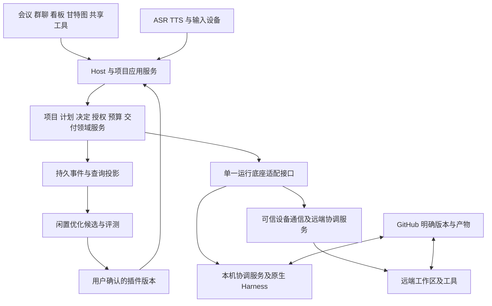

# AhaStudio AME 架构草案

版本：0.1。日期：2026-10-22。配套[产品规格](./10-ame-product-spec-v0.1-2026-10-22.md)。以下分层、实体和接口是供技术评审的实现建议；已确认产品边界以[决策记录](./09-ame-product-decisions-and-open-questions-2026-10-21.md)为准。

## 基线与复用

2026-10-22 只读复核 `/Users/heartline/Documents/Claude/AhaStation`：HEAD 仍为 `bb765223e34cd2ca7c08052cd24b34e9f7bd84ac`，package 0.18.4；`package-lock.json` 有用户修改且另有未跟踪资产。当前 Orca 工作区为空项目基线，不从这里重写产品或直接合并其他检出。

| 现有资产 | 可复用方向 | 新规格差距 |
| --- | --- | --- |
| `electron/meeting-repository.ts` | 事件日志、快照、恢复基础 | 持久项目不能仅以会议为身份，需兼容旧日志而非整库重写 |
| `electron/task-authority.ts`、`permission-broker.ts` | 工具授权、路径检查、批准通道 | 全访问、阶段确认与外部屏幕独立授权须重做映射；已有 always-ask 不能直接代表新策略 |
| `electron/task-budget.ts` | 用量及失败归因基础 | 默认 `UNLIMITED_TASK_BUDGET` 且主要按任务尝试累计，缺项目周期额度、多服务池、并发预留与闲置优化预算 |
| `electron/delivery-harness.ts` | 成果候选、验证、返工、集成状态 | 对齐五大阶段、独立复核强制、按约定终点完成与用户接受 |
| `electron/backends/registry.ts`、`worker-scheduler.ts` | Harness 探测与调度 | 能力门、跨端事件、额度阈值路由和稳定版本仍需验证 |
| `electron/observe/observe-service.ts` | 已有会话只读上下文 | 辅助 Host 调查，不把扫描到的会话直接当受控可写任务 |

历史[2026-10-19 证据](./evidence/2026-10-19-baseline-audit.json)使用隔离 archive 并复用本机依赖，类型检查及构建通过，默认测试 888 项中 871 通过、16 失败、1 跳过；补本地 fixture 后仅重跑 Kimi 定向 14 项通过。

最新[2026-10-22 证据](./evidence/2026-10-22-baseline-audit.json)：在 Darwin arm64、Node v26.12.1／npm 11.20.0 上再次使用 tracked HEAD archive 和现有 node_modules，类型检查、构建通过；默认测试仍 871 通过、16 失败、1 跳过，16 个失败位置与历史一致。本轮未复制缺失 fixture、未做 npm ci 或修复。已取得缓存 Node v22.23.4，但未用它重跑，CI 的 Node 22 验证仍待进行；未调用付费真实 Worker、Windows/N5095 或双机语音测试。C0 尚未通过。

语音现状核查：ASR 为讯飞 IAT，TTS 使用系统 speechSynthesis，音色注册按 locale 和单一选择缓存，未证明角色级多音色。用户确认樱桃 SDK 不支持 N5095；替代实现须先做目标硬件 PoC。全局 CLI 实际版本与固定兼容版本也有差异，见新证据及交接文档，不据安装成功推定可控执行已验收。

## 分层与权威状态

会议、群聊、看板和甘特图读取同一领域事实；它们可以有本地投影，不各自成为可独立决定任务状态的数据库。项目状态可从持久事件恢复，运行状态以执行设备回执对账，模型完成声明只是一种报告。

Host 负责对话与统筹，不直接成为所有权限的裁决者。授权、余额预留、停止、版本有效性在模型之外强制执行。插件承载实现，关键约束可由受审查版本升级，普通 RSI 候选不能同时降低规则并证明自己达标。

## 领域对象与状态建议

| 对象 | 关键关系和版本 |
| --- | --- |
| Project | 稳定 ID、仓库身份、允许目录、用途、工作方式、经理、预算政策；路径只是设备本地映射 |
| WorkItem | 来源 Issue/Story/WBS、父子关系、职能责任、五大阶段与细分状态、交付终点和验收版本 |
| StagePlan | 目标、范围、非目标、方案、验收、依赖、设备、额度约束、待解决项及不可变版本 |
| Meeting / Utterance | 项目、发言者、录音开始锁定的对象与引用、原始文字、时间及来源；会议可结束而任务继续 |
| Decision / Grant | 提案 hash、项目与作用域、批准身份、权限模式、有效状态；阶段确认、动作授权、接受分别记录 |
| AgentRole / RoleAssignment | 稳定职能、名字、音色，项目负责关系与临时子 Agent；角色不绑定固定模型或常驻进程 |
| Run / Attempt | 所属工作项、设备、工作区、源 revision、Harness 会话、授权版本、插件版本、轮次、状态和用量 |
| Evidence / Acceptance | 对应 candidate revision、检查输入、日志 hash、检查结果、复核会话、用户接受及实际集成事件 |
| ServicePool / ProjectAllocation | 账号与服务实例、周期、单位、实际/估算余额、已分配、在途预留、结算及未决消耗 |
| PluginVersion / OptimizationCampaign | 依赖、权限、接口版本、候选来源、基准/留出评测、成本、检查点、启用与分享状态 |

任务阶段使用用户已定五列。阻塞等状态描述当前阶段内的情况；“已提交”“已合并”“已发布”保留各自证据，不能从 GitHub closed 或一个百分比反推完成。父任务汇总必需子任务及整体验证，保持来源工作项唯一，不按职能视图复制。

事件建议含 ID、schemaVersion、projectId、aggregateId、revision、actor/device、causationId、任务或 Run 身份、源序号和时间。需验证重复／乱序／缺页／崩溃恢复的幂等效果。主机时间不能单独裁决主持权或批准新旧。

## 插件接口与工具权限

建议先做六类深接口，优先稳定输入输出、少量可验证契约，不先把每个函数变成独立包。

| 接口 | 输入与输出 | 必须保持的行为 |
| --- | --- | --- |
| Conversation | 语音/文本、锁定上下文 → 回复、专家邀请、决定或工作项提案 | 原话可追溯，单人播报，明确确认才形成授权 |
| Knowledge | 项目及权限过滤后的查询 → 带来源版本的材料 | 先访问控制再检索排序，区分偏好、经验、项目事实 |
| Planning | 确认的需求和约束 → Story/WBS、职能子任务、阶段或 Sprint 提案 | 不以自动拆解越过阶段确认，保持同一工作项身份 |
| Execution | 确认计划、执行能力及预算预留 → Run、工具事件、停止回执 | 默认及完全访问正确映射，原生能力不足明确拒绝 |
| Delivery | 固定成果及验收版本 → 独立证据、发现与接受/集成记录 | 未知不当通过，实现与复核独立会话 |
| Optimization | 合法使用的轨迹、策略版本及闲置预算 → 候选、评测、检查点 | 默认关闭，正常工作优先，候选不自动发布或分享 |

插件清单建议声明来源、内容 hash、版本、适用平台、依赖、能力请求、配置和卸载清理。Skill 是模型指令资源，插件可包含可执行实现，两者不能只用相同提示词做权限约束。第三方原生代码的隔离边界需另行评估，批准界面不等于操作系统沙箱。

内置浏览器与日常浏览器是独立会话来源。文档与浏览器人工接手采用对象级控制权：Agent 不再派发对该对象的写操作，在途写入须对账后交接；交还后重新读取版本或页面。CLI 只输出展示，不开放用户输入通道。外部屏幕权限另有设备级能力及任务 Grant，不能被项目 full access 隐含开启。

## 单一运行底座的选择

| 候选 | 验证重点 | 选择状态 |
| --- | --- | --- |
| 现有 AhaStation | 修复基线、保留业务状态与迁移成本、两平台真实调用 | 对照基线 |
| Paseo SDK / daemon | 公开接口、原生权限保真、停止、历史补取、用量 | 第一批 adapter 候选 |
| DeepSeek Harness / Cordis | 插件生命周期、依赖和 SDK、选定 Harness 适配、版本变更成本 | 新增候选，不预设取代现有代码 |

候选使用同一任务、平台、Harness 版本和权限矩阵，比较创建、追问、批准拒绝、取消、断线补历史、恢复、越界请求、用量及证据。先完成固定版本的小切片再选一个，不让三套编排同时承担生产权威。Orca 参考运行模型；Multica 参考组织，嵌入前核对具体许可。

依据见[上游复用研究](../research/ahastudio-upstream-reuse-boundaries-2026-10-21.md)和[RSI 研究](../research/ahastudio-rsi-harness-reuse-2026-10-22.md)。Cordis 动态清理不能撤销外部提交、网页操作或部署；外部动作需各自补偿或回退协议。

## 额度服务与模型路由

建议每服务池持有独立单位，不创建虚假的统一精确货币余额。项目预算是用户允许消耗的边界，服务池余额是供应商实际可用性的观测，两者均须满足。会议与 ASR/TTS 分类不参与项目执行额度，实际后台任务不因入口是会议而豁免。

执行请求先取得项目和服务池预留，再发给 Worker；预留、结算与释放具有幂等身份。模型选择遵循角色复杂度默认及用户优先级，阈值和最低能力共同筛选。无合格服务或可用分配时暂停，追加或周期恢复按用户选择，不偷偷借用别的项目。

建议记录 reported、estimated、reserved、unsettled 等计量质量。调用已发出且反馈丢失时不能立即释放成可再次消费的余额；真正精确的消耗上限需要 provider 支持或保守的请求上限。无法读取的订阅余额不能靠百分比 UI 强行保证。具体可读性、刷新周期和在途成本由各适配器实测，不把订阅服务都当作同一额度协议。

闲置优化先预留正常项目和自身下一轮评测的预计消耗。额度下降、正常任务恢复或触发条件失效时停止新派发、保存版本及评测检查点；已经发出的调用仍结算。优化用量单列且扣对应服务池，不冒充免费资源。

## 通信 存储与接续

客户端本地数据库/日志保存领域事件与查询投影，正式项目知识写入 Git。具体存储引擎待迁移与双端验证后决定，优先复用现有可靠事件能力。迁移需备份、schemaVersion、重复迁移幂等和回退路径；不能将旧“completed”直接转成新“用户已接受”。

每台设备有本地协调服务，完整应用与后台服务可分进程但统一安装。正式计划写入由一个项目主持者负责；执行端独立持有已授权 Run 与恢复状态。通信需请求 ID、回执、历史补取、来源版本、重放防护和取消状态；群聊文本不是机器指令的唯一格式。

官方中转传密文，可信设备管理解密和恢复凭据；复用成熟加密实现，不自创协议。代码、大文件走 GitHub 明确版本，小文本可在通信内。账号登录发现设备不自动授权目录或屏幕。失去全部设备时的恢复体验、保留期限属于确认单，密钥与恢复方案先技术评审。

## 优化版本与评测

任务交付和系统改进分别记录。改进固定原版、候选、数据使用范围、变更假设、评估配置与消耗；新案例检查改进，历史回放检查旧能力，留出案例检查泛化，不能把同一批反馈反复优化后的成绩当独立证明。模型评价可辅助归因，真实验收与工具结果提供外部信号。

指标建议用目标纠正、错误打断、被接受交付返工、同质量额度消耗和关键约束违例，而非代码行数或 Agent 数量。用户确认启用后仅新任务用新版本；在途任务版本固定，到阶段边界检查兼容、状态、验收与授权后切换。保存候选不代表启用，插件回滚不修改历史证据。

## 测试接缝与退出条件

以项目应用服务的命令→事件→投影为主要行为测试入口，运行底座、语音、通信和工具为可替换适配器。确定性测试验证授权、预算、状态和恢复；真实 Harness 与双机测试验证适配器不能模拟证明的进程、系统权限和网络副作用。

首次验证失败也要交付能力矩阵与原始证据，不能填一个“支持”布尔值。发布检查覆盖文档规格中的正常、拒绝、离线、重启、未知和回退场景；格式与平台未通过的能力不得进入安装包的已支持列表。
