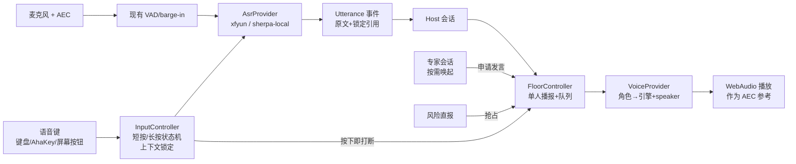

# 会议模式技术方案（B11 / B12 / B13）

日期：2026-10-22。状态：**设计草案，未改代码**。基线 main `c134de2`。
依据：规格 10「团队组织与会议」「语音与共享工具」、决策 D11–D18、D36–D42、B05 候选（`../b05-voice/README.md`）。

## 1. 要满足的规则（摘自规格，不扩展）

1. 默认用户 + 助理双人会议；Host 可以邀请项目内专家，用户可以阻止或点名。
2. 每位专家有独立音色；**同一时刻只有一个 Agent 播报**；专家先向 Host 示意，再按顺序发言。
3. 短按开始、再短按发送并闭麦；长按录音、松手发送并闭麦。结束本轮输入不结束会议。
4. 用户按语音键**立即打断播报并录音**；打断播报 ≠ 停止执行。
5. 共享对象和选区在**录音开始时锁定**；切视图不偷换对象。
6. 越权、数据破坏风险、无法满足验收：成员直接上报并暂停受影响任务，不排队等发言。
7. 专家按需调用，不每轮调用全体；「在会」和「已审阅」分开显示。
8. 会议不计执行额度；ASR/TTS 不计项目用量。
9. 结束会议：已授权工作继续，未确认安排留草稿，麦克风关闭。

## 2. 现有代码可以复用的部分

| 模块 | 已有能力 | 差距 |
| --- | --- | --- |
| `src/hooks/useVoiceCapture.ts`（726 行） | VAD 分段、播报中 barge-in 门限（约 200 ms + 平均语音概率 0.45）、播报结束后的回声宽限窗口、ASR 流生命周期容错 | 是「自动 VAD」模型；没有短按/长按两种按键语义；没有录音开始时的上下文锁定 |
| `src/lib/speech-session.ts`（503 行） | 按句流式 TTS、turn 级 supersede、过期回调防护 | 走系统 `speechSynthesis`：**只有一个音色**，并且声音不经过 WebAudio，回声消除很可能拿不到参考信号 |
| `src/lib/voice-registry.ts` | 按 locale 选一个系统音色 | 没有角色 → 音色映射 |
| 声纹锁（`useVoiceLock` / `useRemoteVoiceLock`） | 说话人验证，过滤他人声音 | 可保留，作为可选项 |
| `electron/asr/xfyun-iat.ts` | 讯飞云端流式 ASR | 只有一种 ASR；没有离线路径 |
| `orchestrator.ts` 会议编排 | Host、计划提案、批准、交付事件 | 没有发言权（floor）概念；专家与 Worker 未区分 |

**结论**：不重写采集链路；新增三层——`InputController`（按键语义与上下文锁定）、`FloorController`（发言权与队列）、`VoiceProvider`（引擎与角色音色）——把现有 VAD 和 TTS 队列接到它们下面。

## 3. 总体结构



### 进程划分

| 组件 | 进程 | 理由 |
| --- | --- | --- |
| 采集、VAD、播放 | 渲染进程（现状） | `getUserMedia` 的 AEC 只在 Chromium 内生效 |
| 本地 ASR / TTS 推理（sherpa-onnx） | **Electron `utilityProcess`** | N5095 上推理会占满一个核；放主进程会卡 IPC，放渲染进程会卡 UI。用 `sherpa-onnx-node` 的 N-API 绑定 |
| 云端 ASR / TTS | 主进程（凭据在主进程） | 沿用 xfyun 的做法 |
| Floor / Input 状态 | 渲染进程状态机 + 关键事件写入会议日志 | 状态本身要即时；「谁说了什么、谁打断了谁」要持久 |

## 4. InputController：按键状态机

```
idle ──press──▶ pressing ──(松开 < 350ms)──▶ recording-toggle ──press──▶ sending ──▶ idle
                    │                                  │
                    └──(按住 ≥ 350ms)──▶ recording-hold ──release──▶ sending
recording-* ──(ASR 失败)──▶ failed-pending（保留音频与已识别片段，等待重试/丢弃）
```

- **press 的瞬间**：① `FloorController.interrupt('user')`，停止当前播报；② 抓取 `ContextLock {projectId, sharedObjectRef, selection, viewId, ts}`；③ 开始录音。三件事同步完成，不等待 ASR 连接。
- 350 ms 是初值，由 B11 实测决定（WBS 说「按键阈值由测试定，不让用户猜」）。
- `sending`：生成 `utterance.recorded` 事件（原文、ASR 来源与置信度、ContextLock、录音时长）；**原始音频默认不落盘**（规格「原始录音不默认长期保存」）。
- 项目不明确（ContextLock.projectId 为空或 Host 判断歧义）：Utterance 照常保存，Host 只澄清不派工（验收场景「语音跨项目歧义」）。
- 离线：ASR 走本地；本地也不可用时保存待发送状态（`failed-pending`），恢复后由用户确认再发，**不自动重发**（B11「不重发不误派」）。

硬件键（AhaKey / Station 实体键）只需映射成同一个 `press/release` 事件源；全局快捷键用 Electron `globalShortcut` 无法区分按下和松开，因此 Windows 上要用低级键盘钩子或 HID 直读，**这是 B11 的技术风险点**，需要样机验证。

## 5. FloorController：发言权

### 规则

| 来源 | 优先级 | 行为 |
| --- | --- | --- |
| 用户按键 | 0（最高） | 立即打断当前播报；清空播报队列中尚未开始的句子，保留文字到群聊 |
| 风险直报（越权、数据风险、验收不可满足） | 1 | 不进普通队列；当前句子播完后立即播报（**不打断用户录音**）；同时暂停受影响任务——暂停是执行动作，不依赖播报是否完成 |
| Host | 2 | 默认持有发言权 |
| 专家 | 3 | 先 `floor.requested`，由 Host 在自然停顿处 `floor.granted`；用户可以点名（直接 grant）或阻止（deny） |

- 同一时刻最多一个 `speaking`。队列中的专家发言文本先进群聊（可读），播报排队。
- **打断 ≠ 停止**：`interrupt` 只停播报与当前 LLM 回复的生成，不向任何 Worker 发送 stop。
- 专家发言超时（例如 Host 未在 N 秒内授权）：转为群聊文字，不播报。
- 被打断的发言：事件记录 `interruptedAtChar`，群聊仍显示全文并标记「未播完」。

### 事件（写入会议日志，B03 信封）

`floor.requested`、`floor.granted`、`floor.denied`、`floor.released`、`floor.interrupted`、`expert.invited`、`expert.joined`、`expert.reviewed`（已审阅 ≠ 在会）、`risk.escalated`。

## 6. 专家：按需调用与上下文

- 专家 = `AgentRole`（稳定职能 + 名字 + 头像 + voiceId）+ 每次唤起时的一个短会话。**不常驻进程**（架构 11：角色不绑定固定模型或常驻进程）。
- 入会包：议题、确认的目标、约束、引用（原话 ID / 文档版本 / 任务版本）。专家可以按权限回查原件，不只依赖 Host 摘要。
- 其他项目的私有内容不进入入会包（按 projectId 过滤后再检索）。
- 费用：会议不计执行额度，但专家调用仍消耗服务池（B19 记为「会议类」）。默认只唤起被点名或 Host 判断必要的 1–2 位。

## 7. VoiceProvider：引擎与音色

```ts
interface VoiceProvider {
  id: 'sherpa-vits-aishell3' | 'sherpa-kokoro-zh' | 'xfyun-tts' | 'system' | string;
  voices(): Promise<Array<{ voiceId: string; label: string; gender?: string }>>;
  synthesize(text: string, voiceId: string, opts: { speed?: number }): AsyncIterable<Float32Array>; // 流式 PCM
}
interface RoleVoiceBinding { roleId: string; providerId: string; voiceId: string; deviceScope: 'this-device' | 'all-devices' }
```

- **播放统一走 WebAudio**（`AudioWorklet` 播放 PCM），不再用 `speechSynthesis` 直接出声。这样 Chromium AEC 有参考信号；B05 补测要验证这一点。
- 系统音色只作兜底（每台设备通常只有 1–3 个中文音色，不满足「每专家独立」）。
- **跨设备一致性取决于用户决定**（README 第 6 节第 2 项）：
  - 只要求同设备可区分 → 每台设备按本机可用引擎自动分配，`deviceScope: 'this-device'`。
  - 跨设备同一声音 → 两端都要用同一引擎和 speaker：N5095 若无法实时跑高音质模型，只能用 aishell3（8 kHz）或在线 API。
- 文本前处理：Kokoro 对部分中文标点报 unknown token（B05 冒烟发现），统一在 Provider 内规范化标点。

## 8. 与执行的边界

- 会议中形成的是 Utterance、Decision 草稿、WorkItem 草稿；**记录 ≠ 授权**。只有 `ConfirmStagePlan` 命令（B03 §4.1）才产生授权。
- 结束会议：`meeting.ended` → 麦克风关闭；已授权 Run 不受影响；未确认的计划保持 `design/awaiting-confirm`。
- 恢复会议（确认单第三组）：进入时 Host 只简短提示未决事项，不复述全部历史；保留项目与阅读位置。

## 9. 测试策略

| 层 | 方法 |
| --- | --- |
| InputController / FloorController | 纯状态机，确定性单测：短按、长按、阈值边界、按下时正在播报、风险直报与用户录音冲突、专家超时 |
| ContextLock | 录音开始后切换视图，断言 Utterance 引用的是开始时的对象 |
| VoiceProvider | 假引擎；验证同一角色在一次会议中音色不变、voiceId 不可用时的降级提示 |
| 真机（N5095 / Mac） | 回声：扬声器播放时说话的误识别率（系统 TTS vs WebAudio）；端到端延迟（按下 → 播报停止 < 150 ms 为建议目标）；CPU 占用（ASR + TTS 同时运行时不超过 2 核） |

## 9a. 跨设备补充（R3，2026-10-27）

依据：R2 裁决、`etrnal-dev` 规格第 2.4 节与第 12 节（Q70–Q100）、`remote-control.md` §0。本方案与 `etrnal-dev` 的统一会议设计大部分一致，以下只写对齐点和需要补的地方。

| 主题 | 本方案 | `etrnal-dev` | 对齐结果 |
| --- | --- | --- | --- |
| Host | 一个会议一个 Host，是唯一的派发权威 | 原 Host 唯一统筹，不另起共享 Host（Q72、Q77、Q96） | 一致。Host 运行在主持设备上；主持接续（C06）时，新设备上的 Host 从会议记录和背景摘要恢复，不复制模型会话 |
| 普通消息与 @ | Host 默认回应；用户可以点名或阻止专家 | 普通消息给 Host，@ 给指定对象，不全员自动回复（Q81、Q95） | 一致。@ 候选要能区分设备、Agent 和已有对话（Q81） |
| 专家与 Worker | 专家是按需唤起的短会话；打断不等于停止 | Worker 执行期间仍可与独立专家交流，专家不插入任务对话（Q100） | 一致，对应 §6。专家交流上下文、任务执行上下文和已有对话分别管理（Q97、Q98） |
| 入会背景 | 入会包：议题、目标、约束、原话引用 | 新成员按需读取会议背景摘要，加入时不自动调用模型（Q93） | 一致。入会包在首次被 @ 或被咨询时生成 |
| 中断范围 | 用户按键打断播报，不停止执行 | 底部中断先选范围：Host 回复 / 指定任务 / 本会议全部（Q99） | 合并：按语音键只打断播报和当前 LLM 回复；停止任务走 Q99 的范围选择，全部停止要再次确认 |
| 播报设备 | 只在本机播报 | 未涉及 | **只在用户当前操作的那台设备播报**，另一台设备只显示文字。D4（同一专家跨设备同一音色）照常适用：换设备后声音不变 |
| 界面 | B07：参会人窗格在上、共享区在下 | 接进现有「会议 / 任务」界面 | 按 C13，协作只提供数据投影，布局用 B07 |
| 计划确认 | 只有 `ConfirmStagePlan` 产生授权；允许纯语音确认（D7） | 计划审阅处一次批准整份计划（Q101） | 一致。跨设备时只能在主持设备上确认（C10）；自动批准开关见 C15 |

需要补的实现：
- 发言权和播报队列（FloorController）只在当前操作的设备上运行；当前设备切换时，未播完的内容转成文字，不在两台设备上同时播报。
- 语音点名产生的 Utterance 要带上 `deviceId`，并按 `b03-contract` §8.1 签名后再进会议。

## 10. 切片与估算（相对规模）

| 切片 | 内容 | 规模 | 依赖 |
| --- | --- | --- | --- |
| M1 | `VoiceProvider` 接口 + WebAudio 播放 + 角色音色绑定（先接系统音色与 xfyun TTS） | M | 无（可立即开工） |
| M2 | sherpa-onnx `utilityProcess` 推理服务（ASR + TTS），模型下载与校验 | M | B05 实测结果 |
| M3 | `InputController` 状态机 + ContextLock + 待发送状态 | M | B03 Utterance 事件 |
| M4 | `FloorController` + 专家唤起 + 事件 | L | M1、M3、B12 Host |
| M5 | 实体键：Windows 低级钩子 / HID，macOS 同等实现 | M（不确定性高） | 样机 |
| M6 | 真机回声、延迟、CPU 验证 | M | M1、M2、样机 |
