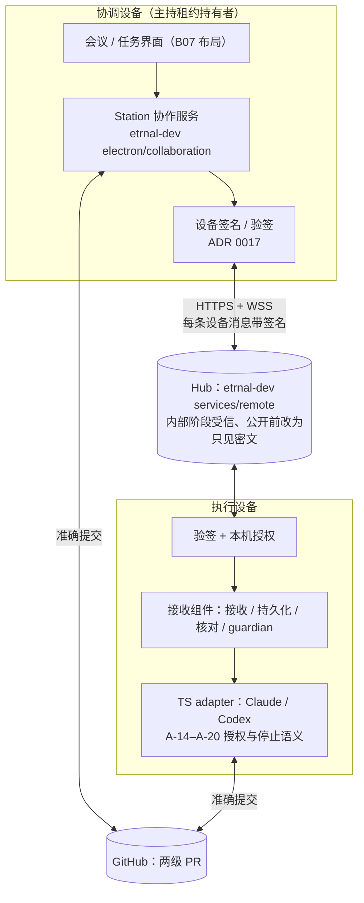
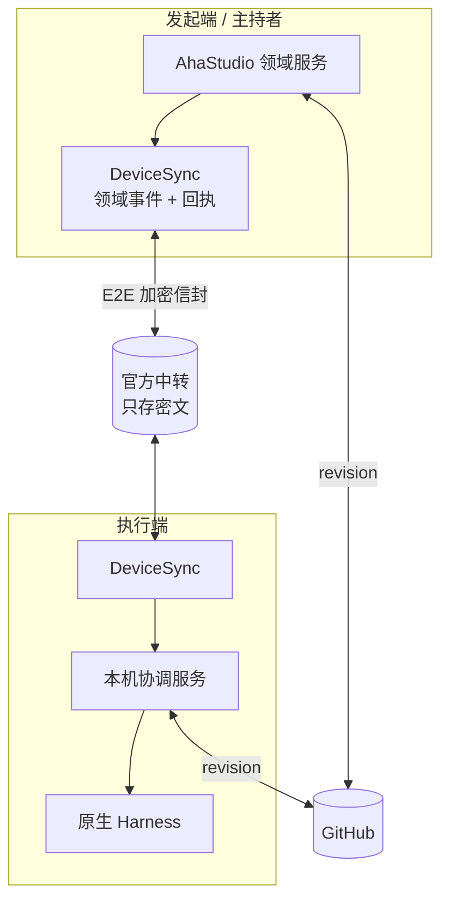

# 远程控制与跨设备方案（B27–B31）

日期：2026-10-22。状态：**设计草案，未改代码**。依据：规格 10「多设备与离线」「开放与服务」、架构 11「通信 存储与接续」、上游复核 `../research/upstream-2026-10-22.md`。

## 0. R3 修订（2026-10-27）：改以 `etrnal-dev` 为实现基础

> **2026-10-28 更正**：执行端改走原生 CLI，由终端线负责，Station 只做编排；远端会话可以经 Hub 实时只读查看。下面 0.3「执行端（C03、ADR 0018）」和 0.4 的 X1 以 [ADR 0019](../../adr/0019-native-cli-workers-with-host-hooks.md) 与 [变更说明](native-cli-worker.md) 为准。

依据：
- R1 评审 `../review-etrnal-dev/README.md`；
- R2 冲突表与全部裁决 `../review-etrnal-dev/CONFLICTS.md`；
- ADR 0017（内部验收阶段受信 Hub + 设备签名）、ADR 0018（执行端复用 TS adapter）；
- 产品规则：`../../ame/` 中的 AME-D06、D10、D23、D41、D47–D50、D56、D57，以及 C07、C15 对 D06、D23 的修改。

**本节优先于下面 §1–§10 的原设计。** 原文保留，作为 10-22 的设计历史；下表逐节说明哪些保留、哪些作废。

### 0.1 新的分层



### 0.2 原设计逐节处理

| 原节 | 内容 | 处理 | 依据 |
| --- | --- | --- | --- |
| §1 R1 | 用户手动指定执行设备 | **改**：Host 在计划里安排设备和 Agent，批准计划即确认；调度器不静默改派 | C07（修改 AME-D06） |
| §1 R2、§5.4 | 唯一主持者 + 主持租约 + 明确接续 | **保留**，落在 `etrnal-dev` 的协调者上：租约以会议为单位 `{meetingId, holderDeviceId, epoch}`，所有改计划或派发的命令都带 epoch | C06、AME-D48 / D49 |
| §1 R5、§5.2 | 回执四级与「只有 applied 才显示已停止」 | **保留语义**，界面文案用 `etrnal-dev` 的「停止请求中 / 停止未确认 / 已停止 / 待核对」 | C17 |
| §1 R7、§4 | 端到端加密，中转只见密文 | **分两步**：内部验收阶段只做签名（L1）；内容加密在首次公开可用前完成 | C01、ADR 0017、AME-D47 |
| §1 R10、§4 | 可信设备链、撤销、恢复凭据 | **保留**：新设备登录后要由已有可信设备一键确认，不用配对码；首次启用跨设备时引导保存恢复凭据 | C08 |
| §1 R11、§8 | 30 天试用 | **保留规则，推迟实现**：放在首次公开可用前，在 Hub 上记录 `firstPairedAt` | C09、AME-D56 / D57 |
| §2 | pocket-vibe 不作首发基础 | 不变。`etrnal-dev` 的 Pocket Vibe 旧 adapter 按它的 Q84 内部过渡 | — |
| §3 L1 | 设备密钥与签名链 | **保留**，是内部验收阶段唯一的密码学要求 | ADR 0017 |
| §3 L2、§7 | 传输：自建 WebSocket 中继（方案 A） | **作废**，改用 `etrnal-dev` Hub 的 HTTPS + WSS。原 X5（XL）不再单独做 | R1 |
| §3 L3、§5.1–§5.3 | `SyncEnvelope`、回执、补取 | **合并**到 `etrnal-dev` 已有的消息确认、游标补拉与快照边界，再补 ADR 0017 的签名字段。`SyncEnvelope` 的 `body: Ciphertext` 推迟到公开前 | R1 §4、ADR 0017 |
| §6 | GitHub 交接：检查点分支、结果分支 | **改**：采用 `etrnal-dev` 的用户指定资料仓库 + 两级 PR（任务分支 → 会议集成分支 → 用户目标分支），合格成果由 Host 自动集成到会议分支，最终合并由用户在 GitHub 完成。分支统一用 `aha/` 前缀 | C19 |
| §6 | 小于 64 KB 的文本放进加密信封 | 内部阶段直接走 Hub 消息（已签名）；公开前随内容加密一起进信封 | C01 |
| §9 | 切片 X1–X8 | **重排**，见 0.4 | — |
| §10 | 待定问题 Q1–Q5 | Q1–Q4 已由 D10–D12、D2 决定；Q5（GitHub 凭据）沿用 `etrnal-dev` 的「按需 GitHub 登录」，凭据仍由各设备自己管理 | — |

### 0.3 新增的行为规则（来自裁决）

- **执行端（C03、ADR 0018）**：跨设备任务通过 TS adapter 执行，授权映射为 `read-only + on-request`，获批命令前后做 hash 比对（G4），停止语义按 A-20。Python 接收组件不再自己启动 Codex，因此 0.144.1 的版本锁随之删除。
- **已有对话接续（C04）**：只接续权限不超过执行设备本机项目授权的对话；超出的提示「需要在本机桌面继续」。
- **平台（C05）**：首轮内部验收由 Mac 协调、N5095 执行；macOS 执行端（guardian 的进程组和进程树核对）在首次公开可用前完成，届时跑双向验收（AME-D10）。
- **计划确认（C10）**：只有主持设备能确认计划；工具审批任何可信设备都能答复，只接受一次有效答复。
- **自动批准（C15）**：保留默认关闭的开关。打开后，计划由系统自动确认，记录标为自动；含跨设备任务时只在会议里提醒、不拦截，用户可以随时停止。
- **取消（C12）**：跨设备任务在「已停止且已确认退出」后可以标为已取消；工作区、文件和提交保留，任务移出五列。
- **Agent 范围（C14）**：跨设备首版同时支持 Claude 与 Codex。
- **并发（C16）**：默认 2，本机任务与跨设备任务共用名额。
- **数据保存（C02）**：会议和任务记录在 Hub 上长期保存；用户删除会议时 Hub 同步删除；服务条款写明保存上限。待投递消息保留 30 天（D12）。
- **项目身份（C11）**：Hub 保存 `prj_` 与仓库身份的对应关系（ADR 0013）；GitHub 只在跨设备文件任务中必填。
- **界面（C13）**：协作只提供数据投影，布局由 B07 负责。

### 0.4 新切片

估算是 Mac 侧的粗估（人日，单人，含测试），要等 eternal904 对他那部分代码给出意见后再修正。「主责」是建议的写者：`etrnal-dev` 代码的修改由原作者负责，TS 侧与 C0 契约由本仓库负责。

| 卡 | 内容 | 主责建议 | 规模 | 人日 | 前置 | 阶段 |
| --- | --- | --- | --- | --- | --- | --- |
| X0 | `etrnal-dev` 修 K01、在运行时修复合入后 rebase、按六块拆 PR | eternal904 | — | 作者估 | P4 合入 | 内部首轮 |
| A-12 | 设备密钥 + 可信设备列表 + 新设备确认（C08）+ 恢复凭据引导 | 本仓库（TS） | M | 4–6 | — | 内部首轮 |
| A-13 | 设备消息签名与验签，Station 与 Hub 两侧都要接（ADR 0017） | 本仓库 + eternal904 | M | 3–5 | A-12、X0 契约块 | 内部首轮 |
| X1 | 执行端改走 TS adapter，接上 guardian（C03） | 本仓库 + eternal904 | L | 6–10 | A-14–A-20 合入、X0 | 内部首轮 |
| X2 | 已有对话接续 + 权限核对（C04） | 本仓库 | M | 3–5 | X1 | 内部首轮 |
| X3 | 主持租约 + fencing + 明确接续（C06） | eternal904 | M | 3–5 | X0 | 内部首轮 |
| X4 | GitHub 交接对齐：两级 PR、`aha/` 前缀（C19） | eternal904 | S | 1–2 | X0 | 内部首轮 |
| X5 | Hub 补齐：设备待确认状态、验签、删除同步与保存上限（C02） | eternal904 | M | 4–6 | A-12、A-13 | 内部首轮 |
| X6 | Hub 存 `prj_` 映射，契约中 GitHub 改为条件必填（C11） | eternal904 + 本仓库 | M | 2–3 | A-02 | 内部首轮 |
| X11 | 跨设备「已取消」状态（C12） | eternal904 | S | 1–2 | X0 | 内部首轮 |
| X12 | 跨设备数据投影，供 B07 的会议和看板使用（C13） | 本仓库 | M | 3–5 | A-01、A-05 | 内部首轮 |
| X13 | 自动批准开关的跨设备提醒（C15）；默认并发 2（C16） | eternal904 | S | 1–2 | X0 | 内部首轮 |
| X8 | 双机故障测试：Mac 协调、N5095 执行，Claude 与 Codex 各一遍（C05、C14） | N5095 + Mac | L | 6–8 | X1–X6 | 内部首轮 |
| X9 | macOS 执行端 guardian + 双向验收（C05） | 待定 | M | 3–5 | X1 | 公开前 |
| X10 | Hub 改为只见密文：内容加密、客户端投影、恢复凭据解封备份（C01、ADR 0014） | 待定 | XL | 15–25 | A-13、X5 | 公开前 |
| X7 | 30 天试用与到期收尾（C09） | eternal904 | S | 1–2 | X5 | 公开前 |

合计：
- **内部首轮**：本表约 37–59 人日（不含 X0）。
- **公开前追加**：约 19–32 人日。

原 X1–X8 合计 31–46 人日，但那是自建中继的估算，不含 Hub 服务端和执行端接收组件；`etrnal-dev` 已经完成了这两块的大部分。新估算多出来的部分，主要是这几次裁决新增的范围：已有对话接续、取消、Claude、界面投影，以及公开前的内容加密。两个数字不能直接比较。

## 1. 要满足的规则（摘自规格）

| # | 规则 |
| --- | --- |
| R1 | 用户**手动指定**执行设备；首发不自动选设备 |
| R2 | 同一项目只有**一个正式计划写入者（主持者）**；其他端只读或明确接续 |
| R3 | 换交互设备不迁移 Run、不重复派工 |
| R4 | 发起端离线：执行端继续已授权阶段并保存结果；需要新增授权时暂停 |
| R5 | 远端停止状态必须区分：**已记录 / 已送达 / 执行端确认 / 状态未知**；未确认不能显示「已停止」 |
| R6 | 断网保留输入；普通消息恢复后补发；改变执行状态的旧指令先核对版本和有效性 |
| R7 | 群聊、私信、小文档正文：只有可信设备能解密，官方中转只见密文 |
| R8 | 代码与大文件经 GitHub 传明确版本；未提交修改先展示范围，确认后经专用检查点分支交接，不夹带无关内容 |
| R9 | 账号登录发现设备 ≠ 授权目录或屏幕 |
| R10 | 可信设备授权新设备、撤销丢失设备；全部丢失时用恢复凭据恢复仍有备份的记录 |
| R11 | 试用：首次两端成功远程连接后固定 30 天，换绑/重装/重连不重置 |

## 2. 现有资产：pocket-vibe

| 项 | 现状 | 能否作为首发基础 |
| --- | --- | --- |
| 拓扑 | 本机 adapter → HTTP → FastAPI hub（仓库外）→ 远程 desktop agent | 可以作为**局域网原型**，不能作为首发：hub 不在本仓库、Python 运行时需要另装 |
| 传输 | HTTP 轮询，无流式 | ❌ 延迟以十秒计 |
| 取消 | 无；interrupt 只停本地轮询 | ❌ 违反 R5 |
| 安全 | 明文 dev token | ❌ 违反 R7 |
| 交付 | ```work-report 围栏帧 | ✅ 契约可沿用 |

结论：pocket-vibe 保留为实验 backend（`FIRST_RELEASE_STABLE_WORKERS` 已排除它），**首发跨设备不在它上面演进**。

## 3. 分层



三层分开选型：

| 层 | 内容 | 方案 |
| --- | --- | --- |
| L1 身份与密钥 | 设备密钥、可信设备列表、撤销、恢复凭据 | **自持**（必须和授权、试用规则绑定） |
| L2 传输 | 发现、配对、NAT 穿透 / 中继、重连 | **二选一**：自建 WebSocket 中继，或 Paseo daemon + relay（B04 对照） |
| L3 领域同步 | 事件信封、回执、补取、主持租约、停止状态 | **自持**（上游都没有这套语义） |

## 4. L1 身份与密钥

- 每台设备生成 **Ed25519 签名密钥 + X25519 加密密钥**，私钥存系统钥匙串（Electron `safeStorage`；Windows 为 DPAPI，macOS 为 Keychain）。
- 账号（官方服务）只用于发现与计费，**不持有解密密钥**。
- **可信设备列表**是一条签名链：每次加入 / 撤销由已有可信设备签名，新设备通过扫码或配对码获得第一条签名。第一台设备自签。
- 会话内容加密：每个项目一把**项目内容密钥**，用每台可信设备的 X25519 公钥分别封装；撤销设备时轮换项目密钥（被撤销设备无法解密新内容，旧内容无法收回——UI 要说清楚）。
- **恢复凭据** = 一个高熵恢复码，派生出可以解封「可信设备列表 + 项目密钥」备份的密钥。备份密文存官方服务。
- 加密实现：**libsodium**（`sodium-native`，ISC 许可）。使用 `crypto_box_seal`、`crypto_secretstream`、`crypto_sign`，**不自创协议**（架构 11 要求）。
- 待技术评审：是否直接采用 MLS（RFC 9420）做群组密钥。首发设备数少（试用 2 台），简单的「项目密钥 + 逐设备封装」足够；设备数上来后再评估。

## 5. L3 领域同步协议

### 5.1 信封

在 B03 的 `DomainEventV2` 外面套一层传输信封：

```ts
interface SyncEnvelope {
  v: 1;
  msgId: string;            // 去重
  from: DeviceId; to: DeviceId | 'project-members';
  projectId: string;
  kind: 'event' | 'command' | 'receipt' | 'fetch' | 'fetch-result';
  cursor?: string;          // 发送方日志游标，用于补取
  keyId: string;            // 项目内容密钥版本；撤销/轮换时单调递增
  algorithm: 'secretstream-xchacha20poly1305-ed25519-v1';
  body: Ciphertext;         // 用项目内容密钥加密的 DomainEventV2 / 命令
  sig: Signature;           // 发送设备签名（覆盖除 sig 外全部字段）
}
```

中转只能看到 `from / to / projectId / kind / keyId / 大小 / 时间`，看不到内容。`projectId` 是随机 ID，不泄露仓库名。签名输入使用规范 CBOR（不是依赖对象键序的 JSON.stringify）；可信设备链记录 `previousHash + sequence`，签名覆盖完整链事件。每个项目保留受信历史密钥以解密旧事件，撤销后只轮换后续 `keyId`，不重新加密旧日志。配对码短时、一次性，两个设备必须核对安全码后才写入可信链。

### 5.2 命令与回执（解决 R5、R6）

远端命令（`StartRun`、`StopRun`、`SteerRun`、`ApproveAction`）都带：

- `commandId`、`issuedAt`、`basedOn: { aggregateId, revision }`（发出时看到的版本）、`expiresAt`。

执行端按顺序回执：

| 回执 | 含义 | UI |
| --- | --- | --- |
| `recorded` | 发起端本地已写入日志 | 「已记录，等待发送」 |
| `relayed` | 中转已接收 | 「已发出」 |
| `delivered` | 执行端已收到并通过签名、版本、过期校验 | 「对方已收到」 |
| `applied` / `rejected(reason)` | 执行端实际执行结果，例如 Harness 已确认中断 | 「已停止」/「未执行：原因」 |
| 超时无 `applied` | — | 「状态未知」，提供重试与查看执行端最近状态 |

- **只有 `applied` 才能显示「已停止」**。`StopRun.applied` 的签发条件是：未答复与新到的批准均已 decline、Harness 中断已确认、观察窗口内无新工具调用与文件变化、子进程树已退出；此前只显示「停止中」，超时显示「状态未知」。撤销 Grant 是独立事件，只禁止后续动作，不能冒充 Run 已停止。
- 执行端校验 `basedOn.revision`：版本已过期（例如 Run 已结束、计划已改版），返回 `rejected('stale')`，**旧批准不会重复生效**（验收场景「断网停止与双端决定」）。
- 普通消息（群聊文本）没有 `basedOn`，恢复后直接补发。

### 5.3 补取

每台设备对每个项目维护「已从各设备接收到的游标」。重连后发 `fetch {sinceCursor}`，对方返回分页结果；接收端按 `msgId` 去重、按 `aggregateRevision` 检测缺口（B03 §3）。

### 5.4 主持租约（解决 R2、R4）

- 每个项目有一个 `HostLease {projectId, holderDeviceId, epoch, expiresAt}`，由持有者定期续约（事件广播）。
- 所有改变项目聚合的命令都必须带当前 `epoch`，不只阶段计划；执行端和其他设备持久化已见最大 epoch 并拒绝旧 epoch（fencing token）。网络分区后旧主持恢复连接也不能凭较新的本地时间写回。
- **接续**：用户在另一台可信设备上明确点「由这台继续主持」→ 新设备发布 `epoch+1`。原持有者上线后看到更高 epoch，自动降为只读。
- **不自动接管**：租约过期只显示「主持端离线」，不自动转移（规格「首发不自动接管全局助理」）。
- 执行端已授权的 Run 不依赖租约存活（R4）；需要新增授权时进入 `awaiting-decision`。按已决定的 D10：动作级 Grant 可以在任一可信设备上给出；阶段计划确认只能在主持设备上给出。

## 6. GitHub 交接（R8）

| 场景 | 做法 |
| --- | --- |
| 已提交代码 | 命令里携带 `{repo, commitSha}`，执行端 `git fetch` 指定 SHA，不用分支名 |
| 未提交修改 | 发起端列出改动文件 → 用户勾选确认 → 在临时 worktree 中只提交所选文件到 `aha/checkpoint/<runId>` 分支并推送 → 命令携带该 SHA。**原目录与当前分支不变** |
| 小文本（< 64 KB） | 直接放进加密信封 |
| 执行端回传 | 推送到 `aha/result/<runId>` 分支，回执里带 SHA 与证据 hash；合并仍按授权单独进行 |

需要的 GitHub 权限：对目标仓库的 contents 写权限（推检查点分支）。用 GitHub App 或用户自己的 `gh` 凭据，待 B14 统一。

## 7. L2 传输：两个候选

| | A 自建 | B Paseo daemon + relay |
| --- | --- | --- |
| 组成 | 官方 WebSocket 中继（无状态转发 + 离线信箱）+ 客户端直连尝试 | 每台设备运行 Paseo daemon；AhaStudio 用 `@getpaseo/client` 的 `hosts.client(serverId)` 访问远端 |
| 远端执行 | 我们的本机协调服务驱动 Harness | Paseo daemon 驱动 Harness |
| E2E | 我们的 libsodium 信封 | Paseo relay 的加密 + 我们的信封再加一层（领域内容仍只有我们的密钥能解） |
| 停止确认 | 我们实现 | **SDK 未文档化中断**，需实测 |
| 授权保真 | 现有 `permission-broker` | 依赖 provider 原生选项，文档警告非宿主隔离 |
| 规模 | XL（B28 原估） | L（接入 + 验证），但依赖 beta 功能 |
| 风险 | 工作量；NAT 场景 | 上游节奏快；权限保真；我们的授权模型要绕过它的默认值 |

**建议**：B04 的跨设备对照用同一组场景（派工、断线、停止、旧批准、补取）跑这两条。B 只在「停止可确认」和「权限保真」两项都通过时才选。**无论选哪个，L1 与 L3 都是自持的，可以先开工。**

**2026-10-23 B04 结论：选 A（自建）。** Paseo 在本机对照中「权限保真」未通过：Codex 最严格的 `auto` 模式下工作区内写入不经宿主（S4 一票否决失败），Codex 的断线补历史也失败（S7）。远端执行面会继承同样的语义，因此不采用 connected hosts。借鉴其两点：执行端在断线期间保留待批准请求；任务在执行端后台进程中独立于发起端存活。见 ADR 0016。

## 8. 试用计时（R11）

- 「首次两端成功远程连接」定义为：两台不同设备首次完成一次 `delivered` 回执往返。官方服务记录 `firstPairedAt`，绑定到**账号**，不绑定设备，所以换绑、重装、重连都不会重置。
- 到期后：中转拒绝新的 `StartRun` 类命令（`rejected('trial-expired')`），继续放行 `StopRun`、回执、补取和结果回传——满足「已授权阶段可完成验证并回传，停止撤销控制保留」。

## 9. 切片

| 切片 | 内容 | 规模 | 可否立即开工 |
| --- | --- | --- | --- |
| X1 | L1：设备密钥、可信设备签名链、safeStorage 存储、配对码 | M | ✅ |
| X2 | L3：SyncEnvelope、回执状态机、补取，先用**进程内假传输**做确定性测试 | L | ✅（依赖 B03 信封） |
| X3 | 主持租约 + fencing | M | ✅（依赖 X2） |
| X4 | GitHub 检查点分支交接 | M | ✅（依赖 B14 凭据方案） |
| X5 | L2 传输：A 或 B | L–XL | ⛔ 等 B04 |
| X6 | 恢复凭据与备份 | M | ✅（密钥协议评审后） |
| X7 | 试用计时与到期 | S | ⛔ 等官方服务 |
| X8 | 双机故障测试（断网、乱序、重放、停止未知） | L | ⛔ 需要两台真机 |

## 10. 待定问题

| # | 问题 | 建议 | 谁定 |
| --- | --- | --- | --- |
| Q1 | 非主持设备上的批准是否有效 | 动作级批准可以；阶段计划确认只在主持设备 | 产品负责人 |
| Q2 | 撤销设备后旧内容无法收回，如何告知 | 撤销确认框明确说明 | 产品负责人 |
| Q3 | 中转离线信箱保存期限 | 建议 30 天，与「官方中转密文另定期限」一致，待定 | 产品负责人 |
| Q4 | 是否采纳 Paseo 作为传输层候选 | 见上游复核 §5 | 产品负责人 |
| Q5 | GitHub 凭据：GitHub App 还是用户 `gh` 登录 | 首发用户自己的 `gh` / OAuth 设备流，GitHub App 后置 | 技术评审 |
