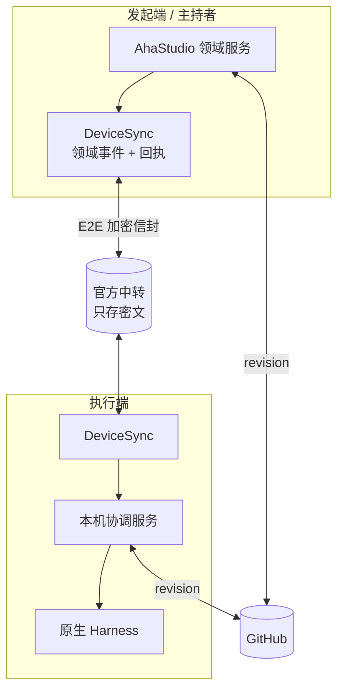

# 远程控制与跨设备方案（B27–B31）

日期：2026-10-22。状态：**设计草案，未改代码**。依据：规格 10「多设备与离线」「开放与服务」、架构 11「通信 存储与接续」、上游复核 `../research/upstream-2026-10-22.md`。

## 1. 要满足的规则（摘自规格）

| # | 规则 |
| --- | --- |
| R1 | 用户**手动指定**执行设备；首发不自动选设备 |
| R2 | 同一项目只有**一个正式计划写入者（主持者）**；其他端只读或明确接续 |
| R3 | 换交互设备不迁移 Run、不重复派工 |
| R4 | 发起端离线：执行端继续已授权阶段并保存结果；需要新增授权时暂停 |
| R5 | 远端停止状态必须区分：**已记录 / 已送达 / 执行端确认 / 状态未知**；未确认不能显示「已停止」 |
| R6 | 断网保留输入；普通消息恢复后补发；改变执行状态的旧指令先核对版本和有效性 |
| R7 | 群聊、私信、小文档正文：只有可信设备能解密，官方中转只见密文 |
| R8 | 代码与大文件经 GitHub 传明确版本；未提交修改先展示范围，确认后经专用检查点分支交接，不夹带无关内容 |
| R9 | 账号登录发现设备 ≠ 授权目录或屏幕 |
| R10 | 可信设备授权新设备、撤销丢失设备；全部丢失时用恢复凭据恢复仍有备份的记录 |
| R11 | 试用：首次两端成功远程连接后固定 30 天，换绑/重装/重连不重置 |

## 2. 现有资产：pocket-vibe

| 项 | 现状 | 能否作为首发基础 |
| --- | --- | --- |
| 拓扑 | 本机 adapter → HTTP → FastAPI hub（仓库外）→ 远程 desktop agent | 可以作为**局域网原型**，不能作为首发：hub 不在本仓库、Python 运行时需要另装 |
| 传输 | HTTP 轮询，无流式 | ❌ 延迟以十秒计 |
| 取消 | 无；interrupt 只停本地轮询 | ❌ 违反 R5 |
| 安全 | 明文 dev token | ❌ 违反 R7 |
| 交付 | ```work-report 围栏帧 | ✅ 契约可沿用 |

结论：pocket-vibe 保留为实验 backend（`FIRST_RELEASE_STABLE_WORKERS` 已排除它），**首发跨设备不在它上面演进**。

## 3. 分层



三层分开选型：

| 层 | 内容 | 方案 |
| --- | --- | --- |
| L1 身份与密钥 | 设备密钥、可信设备列表、撤销、恢复凭据 | **自持**（必须和授权、试用规则绑定） |
| L2 传输 | 发现、配对、NAT 穿透 / 中继、重连 | **二选一**：自建 WebSocket 中继，或 Paseo daemon + relay（B04 对照） |
| L3 领域同步 | 事件信封、回执、补取、主持租约、停止状态 | **自持**（上游都没有这套语义） |

## 4. L1 身份与密钥

- 每台设备生成 **Ed25519 签名密钥 + X25519 加密密钥**，私钥存系统钥匙串（Electron `safeStorage`；Windows 为 DPAPI，macOS 为 Keychain）。
- 账号（官方服务）只用于发现与计费，**不持有解密密钥**。
- **可信设备列表**是一条签名链：每次加入 / 撤销由已有可信设备签名，新设备通过扫码或配对码获得第一条签名。第一台设备自签。
- 会话内容加密：每个项目一把**项目内容密钥**，用每台可信设备的 X25519 公钥分别封装；撤销设备时轮换项目密钥（被撤销设备无法解密新内容，旧内容无法收回——UI 要说清楚）。
- **恢复凭据** = 一个高熵恢复码，派生出可以解封「可信设备列表 + 项目密钥」备份的密钥。备份密文存官方服务。
- 加密实现：**libsodium**（`sodium-native`，ISC 许可）。使用 `crypto_box_seal`、`crypto_secretstream`、`crypto_sign`，**不自创协议**（架构 11 要求）。
- 待技术评审：是否直接采用 MLS（RFC 9420）做群组密钥。首发设备数少（试用 2 台），简单的「项目密钥 + 逐设备封装」足够；设备数上来后再评估。

## 5. L3 领域同步协议

### 5.1 信封

在 B03 的 `DomainEventV2` 外面套一层传输信封：

```ts
interface SyncEnvelope {
  v: 1;
  msgId: string;            // 去重
  from: DeviceId; to: DeviceId | 'project-members';
  projectId: string;
  kind: 'event' | 'command' | 'receipt' | 'fetch' | 'fetch-result';
  cursor?: string;          // 发送方日志游标，用于补取
  keyId: string;            // 项目内容密钥版本；撤销/轮换时单调递增
  algorithm: 'secretstream-xchacha20poly1305-ed25519-v1';
  body: Ciphertext;         // 用项目内容密钥加密的 DomainEventV2 / 命令
  sig: Signature;           // 发送设备签名（覆盖除 sig 外全部字段）
}
```

中转只能看到 `from / to / projectId / kind / keyId / 大小 / 时间`，看不到内容。`projectId` 是随机 ID，不泄露仓库名。签名输入使用规范 CBOR（不是依赖对象键序的 JSON.stringify）；可信设备链记录 `previousHash + sequence`，签名覆盖完整链事件。每个项目保留受信历史密钥以解密旧事件，撤销后只轮换后续 `keyId`，不重新加密旧日志。配对码短时、一次性，两个设备必须核对安全码后才写入可信链。

### 5.2 命令与回执（解决 R5、R6）

远端命令（`StartRun`、`StopRun`、`SteerRun`、`ApproveAction`）都带：

- `commandId`、`issuedAt`、`basedOn: { aggregateId, revision }`（发出时看到的版本）、`expiresAt`。

执行端按顺序回执：

| 回执 | 含义 | UI |
| --- | --- | --- |
| `recorded` | 发起端本地已写入日志 | 「已记录，等待发送」 |
| `relayed` | 中转已接收 | 「已发出」 |
| `delivered` | 执行端已收到并通过签名、版本、过期校验 | 「对方已收到」 |
| `applied` / `rejected(reason)` | 执行端实际执行结果，例如 Harness 已确认中断 | 「已停止」/「未执行：原因」 |
| 超时无 `applied` | — | 「状态未知」，提供重试与查看执行端最近状态 |

- **只有 `applied` 才能显示「已停止」**。`StopRun.applied` 的签发条件是：未答复与新到的批准均已 decline、Harness 中断已确认、观察窗口内无新工具调用与文件变化、子进程树已退出；此前只显示「停止中」，超时显示「状态未知」。撤销 Grant 是独立事件，只禁止后续动作，不能冒充 Run 已停止。
- 执行端校验 `basedOn.revision`：版本已过期（例如 Run 已结束、计划已改版），返回 `rejected('stale')`，**旧批准不会重复生效**（验收场景「断网停止与双端决定」）。
- 普通消息（群聊文本）没有 `basedOn`，恢复后直接补发。

### 5.3 补取

每台设备对每个项目维护「已从各设备接收到的游标」。重连后发 `fetch {sinceCursor}`，对方返回分页结果；接收端按 `msgId` 去重、按 `aggregateRevision` 检测缺口（B03 §3）。

### 5.4 主持租约（解决 R2、R4）

- 每个项目有一个 `HostLease {projectId, holderDeviceId, epoch, expiresAt}`，由持有者定期续约（事件广播）。
- 所有改变项目聚合的命令都必须带当前 `epoch`，不只阶段计划；执行端和其他设备持久化已见最大 epoch 并拒绝旧 epoch（fencing token）。网络分区后旧主持恢复连接也不能凭较新的本地时间写回。
- **接续**：用户在另一台可信设备上明确点「由这台继续主持」→ 新设备发布 `epoch+1`。原持有者上线后看到更高 epoch，自动降为只读。
- **不自动接管**：租约过期只显示「主持端离线」，不自动转移（规格「首发不自动接管全局助理」）。
- 执行端已授权的 Run 不依赖租约存活（R4）；需要新增授权时进入 `awaiting-decision`。按已决定的 D10：动作级 Grant 可以在任一可信设备上给出；阶段计划确认只能在主持设备上给出。

## 6. GitHub 交接（R8）

| 场景 | 做法 |
| --- | --- |
| 已提交代码 | 命令里携带 `{repo, commitSha}`，执行端 `git fetch` 指定 SHA，不用分支名 |
| 未提交修改 | 发起端列出改动文件 → 用户勾选确认 → 在临时 worktree 中只提交所选文件到 `aha/checkpoint/<runId>` 分支并推送 → 命令携带该 SHA。**原目录与当前分支不变** |
| 小文本（< 64 KB） | 直接放进加密信封 |
| 执行端回传 | 推送到 `aha/result/<runId>` 分支，回执里带 SHA 与证据 hash；合并仍按授权单独进行 |

需要的 GitHub 权限：对目标仓库的 contents 写权限（推检查点分支）。用 GitHub App 或用户自己的 `gh` 凭据，待 B14 统一。

## 7. L2 传输：两个候选

| | A 自建 | B Paseo daemon + relay |
| --- | --- | --- |
| 组成 | 官方 WebSocket 中继（无状态转发 + 离线信箱）+ 客户端直连尝试 | 每台设备运行 Paseo daemon；AhaStudio 用 `@getpaseo/client` 的 `hosts.client(serverId)` 访问远端 |
| 远端执行 | 我们的本机协调服务驱动 Harness | Paseo daemon 驱动 Harness |
| E2E | 我们的 libsodium 信封 | Paseo relay 的加密 + 我们的信封再加一层（领域内容仍只有我们的密钥能解） |
| 停止确认 | 我们实现 | **SDK 未文档化中断**，需实测 |
| 授权保真 | 现有 `permission-broker` | 依赖 provider 原生选项，文档警告非宿主隔离 |
| 规模 | XL（B28 原估） | L（接入 + 验证），但依赖 beta 功能 |
| 风险 | 工作量；NAT 场景 | 上游节奏快；权限保真；我们的授权模型要绕过它的默认值 |

**建议**：B04 的跨设备对照用同一组场景（派工、断线、停止、旧批准、补取）跑这两条。B 只在「停止可确认」和「权限保真」两项都通过时才选。**无论选哪个，L1 与 L3 都是自持的，可以先开工。**

**2026-10-23 B04 结论：选 A（自建）。** Paseo 在本机对照中「权限保真」未通过：Codex 最严格的 `auto` 模式下工作区内写入不经宿主（S4 一票否决失败），Codex 的断线补历史也失败（S7）。远端执行面会继承同样的语义，因此不采用 connected hosts。借鉴其两点：执行端在断线期间保留待批准请求；任务在执行端后台进程中独立于发起端存活。见 ADR 0004。

## 8. 试用计时（R11）

- 「首次两端成功远程连接」定义为：两台不同设备首次完成一次 `delivered` 回执往返。官方服务记录 `firstPairedAt`，绑定到**账号**，不绑定设备，所以换绑、重装、重连都不会重置。
- 到期后：中转拒绝新的 `StartRun` 类命令（`rejected('trial-expired')`），继续放行 `StopRun`、回执、补取和结果回传——满足「已授权阶段可完成验证并回传，停止撤销控制保留」。

## 9. 切片

| 切片 | 内容 | 规模 | 可否立即开工 |
| --- | --- | --- | --- |
| X1 | L1：设备密钥、可信设备签名链、safeStorage 存储、配对码 | M | ✅ |
| X2 | L3：SyncEnvelope、回执状态机、补取，先用**进程内假传输**做确定性测试 | L | ✅（依赖 B03 信封） |
| X3 | 主持租约 + fencing | M | ✅（依赖 X2） |
| X4 | GitHub 检查点分支交接 | M | ✅（依赖 B14 凭据方案） |
| X5 | L2 传输：A 或 B | L–XL | ⛔ 等 B04 |
| X6 | 恢复凭据与备份 | M | ✅（密钥协议评审后） |
| X7 | 试用计时与到期 | S | ⛔ 等官方服务 |
| X8 | 双机故障测试（断网、乱序、重放、停止未知） | L | ⛔ 需要两台真机 |

## 10. 待定问题

| # | 问题 | 建议 | 谁定 |
| --- | --- | --- | --- |
| Q1 | 非主持设备上的批准是否有效 | 动作级批准可以；阶段计划确认只在主持设备 | 产品负责人 |
| Q2 | 撤销设备后旧内容无法收回，如何告知 | 撤销确认框明确说明 | 产品负责人 |
| Q3 | 中转离线信箱保存期限 | 建议 30 天，与「官方中转密文另定期限」一致，待定 | 产品负责人 |
| Q4 | 是否采纳 Paseo 作为传输层候选 | 见上游复核 §5 | 产品负责人 |
| Q5 | GitHub 凭据：GitHub App 还是用户 `gh` 登录 | 首发用户自己的 `gh` / OAuth 设备流，GitHub App 后置 | 技术评审 |
