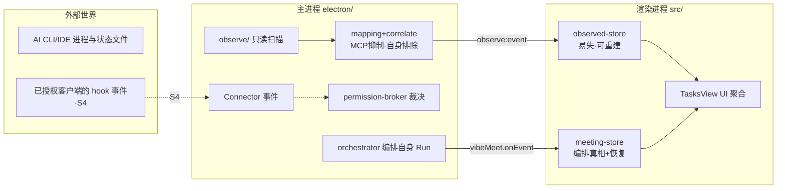

# AhaStudio 技术方案与落地开发计划

版本：v1.7 · 2026-07-26（会议展示 + 意图路由落地版）
地位：技术实现的唯一事实来源。`04-product-architecture.md` 管"做什么/为什么"，本文管"怎么实现/先做什么"；`02-integration-plan.md` 的 §4 迁移顺序由本文 §6 取代。

**v1.5 变更说明**：①S0 已随 **PR #29 合并入 main**（rebase 至 e3489fd/PR28；冲突仅 src/App.tsx 一处，按"统一引导"方案解——采用 PR21 已发布的 `ahastudio.onboarded` 旗标，以真实扫描的 Onboarding 替换 PR21 占位 OnboardingModal，其注释本就声明"观察层接入后替换数据源"）；②引导三件套（首启 4 步真实扫描流程 / 冷启动 splash / 无项目落地任务看板 / 最小化·关闭提示开启 AhaBar）随 PR #29 落地，merged 代码 CDP 全流程验证通过；③**PR #30**：借鉴 agent-searcher（MIT），Codex 标题接入 `~/.codex/.codex-global-state.json` 的 thread-descriptions-v1（优先于 session_index，逐 id 溯源）；④§5 增补 agent-searcher 分析结论与后续可借鉴清单。

**v1.6 变更说明**：①**PR #32 Kimi Code CLI 观察者**落地——`~/.kimi-code` session_index + state.json + kimi-code.log 尾部在飞检测，纯 cwd 反查关联（进程 args 为空），真机 7 个活进程全部关联成功；②**PR #34 Codex Desktop（ChatGPT.app code mode）弱观察**落地——桌面版不写 rollout，改从 global-state thread-descriptions + `process_manager/chat_processes.json`（osPid/cwd）联结，`codex app-server` 从 CLI 候选排除，上板规则修订为"idle 有 pid 背书时显示"；③用户实测问题（4 个 Kimi 窗口扫不到）根因入档：Kimi 当时未实现 + Codex 桌面版无 rollout；④S1 剩余范围收窄为 OpenCode/Gemini/Cursor/Kimi 桌面客户端 + detection matrix + 跳转。

**v1.7 变更说明**：①**PR #39 落地三个递进能力**——(a) 修复 Codex CLI/Desktop 撞 id 隐藏 bug（Desktop 续跑 CLI 会话时按新鲜度选无进程侧 → 隐藏；改为 codex-merged 证据合并，pid/状态取活着的一侧）；(b) 会议模式 ObservedStrip（画廊下方观察磁贴横条）+ AhaBar hover 观察详情（compact 显示观察数、复制接续命令，resume 命令不下线）；(c) **Host 语音意图路由**：observed_sessions_list/focus/send_text 三工具，tty 写入实现"派任务/批准"，动作工具强制走批准模型（high 级 + 目标描述），无 tty 桌面线程降级 focus 并如实告知；②ps 增加 tt 列，tty 进 ObservedSession；③rebase 至 PR37（pocket-vibe-backend/terminal-worker 已并入 main），冲突 3 处按双方保留解——observed 动作工具必须先于通用会议工具分类，否则被误判内置低风险（已加注释与同步测试豁免）；④**main 存在 13 个存量测试失败**（backend-capability-gates/scheduler/orchestrator 多后端流程，干净 main 基线复现，与观察层无关）——已通报，属 PR35-38 合入序列的回归，归对应负责人。

**v1.4 变更说明（S0 实施回写）**：S0 观察层最小闭环已于 2026-07-25 当晚完成并验证（分支 `feat/observe-layer`，未提交）：electron/observe/ 全模块 + IPC + observed-store + TasksView 观察卡片 + 49 新测试（643/643 绿）+ 真机验证（活会话发现、真实 App 渲染、自身排除）。§6.2 末尾新增「S0 实施回写」，记录 7 处以代码为准的方案出入（纯文件证据会话降级态、任务板展示策略细则、噪声活会话豁免、标题 path 拒绝、自身排除接线实况、exec 判定字段、node 路径）。

**v1.1 变更说明**：①基线切换为 origin/main（PR17/19/20 已合并）——M2 批准模型前端（risk-classify/ApprovalCard/HoldToApprove）、M5 AhaBar/虚拟键盘、跨项目任务板（TasksView/useCrossProjectTasks/task-columns）、03 设计令牌均已在 main 落地，§4.4/§4.9/§6 相应重写；②TD-1 修订：取消 monorepo 先行，基于现有仓库原地开发，monorepo 降级为远期可选；③§3.1 重写：观察事件不进 meeting journal，独立 observed store + UI 聚合，不触碰恢复语义；④风险分级单一来源定为前端 `risk-classify.ts`；⑤批准回路归属 `permission-broker`，观察层只生产事件；⑥计划改切片制（放弃按周估算），Slice 0 = 观察层最小闭环；⑦新增自身会话排除规则，防止观察层"发现"自己 spawn 的 Worker。

**v1.2 变更说明**：整合 `references/notes/` 四份源码研读笔记（abtop/codedash/purplemux/tokentelemetry，均带行号可核对）与真机验证。§4.1 结构性重写：①**状态推断废弃 mtime 门限**（abtop 踩坑：流式回复期间文件不落盘会闪断），改三信号状态机 + 合成消息过滤；②PID↔会话映射改三退路（cmd 参数 → PID 文件 → cwd/fd 反查）——本机实测 `~/.claude/sessions/` 不存在，PID 文件不可作唯一依赖；③新增 MCP 抑制（codex mcp-server 幽灵会话）、进程识别排除清单、安全三件套（symlink fail-closed/脱敏/行长上限）；④移除 fs.watch 方案，改 mtime+size 变更标记轮询；⑤明确不采用项：不删第三方 PID 文件（TD-7）、不抄 tmux 抓屏兜底、不按蓝图里程碑做历史列表优先；⑥S0 任务分解同步更新。

**v1.3 变更说明**：整合竞品 UI 截图分析（2026-07-25，35 张：codbash v7.15.0 浏览器端、TokenTelemetry Web、abtop 中文 TUI）：①S0 观察卡片新增**标题兜底链**（session_index → 首条真实 user prompt → 项目名+时间，绝不显示裸路径/tmp 垃圾）与**噪声抑制**（tmp/e2e/极短会话折叠）；②工程红线：ps/lsof 轮询必须异步 off-loop（codbash 同步轮询冻结终端 I/O 的 changelog 教训）+ spawn 嵌套 agent 清洗父会话 env + GUI 启动 PATH 修复；③§4.6 额度新增诚实成本语义（✓measured/~est. 按客户端标注、`$ Rates` 日期戳、套餐类型从 `~/.codex/auth.json`/`ANTHROPIC_API_KEY` 自动检测）、cache 命中率叙事、delegation 归属标注（already in/on top of totals）、transcript retention 归档层；④§4.9 表面层新增 CONNECTED n 常驻检测指示（稳定 per-client 颜色）与 P8 引导的 detection matrix 对标；⑤卡片字段词汇对齐 abtop（客户端/项目/标题/状态/模型/上下文%/Token/最后活跃）。

关联文档：

- [共享产品语言 / 已确认决策](../../CONTEXT.md)
- [产品架构与 UX 设计全案](./04-product-architecture.md)
- [代码整合方案](./02-integration-plan.md)
- [高保真设计令牌](./03-hifi-ux-design.md)
- 源码研读笔记：`references/notes/`（abtop-session-discovery / codedash-data-sources / purplemux-session-state / tokentelemetry-parsers）及对应 vendored 源码
- 竞品 UI 截图：`ahastudio/docs/竞品2-*`（codbash）、`竞品3-*`（TokenTelemetry）、`扫描竞品图.png`（abtop）

## 0. 文档目的与输入

把 04 文档 M1–M10 全部功能落成技术方案，并给出切片化开发计划。输入七份：

1. **产品定义**：04 文档（M1–M10、L0–L4、BR-A/BR-B/BR-C）
2. **代码现状**：origin/main @ 0075642（PR17/19/20 合并后，2026-07-25 核查），仓库 `ShawnyinsGit/ahastation-internal`
3. **旧代码资产**：ahakey-studio-community 仓库内 ahakeyconfig-mac（Swift）、vibebar、BLE_tcp_bridge、CH582m 固件、win-py/java 配置器
4. **开源生态调研**（2026-07-25）：abtop、codedash、TokenTelemetry、agent-deck、vibe-kanban 等项目的发现机制与许可证核实（§5）
5. **源码研读笔记**（2026-07-25）：`references/notes/` 四份，覆盖 abtop v0.5.3（~19k 行 Rust）、codedash（~23k 行 Node）、purplemux（TS/tmux）、TokenTelemetry（FastAPI ~9k 行）的逐行实现
6. **竞品 UI 截图分析**（2026-07-25）：codbash v7.15.0 十九屏、TokenTelemetry 十五屏、abtop TUI 一屏的逐屏分析
7. **v1.0 方案的批判性复查**（2026-07-25）：四条合理性问题 + 五条设计问题的修正结论，已并入本版

## 1. 总体技术决策

| 编号 | 决策 | 理由 | 影响 |
|------|------|------|------|
| TD-1 | **基于现有仓库 origin/main 原地开发；monorepo 降级为远期可选重构** | main 的演进方式（PR17/19/20 直接在 electron//src/ 落地新 IA）证明原地迭代是实际节奏；1–2 人 + AI 密集开发下，monorepo 抽取是纯管道工，推迟"立身之本" | 模块布局见 §2.1；§2.4 保留 monorepo 触发条件 |
| TD-2 | **观察层自研，开源项目只做参考实现与开发期对账工具，不做运行时集成** | ①开源工具终点是"展示"，我们起点是"投影为 Task + 授权升级"，数据模型不同；②abtop=Rust、agent-deck=Go、TokenTelemetry=Python，运行时集成=Electron 内分发异构二进制；③MIT/Apache 允许借鉴思路与移植解析器 | §4.1、§5 |
| TD-3 | **两级接入模型：Observation（零授权只读）→ Connector（显式安装，交互控制）** | 对齐 CONTEXT.md 术语；首次启动"零授权纯观察"是信任第一步（04 §7 动线 1） | 观察层与 hooks 分两步交付 |
| TD-4 | **任务真相多表面，沿现有 store 模式扩展，不推倒重来** | main 已有 `window.vibeMeet.onEvent` 全局事件流 + `meeting-store` useSyncExternalStore 聚合；多订阅者化在此模式上演进，不另造总线 | §3.2 |
| TD-5 | **能力门一等公民，从编排扩展到观察** | `BackendCapabilities` 扩展观察维度：observable / controllable / orchestratable；"任何客户端都能被关注，干活范围按能力声明" | Observer/Connector 接口按能力降级 |
| TD-6 | **许可证红线：只参考/移植 MIT、Apache-2.0；AGPL 与 NOASSERTION 不搬代码** | 社区版 Apache 2.0（BR-B4）；claude-squad（AGPL）排除；ccusage（NOASSERTION）只参考数据源 | §5 |
| TD-7 | **只读承诺用技术手段保证，不靠自律** | 文件 O_RDONLY、SQLite readonly 模式、禁止写第三方配置（含不删除陈旧 PID 文件）；Connector 装前快照、可卸载还原；retention 归档只写自己 userData | §4.1.6、§4.1.9、§4.6 |
| TD-8 | **平台顺序：macOS 首发，Windows/Linux 随后** | 现状 macOS 假设多；进程扫描等 OS 相关实现先 darwin，接口隔离 | §4.1.2 |
| TD-9 | **观察与编排双 store，UI 聚合；观察数据永不进 meeting journal** | meeting-repository 与恢复逻辑（task-recovery/collaboration-recovery）深度绑定 meetingId；观察事件无 meetingId 且易失可重建，混入会污染恢复语义 | §3.1 |
| TD-10 | **诚实语义是一等公民：每个数字标注口径与置信度** | 竞品验证（codbash `✓/~est.`、TT `$ Rates` 日期戳与套餐检测）；04 M8-2 置信度必标；额度 UI 若需要免责声明段落才能看懂就是设计失败（TT 反面教材） | §4.6、卡片与额度条文案规范 |

## 2. 目标架构

### 2.1 模块布局（现有仓库内）

```text
ahastation-internal/                 # 现有仓库，origin/main 为基线
├── electron/
│   ├── observe/                     # ★新建 观察层（本方案核心新增）
│   │   ├── observers/               # 每客户端一个只读观察者
│   │   ├── process/                 # 手段一：进程扫描（OS 接口隔离）
│   │   ├── statefiles/              # 手段二：状态文件解析（只读）
│   │   ├── mapping.ts               # PID↔会话三退路 + MCP 抑制 + 自身排除
│   │   ├── state-machine.ts         # 三信号状态机（Claude/Codex 两族）
│   │   ├── correlate.ts             # 信号汇总 → ObservedSession
│   │   └── observe-service.ts       # 双 tick 调度（off-loop）+ IPC 发布
│   ├── backends/                    # core-clients（复用，main 上持续演进）
│   ├── orchestrator.ts 等           # core-meeting 内核（复用）
│   └── permission-broker.ts         # core-approval 裁决点（批准回路归属）
├── src/
│   ├── lib/observed-store.ts        # ★新建 观察 store（对齐 meeting-store 模式）
│   └── components/TasksView.tsx     # 任务板（main 已有）+ 观察卡片（★新增）
└── tests/
    ├── fixtures/observe/            # ★新建 ps/lsof 输出样本、各客户端状态文件样本树
    └── observe-*.test.mjs           # ★新建
```

### 2.2 分层映射（04 §3 不变）

| 04 分层 | 落地 |
|---------|------|
| L4 硬件层 | AhaKey X1（设备服务，§4.10）、AhaStation（未来） |
| L3 表面层 | src/（主窗口双视图 / AhaBar / 虚拟键盘 / 探索 / 设置） |
| L2 应用服务 | meeting-store + observed-store（UI 聚合）+ window.vibeMeet 事件流 |
| L1 Aha Core | electron/（observe / backends / orchestrator / permission-broker / 语音 / 未来 quota、sync、identity） |
| L0 平台层 | Electron 壳、安全体系（CSP/zod/sandbox）、存储 |

### 2.3 数据流



核心不变式：**Task 两来源（observed / orchestrated）对用户无差别呈现**；观察数据走独立通道与 store，永不写 meeting journal，永不碰第三方配置。

### 2.4 monorepo 触发条件（远期可选）

仅当以下任一成立时再评估拆分：①需要第二个独立分发的 app（station 硬件线启用）；②core-* 需要被仓库外消费者引用；③构建时长/类型检查成为瓶颈。触发前所有包边界以 `electron/` 目录纪律维持。

## 3. 核心机制设计

### 3.1 双 store + UI 聚合（TD-9）

- **编排侧不动**：meeting-repository（journal）+ task-projection + 恢复逻辑保持原样；orchestrated Task 语义零改动。
- **观察侧新建 `observed-store`**：纯内存、易失（应用重启即重建，观察结果本来就来自重新扫描，无需持久化）；对齐 meeting-store 的 `useSyncExternalStore` 模式（`subscribe`/`getSnapshot`）。
- **聚合点在 TasksView**：`useCrossProjectTasks`（编排）与 `useObservedTasks`（观察）在视图层合并渲染；观察卡片用独立的 `ObservedTaskCard` 类型，不复用 `AggregatedTask`——避免给编排聚合类型塞进永远为空的字段（attempt/deps/delivery）。
- 观察卡片对外状态：`active(=thinking+executing) / waiting / idle / done / unknown`（推断必标注"推断"）；`waiting` 进 attention 列但只读展示，操作区显示「去对应客户端处理 ↗」（04 §9.7 观察级别降级规则）。

### 3.2 事件通道

- 编排事件沿用 `window.vibeMeet.onEvent` 全局流，不动。
- 观察事件走**独立 IPC 通道** `observe:event` + 快照拉取 `observe:getSnapshot`（preload 白名单新增 `observe` namespace）：观察事件没有会话 slot 语义，混入编排全局流会让 meeting-store 的 reducer 多一堆 no-op 分支。
- 慢消费者策略：观察扫描每周期全量推快照（数据量小：数十个会话），不做增量 diff——简单且自愈。

### 3.3 会话身份与去重

```text
ObservedSessionId = hash(clientKind + nativeSessionId + realpath(cwd))
```

- `nativeSessionId`：Claude=jsonl 的 session_id；Codex=rollout 文件 session id；OpenCode=server session id
- projectId 沿用现状 `sha1(realpath(cwd))`（04 §4），观察卡片与编排任务按同一 projectId 分组——用户看到的"项目"是一致的
- PID 只作易失证据不入身份；进程重生/文件滚动更新同一会话的状态
- "消失判定"：Claude PID 失效即消失（无完成窗口）；Codex 无进程认领 + mtime<5min → done 后从活跃视图移除（§4.1.5 完成窗口不对称）

## 4. 各模块技术方案（M1–M10 全覆盖）

### 4.1 观察层（M7-1）★立身之本

#### 4.1.1 观察者接口

```typescript
interface ClientObserver {
  readonly kind: AiClientKind;                   // 'claude-code' | 'codex' | ...
  readonly capabilities: ObserveCapabilities;    // { processScan, stateFiles, quotaSignals, connectorUpgrade }
  probe(): Promise<ClientInstallInfo | null>;    // 装了没、版本、配置目录（复用 registry.ts probe 模式）
  scan(shared: SharedProcessSnapshot): Promise<ObservedSignal[]>;  // 共享进程快照，不重复 spawn ps
}
```

每客户端一个 observer（对齐 backends/ 适配器风格），S0 交付 claude-code + codex，S1 补 opencode/gemini/cursor。

#### 4.1.2 手段一：进程扫描（含识别与排除）

源自 abtop process.rs 与 codedash getActiveSessions 的踩坑记录：

- 每 tick **单次** `ps -axo pid,ppid,%cpu,rss,comm,args` 构建全局共享快照（pid→info、ppid→children），所有 observer 共用；CPU 信号取**子孙最大值**
- **工程红线（codbash v7.15 changelog 教训：同步轮询 ps/lsof 冻结终端 I/O）**：所有子进程调用必须 async off-loop（`execFile` Promise 化 + 超时 + in-flight 去重），绝不在事件循环上同步执行
- `cmdHasBinary(cmd, name)`：token 级匹配命令行里的二进制名，处理 node wrapper（`node .../codex.js`）、npm shim、`.exe` 后缀——不会把"路径里含 claude 但二进制不是"的进程误判
- **排除清单（必须）**：Electron `--type=(renderer|utility|…)`、`.app/Contents/(Frameworks|MacOS)/`、`* Helper`（Claude Desktop 的进程名会命中 `\bclaude\b`）、`mcp-server`、`/plugins/`、`app-server-broker`、grep 自身、app 自身进程树（§4.1.4）
- 子孙查找带**两级**（`claude --resume` 会二次 fork，只看直接子进程会漏）
- cwd/端口：仅对命中 PID 调**单次批量** `lsof -Fn -p <pids>`；输出带 `(readlink: Permission denied)` 的丢弃；失败降级为"进程存在但 cwd 未知"

| 平台 | 实现 |
|------|------|
| macOS | 上述 ps + lsof 方案（S0） |
| Linux | 直读 `/proc/<pid>/{cmdline,cwd,fd}`，零 spawn（S1 后） |
| Windows | CIM `Win32_Process`；无 lsof 等价物，Codex 按 mtime 启发式分配 rollout（后续切片，首发不承诺） |

#### 4.1.3 手段二：状态文件扫描（数据源与标题）

| 客户端 | 数据源 | 标题来源 | 切片 |
|--------|--------|----------|------|
| Claude Code | `~/.claude/projects/<编码cwd>/<sid>.jsonl`（v1+ **唯一来源**；`history.jsonl` 仅遗留元数据补充，不可只信） | `type:"summary"` 行或首条真实 user prompt | S0 |
| Codex | `~/.codex/sessions/YYYY/MM/DD/rollout-*.jsonl`（**只读第一行**拿 session_meta：id/cwd/startedAt） | ①`.codex-global-state.json` thread-descriptions-v1（应用自维护标题，优先，v1.5/PR #30 接入）②`session_index.jsonl` thread_name（次选） | S0 |
| OpenCode | 多候选路径探测（`$OPENCODE_DATA_DIR` → XDG → `~/.local/share` → App Support；**禁单路径+吞错=静默消失**）；`sqlite3 -readonly -separator '\t'` CLI（macOS 自带，已验证；标题含 `\|` 会炸默认分隔符） | SQLite session 表 | S1 |
| Gemini CLI | `~/.gemini/tmp/<project>/chats/session-*.json` + `projects.json` slug 映射 | 同上 | S1 |
| Cursor | `~/.cursor/projects/` + `chats/` + workspaceStorage `state.vscdb`（三种来源，最复杂） | 目录编码**不可逆**（`/`和`.`都是`-`）→ 沿真实文件系统逐级贪心反解 | S1 |
| Kimi | `~/.kimi-code/session_index.jsonl`（sessionId/sessionDir/workDir）+ `state.json` + `logs/kimi-code.log` 尾部 | state.json title → lastPrompt（✅ 已实现，PR #32） | S0+ |
| Codex Desktop（ChatGPT.app code mode） | **不写 rollout**；`.codex-global-state.json`（thread-descriptions）+ `process_manager/chat_processes.json`（osPid/cwd/turn） | thread-descriptions（✅ 已实现，PR #34；弱观察全标推断） | S0+ |

解析规则：单行 10MB 上限；单行损坏跳过该行继续；未知字段容错（zod passthrough）；大文件先字符串前缀过滤再 JSON.parse（Copilot kind:1 行带几 MB 图片 base64 的坑）；Codex 外部导入去重（`external_agent_session_imports.json`：原 Claude 文件还在就跳过 Codex 副本）本机暂无该文件，逻辑后置。

**mtime 只用于扫描排序与缓存新鲜度，不作状态信号**（§4.1.5）。

#### 4.1.4 PID ↔ 会话映射与排除（mapping.ts）

三条退路按优先级（abtop/codedash/purplemux 三家共识）：

1. **命令行参数**：`--session-id` / `--resume <uuid>` / `codex resume <id>` / `--resume-session-id=<id>`（正则同时兼容 `=` 和空格两种形态）
2. **PID 文件**：`~/.claude/sessions/{PID}.json` → {sessionId, cwd, startedAt}。**本机实测该目录不存在（2026-07 版本）——必须可降级，绝不可作唯一依赖**；存在则优先，且只做容错忽略、**永不删除陈旧文件**（purplemux 会 unlink，违反 TD-7）
3. **cwd/fd 反查**：批量 lsof 拿 cwd 匹配已知会话；Codex 可用 fd 反查进程打开的 rollout 文件（macOS `lsof -F pn`；Linux `/proc/<pid>/fd`）

排除规则（三道）：

- **自身排除**：app 进程树后代 PID + 编排侧持有的自身 session_id 清单（observe-service 启动时注入并随会话增删更新），两路任一命中即排除——观察层必须看不到自己 spawn 的 Worker/Host（竞品已能观察到我们的 spawn_agent 层级，佐证必要性）
- **MCP 抑制**：`codex mcp-server` 持有大量历史 rollout fd，先探测其 PID + 持有的 rollout 路径集，采集时跳过——否则冒出 PID=0 的"幽灵会话"
- **`/clear` 覆写**（S1）：`/clear` 生成新 sid 但不重写 PID 文件 → 用"project 目录 mtime > startedAt−5s 的最新 jsonl"覆写 sid，两道安全闸：同 cwd 多个活 PID 时禁用 + 排除已被其他 PID 认领的 sid

#### 4.1.5 状态推断（三信号状态机，不用 mtime）

v1.2 修正：v1.1 的"jsonl mtime < N 秒 → active"规则**废弃**——abtop 踩坑记录：Claude 的 assistant turn 落盘是原子写入，长时间流式回复期间 mtime 不动，按 mtime 判断会闪断。

Claude（abtop 三信号，transcript 增量解析 + 进程 CPU）：

```text
Executing = 子孙进程 CPU > 5%   ← 工具在跑（Bash 等）
         ‖ 末尾存在未闭合 tool_use（current_task 非空）  ← I/O 密集/快速工具兜底
Thinking  = 末尾是真实 user 输入且无 assistant 回复（last_user_ts_ms > 0）
Waiting   = 其他
```

- **合成消息过滤（必需品）**：tool_result 包装、isMeta:true、`<local-command-stdout>`/`<command-name>`/`<bash-input>` 前缀的 user 行不算真人输入——不过滤则空闲会话永卡 Thinking
- 快速工具（`Bash rm …`）在两次 CPU 采样间就跑完、Read/Edit 类 I/O 密集工具子孙 CPU<5%——都靠"未闭合 tool_use"兜底，三个信号缺一不可

Codex（事件状态机，rollout 是事件流）：

| 事件 | 效果 |
|------|------|
| `event_msg/user_message` | generating=true（工具输出走 response_item，天然不污染） |
| `event_msg/agent_message` | turn+1，清 generating |
| `response_item/function_call` ↔ `function_call_output` | 按 call_id 配对开闭（`exec_command`/`write_stdin` 长运行进程有特例） |
| `event_msg/task_complete` | 清 generating；**仅对 `codex exec` 一次性会话算 done**——交互式会话每轮都发，不能当结束 |

- **完成窗口不对称**：Codex 无进程认领 + mtime<5min → done（优雅落幕）；Claude PID 失效即消失（无完成窗口）
- 增量解析（S1 性能化）：offset 缓存 + (inode, mtime) 文件身份检测替换 + 半行延迟（末尾无换行留到下轮）+ saw_turn 保护（空 delta 不覆盖状态时间戳）

对外统一状态：`active(=thinking+executing) / waiting / idle / done / unknown`，推断必标注；映射任务板：waiting→待批准列（只读卡片）、active/idle→进行中、done→从活跃视图消失（保留统计，S3）。

#### 4.1.6 只读与安全

- TD-7 全套：O_RDONLY；SQLite `sqlite3 -readonly`；不写任何第三方配置目录；**不删除陈旧 PID 文件**
- **安全三件套（abtop）**：symlink fail-closed（stat 出错视为 symlink 直接跳过）；显示前脱敏（sk-ant-/sk-proj-/ghp_/AKIA/Bearer 等前缀 → [REDACTED]，并过滤终端控制字符与 Unicode bidi）；单行 10MB 上限防 OOM + session_id 等外部输入做路径组件消毒（拒 `/`、`\`、`..`）
- 每家 observer 独立 try/except，单家失败不拖垮全局；单文件损坏跳过
- 调度：**快/慢双 tick**——2s 刷进程快照与状态，10s 刷端口/DB/标题/git；全 idle 退避到 10s；扫描用 **mtime+size 变更标记跳过**（codedash 式，不用 fs.watch）；贵操作（lsof 全量、DB）间隔 ≥60s + 超时 + in-flight 去重；全部子进程调用 off-loop（§4.1.2 工程红线）

#### 4.1.7 首屏性能预算（引导页切片验收）

进程扫描 ≤300ms；状态文件 ≤1.5s（2 客户端 × 50 文件 cap，Codex 只读首行、Claude 首行+末尾窗口）；对账+快照推送 ≤500ms；上屏 ≤500ms；**合计 ≤5s**。手段：骨架屏先行、每客户端结果流式上屏、无结果直接进空态。

#### 4.1.8 接入点（对 main 的精确挂载）

- 主进程：`observe-service.ts` 在 app ready 后启动（零授权、默认开启，设置项后续切片）；经新 preload namespace `window.vibeMeet.observe`（`getSnapshot()` / `onEvent(cb)`）发布
- 渲染进程：`src/lib/observed-store.ts`（useSyncExternalStore）→ `TasksView` 观察卡片混入四列（按同一 projectId 进项目分组，加「观察中」徽章，操作区降级为「去对应客户端处理 ↗」占位）——04 D1"observed/orchestrated 无差别呈现"
- **观察卡片规范（v1.3）**：
  - 字段词汇对齐 abtop：客户端（稳定色 chip）/ 项目 / 标题 / 状态（推断标注）/ 模型 / 上下文% / Token / 最后活跃时间
  - **标题兜底链**：Codex `session_index` thread_name → Claude 首条真实 user prompt（截断）→ `type:"summary"` 行 → 项目名+时间——**绝不显示裸路径、`/var/folders` 临时路径、`<recommended_plugins>` 等系统片段**（codbash 列表被垃圾标题淹没的反面教材）；空内容用灰斜体「无提示内容」（TT 模式）
  - **噪声抑制**：tmp/临时目录、含 e2e 特征、极短（<2 条消息）会话 → 折叠进"噪声"分组默认收起，可展开——任务板是行动导向，不能被噪声稀释
  - AI 生成标题（S1）：走用户自备 OpenAI-compatible endpoint（codbash 模式，零云依赖，对齐 M3-5"用户配置的整理模型"），带全局开关与单卡片重新生成
- 命名：新代码一律 aha 前缀语义命名（vibe→aha 扫尾另行安排，不阻塞本切片）

#### 4.1.9 Connector 升级路径（S4，交互控制）

1. 安装：M6-10 IDE hooks 体系移植（追加式写 `~/.claude/settings.json` 等；**保留用户已有 hooks**，按配置文件 mtime 缓存解析；装前快照、可还原）
2. 摄取：主进程 HTTP server 仅 bind 127.0.0.1、随机端口、per-client token 随 hook 配置注入、zod 白名单校验
3. 事件模型直接采用 purplemux 转换表（独立纯函数）：`session-start→idle / prompt-submit→busy / notification→needs-input / stop→ready-for-review / interrupt→idle`；事件带**递增 seq**，ack 按 seq 匹配（防旧 ack 误杀新状态）；notification 按**类型白名单**过滤（仅 permission 类转 needs-input，60s 空闲提醒等忽略）；重启后 persisted busy **降级 unknown** + 合成 seq=0 baseline
4. **批准回路归属 `permission-broker`**：hook 事件转为 broker 的权限请求输入，四级裁决复用现有链路；观察层只生产事件，不自带裁决
5. 风险分级**单一来源 = 前端 `risk-classify.ts`**：观察/编排事件都原样上送前端分级，后端不重复实现；auto-approve 三档继续在后端做自动门（main 现状分工固化）
6. 不采用：tmux 抓屏兜底（capture-pane 权限解析、pane 标题识别——tmux 架构特有，不可移植）；abtop 的 StatusLine hook 采 Claude rate limit 同属增强层，S4 后评估

### 4.2 AI 客户端接入（M6）

| 功能 | 现状（main） | 技术方案 |
|------|----------|----------|
| M6-1 后端适配层 | 五适配器 + 能力门，main 上持续演进 | 复用不动；观察层 probe 复用 registry.ts 模式 |
| M6-2 凭证管理 | safeStorage + OAuth | 复用 |
| M6-3 详情跳转客户端 | 新建 | macOS：`open -b <bundle-id>` 激活；CLI 激活所在终端（Terminal/iTerm 分两实现）；S1；观察卡片先给 **Copy Command**（`claude --resume <sid>` 等，只读即可做） |
| M6-4/5/6/7 编辑器/浏览器/屏幕/Computer Use | main 已有 | 复用 |
| M6-9 技能/shadow HOME | claude-defaults.ts | 去 Claude 中心化泛化（02 §3.3），后续切片 |
| M6-10 IDE hooks 体系 | 旧 mac/win-py 完整，win-java 空壳 | S4 移植进 observe/connectors；java 空壳不迁移 |

spawn 侧工程注意（codbash changelog 教训，v1.3）：spawn 嵌套 agent 时**清洗父 agent 的会话 env 变量**（防子会话写错目录）；GUI 启动 PATH 被裁剪时从 login shell 修复（可 opt-out）；sqlite 读取给足 maxBuffer。

### 4.3 会议编排（M1）

main 已演进：coordinated meeting tasks、跨项目任务板同步、scheduler stall 修复、direct delegate vs Plan mode。仍待做：Host 全局化（跨项目统筹，M1-4 改造）、异步决策进任务真相（M1-14 去 Calendar 耦合）、自动编排（M1-16，依赖项目级授权）。复用不动：Worker 池/交付状态机/worktree 隔离/中断恢复/记忆。

### 4.4 批准与权限（M2）

**main 已落地**：四级风险模型（`risk-classify.ts`：低/中/高/禁止快捷 + blocked 正则族）、ApprovalCard、ApprovalDetailModal（P5 详情）、HoldToApproveButton（按住 800ms）、approval-gesture。仍待做：

- 批准卡片四要素的完整接线与拒绝 5 秒撤销（M2-2）
- 项目级低风险授权（M2-5，新建）
- 拨杆语义 fail-safe / 虚拟拨杆 / IDE 配置联动快照（M2-7/8/9，硬件切片）
- 决策（v1.1 确认）：分级逻辑保持前端单一来源；后端 auto-approve 三档为自动门

### 4.5 AhaTalk 语音（M3）

main 已加云端 ASR（xfyun-iat）与 pcm16 管线。仍待做：**provider 抽象**（`TalkProvider { transcribe(), polish(), syncLexicon() }` 三实现 Local / UserKey / AhaTalkCloud）、去 Anthropic 凭证耦合（M3-5）、词库 GUI（M3-8，旧 hot.txt 三文件为迁移种子）、处理路径指示器（M3-7）。BR-B2 禁止静默切换在抽象层强制。

### 4.6 额度（M8-1/2/3）

采集三路按能力降级：本地日志 → CLI 自报 → 厂商接口（待调研不承诺）。本地日志的 **token 口径三分支**直接照抄 TokenTelemetry（S3）：

- **Anthropic**：input/output/cache_creation 逐轮累加，**cache_read 取 max 不取 sum**（另记真 sum 供成本分摊）
- **OpenAI（Codex）**：`total_token_usage` 是滚动累计快照取 max；`net_input = gross_input − cached_input`（防双重计费）；reasoning 折叠判断（`total_tokens > gross+output` 才单列加进 output）
- **Copilot**：shutdown 快照 + 防御性递归求和 + 减法守卫（`input >= cache_total` 才减）

配套：context% = (input + cache_read) / 窗口（不含 cache_creation）；窗口 200K/1M 按 model 名 `[1m]` 或观测 max_context_tokens；compaction 双条件检测（context 降 >30% 且 cache_read 骤降）；子代理归属（Claude 看 `<sid>/subagents/agent-*.jsonl` 且缓存新鲜度纳入子文件 mtime；Codex 用 `thread_source=="subagent"`，**不信 forked_from_id**）；两级定价表 (provider, model) + 模型名归一化 + 运行时零网络；sidecar 缓存三件套（payload 内嵌 `_mtime` + `CACHE_VERSION` + 路径组件消毒）。统一 `QuotaWindowRecord { client, consumed, limit?, resetsAt?, source, confidence }`；Forecast 置信度必标；Warm-up 为 Pro 且逐次授权。

**诚实成本语义（v1.3，TD-10）**：

- 每个数字按客户端标注 `✓ 实测` / `~估算`（codbash 模式）；价格表带 `$ Rates: <日期>` 新鲜度戳（TT 模式）
- **套餐类型自动检测**：`~/.codex/auth.json`（订阅）/`ANTHROPIC_API_KEY` 环境变量（API）+ 手动覆盖（TT 模式）——订阅用户显示"额度窗口消耗"，API 用户才显示金额
- **cache 叙事**：cache 命中率 + `缓存节省 ~$X vs 无缓存`（订阅用户更好的效率故事，AhaBar 素材）
- **delegation 归属标注**：Host/Worker 父子会话 token 汇总必须标注 "already in totals" vs "on top of"（TT 模式），防双重计费
- **retention 归档层**（v1.3 新增）：agent 会自行 prune（Claude `cleanupPeriodDays` 默认 30 天）——core stats（会话 id/项目/时间/token 汇总）归档进自己 userData 永存；**transcript 全文归档默认关、逐客户端授权**（TD-7 兼容：只写自己存储；隐私边界清晰）；归档让 待验收/已完成 卡片不丢证据

### 4.7 同步交接（M8-4/5/6 + M8-8）

Sync Vault（用户私有 Git 仓库 + XChaCha20-Poly1305 加密，密钥派生自 Recovery Kit）、Managed Checkpoint（不动活跃分支，仅安全 fast-forward 自动）、Handoff Bundle（session snapshot/resume 机制为种子）、Execution Lease（lease 记录 + 心跳，BR-C3 唯一执行节点）、Trusted Device 配对/吊销。M8-8 跨平台通信依赖 core-identity，S5。竞品 UX 参照（v1.3）：codbash 的 Resume / Copy Command / Handoff / Convert-to-<CLI> 按钮组——"会话跨客户端便携"的交互先例，我们 Handoff Bundle 叙事更强（跨设备+执行权），观察卡片侧先落地 Copy Command（S1）。

### 4.8 账号与 Pro（M8-7/M9-2）

旧 mac/win-py 云账号体系改造并入 Pro；云端（计费/中继/AhaTalk Cloud）闭源。硬约束 BR-B4：本地功能全部无账号可用；Pro 状态本地缓存 + 离线宽限。S5。参照（v1.3）：codbash Cloud Sync 的"GitHub 账号加密同步、免费层 10 会话"模式——印证 Sync Vault 的账号绑定与免费额度思路。

### 4.9 表面层（M5 + P1–P10）

**main 已落地**：AhaBar（147 行初版）、VirtualKeyboard（131 行）、TasksView 跨项目任务板（四列 + 项目/后端筛选）、ApprovalCard 体系、aha-tokens.css 设计令牌、dispatch-mode。仍待做：

- 任务板**观察卡片混入四列**（S0，§4.1.8）
- **CONNECTED n 常驻检测指示（v1.3）**：侧栏/状态栏常驻"已检测到 N 个客户端"，每客户端稳定颜色贯穿 chips/卡片/画廊磁贴/图表（TT 模式）——便宜高价值，S1 随 detection matrix 一起做
- **P8 首次引导对标 detection matrix（v1.3）**：INSTALLED/NOT INSTALLED chips + 显示探测到的 binary 路径 + "N of M installed" + 每客户端安装命令弹窗（一键复制）+ Refresh detection（codbash 模式）；观察扫描 → 发现 → 落地会议模式（S1）
- AhaBar 三态打磨（compact/hover/pinned）、全屏幽灵态、设备仲裁广播接线（硬件切片）；burn-rate 式紧凑条（$今日/上小时/预计 + 状态徽章，codbash 模式）可作 compact 态额度呈现参考
- 会议⇄任务双视图切换器 IA 对齐（顶栏永远可见，04 §8.2）
- 探索页 P6（生态切片）；参照 codbash Recommended tools 的生态互推卡片（S5 后）

### 4.10 硬件层（M4 + M10）

决策（沿用）：**BLE 协议栈不在 Electron 重写**——保留旧 LaunchAgent 守护（M10-2）作为设备服务宿主，AhaStudio 经本地 IPC 复用其 BLE 连接与 0x00–0x92 指令集；M10-8 设备连接仲裁者即该服务。M4 数字孪生编辑器 UI 在设置页用 React 新写，经设备服务下发。灯效状态源（M4-8）订阅任务/attention 状态。M4-22 随硬件排期。

### 4.11 生态与插件（M9）

更新检查复用；社区配置包依赖 M4-16 移植；插件 SDK（旧 JSON-RPC host API）改造接 M2-7；场景化推荐纯前端。生态切片排 S5 后。

## 5. 开源生态利用策略

调研结论（2026-07-25，按"能否发现本机运行中的 agent"分类）：直接发现类（abtop、TokenTelemetry、codedash、claude-dash-cli、claude-sessions-monitor、Claude-Code-Agent-Monitor、cross-code-organizer）、会话管理/编排类（agent-deck、vibe-kanban、claude-squad、purplemux、emdash）、远程监控类（claw、Yep Anywhere、Lucarne）。竞品 UI 逐屏分析（同日）：codbash（=codedash 改名，v7.15.0 浏览器端）、TokenTelemetry（Web dashboard）、abtop（中文 TUI）。对 AhaStudio 的角色分配：

| 项目 | 语言/许可证 | 角色 | 使用边界 |
|------|-------------|------|----------|
| `references/`（abtop / codedash / purplemux / tokentelemetry 源码 + `notes/` 四份带行号研读笔记） | Rust/JS/TS/Python · MIT | **第一手实现参照**：§4.1 的三信号状态机、三退路映射、数据源表、token 口径均出自这些笔记，行号可跳转核对 | 读源码借鉴；移植保留 NOTICE；不作运行时依赖 |
| [abtop](https://github.com/graykode/abtop)（3.4k★） | Rust / MIT | 头号参考实现 + **开发期对账工具**；中文 TUI 证明中文原生观察面板的空档 | 同上 |
| codbash（[vakovalskii/codedash](https://github.com/vakovalskii/codedash)） | JS / MIT | 数据源清单 + 会话浏览器 UX（标题兜底/检测矩阵/git 上下文/Convert/Handoff）+ 工程四坑（off-loop/env 清洗/PATH 修复/sqlite buffer） | 清单采用；解析器可移植（NOTICE） |
| [TokenTelemetry](https://github.com/VasiHemanth/tokentelemetry) | Python / MIT | token 口径三分支、两级定价表、sidecar 缓存、诚实成本语义、delegation 归属、retention 模式（S3 照抄） | §4.6 |
| [agent-deck](https://github.com/asheshgoplani/agent-deck) | Go / MIT | tmux 会话管理思路（Connector 阶段） | 仅思路 |
| [agent-searcher](https://github.com/Dryoung95/agent-searcher)（团队内部项目，2026-07-25 首公开） | Python / MIT | **已采纳**：Codex `.codex-global-state.json` 标题索引（PR #30）；**待借鉴**：TOKEN_RE 对进程 cmdline 的全链脱敏、Windows CIM 进程扫描 + `.cmd` shim 执行坑（S1+ Windows 切片）、便携/居家双场景 UI（RK3588 掌机线）、`queued→waiting→sent→acked→done` 调度协议词汇与 task_lock 串行（M8-8 跨平台通信参考） | 观察侧不借鉴（朴素子串匹配误报面大、无 PID↔会话关联、无活性推断——我们的方案已覆盖） |
| [vibe-kanban](https://github.com/BloopAI/vibe-kanban) | Rust / Apache-2.0 | worktree 编排参考（已有同等能力） | 仅思路 |
| [ccusage](https://github.com/ccusage/ccusage) | Rust / NOASSERTION | Claude 用量数据源位置 | **只参考数据源，不搬代码** |
| claude-squad | Go / AGPL-3.0 | — | **排除**（许可证不兼容） |

明确不采用（v1.2/v1.3 决议）：purplemux 主动删除第三方陈旧 PID 文件（违反 TD-7）；tmux 抓屏兜底（架构特有）；蓝图里程碑的历史列表/成本统计优先序（我们是任务中枢，历史浏览器后置 S3）；12+ 家长尾数据源预建（WSL 双向、Claude Desktop 内嵌、Grok/Pi/Cline 等——表存档，按能力门逐家加）；额度/历史字段塞进 ObservedSession 主结构；竞品 UX 教训——codbash 的垃圾标题行/百分比>100%/est-real 无解释，TT 的免责长文/零值卡片堆砌/coming-soon 死 UI（§TD-10）。

统一规则：移植代码进 `vendor/` 保留原 LICENSE + NOTICE；借鉴思路在注释注明出处；AGPL/SSPL/NOASSERTION 只读不写。

## 6. 落地开发计划（切片制）

> v1.1 起放弃按周估算（AI 密集开发节奏下周粒度无意义），改为**可验证切片**，每片给出验收标准，完成即切下一片。

### 6.1 切片总览

| 切片 | 目标 | 覆盖 | 验收标准 | 依赖 |
|------|------|------|----------|------|
| **S0 ✅（已合并 PR #29/#30）** | 观察层最小闭环 | M7-1（Claude+Codex）、任务板观察卡片 | 已验收：真机发现/渲染/自身排除全通过；723 测试绿；详见 §6.2 实施回写 | — |
| S1 | 观察层加固 + 扩展 | M7（OpenCode/Gemini/Cursor）、detection matrix（P8 引导主流程已完成，随 PR #29）、M6-3 跳转 + Copy Command、增量解析、/clear 覆写、CONNECTED n 指示、AI 标题 | 5 客户端可观察；首屏 ≤5s；卡片可跳转激活对应客户端窗口；检测矩阵显示 N of M installed | S0 |
| S2 | Host 全局化 + 双视图 IA | M1-4/14、会议⇄任务切换器 | Host 跨项目统筹；顶栏切换器不丢状态 | S0 |
| S3 | 语音 provider + 额度 v1 | M3-5/6/7/8、M8-1/2（口径三分支 + 诚实语义 + cache 叙事 + retention stats 归档） | 三路径可切换不静默；Claude/Codex 额度条带置信度与套餐类型标注 | S0 |
| S4 | Connector 升级 | M6-10、M1-15、M2-2 接线 | 授权后可从 AhaStudio 批准外部 Claude 会话的权限请求（走 permission-broker） | S1 |
| S5 | 同步交接 + 账号 Pro | M8-4~8、M9-2、M1-16 | 手动跨设备交接跑通（BR-C）；Pro 开通且本地功能不锁 | S2 后 |
| S6 | 硬件线 + 生态（持续） | M4、M10、M9 | AhaKey 配对→编辑器→实体键批准→灯效联动 | 设备服务 IPC 定稿后可并行启动 |

### 6.2 S0（今晚）任务分解

1. **分支**：从 origin/main 切 `feat/observe-layer`（工作树当前在 pr-17-rebase-dryrun，需先切基线）
2. **主进程** `electron/observe/`：
   - `process/darwin.ts`：单次 ps 全局共享快照（pid/ppid/%cpu/rss/comm/args + children_map，**async off-loop + 超时 + in-flight 去重**）+ `cmdHasBinary` token 级匹配 + 排除清单（Electron/Helper/mcp-server/plugins/自身树）+ 两级子孙 + 批量 lsof（cwd/端口，权限失败降级）
   - `statefiles/claude-projects.ts`：`~/.claude/projects/**/*.jsonl`（cap 50；扫前 N 行取 session_id/cwd；末尾窗口取状态信号；合成消息过滤；标题取首条真实 user prompt）
   - `statefiles/codex-sessions.ts`：`~/.codex/sessions/**/*.jsonl` 只读第一行拿 session_meta + 事件状态机解析 + `session_index.jsonl` 标题映射
   - `mapping.ts`：三退路（cmd 参数 → PID 文件（可缺失）→ cwd/fd 反查）+ MCP 抑制 + 自身排除（进程树 + session_id 双路）
   - `state-machine.ts`：Claude 三信号（子孙 CPU>5% ‖ 未闭合 tool_use ‖ trailing real-user）+ Codex 事件机 + 完成窗口不对称
   - `correlate.ts` + `observe-service.ts`：快照汇总、快/慢双 tick（2s/10s）、mtime+size 变更标记跳过、IPC 发布
   - 安全三件套：symlink fail-closed、显示前脱敏、单行 10MB 上限 + 路径组件消毒
3. **IPC**：preload 新增 `observe` namespace（getSnapshot/onEvent）；main.ts 接线
4. **渲染**：`src/lib/observed-store.ts` + TasksView 观察卡片混入四列（同一 projectId 分组、「观察中」徽章、标题（§4.1.8 兜底链）、状态（推断标注）、最后活跃时间、「去对应客户端处理 ↗」占位；噪声会话折叠分组）
5. **测试**：`tests/fixtures/observe/`（ps/lsof 输出样本、claude/codex jsonl 样本树、合成消息样本、MCP 抑制样本、自身会话样本验证排除、session_index 样本）+ `tests/observe-state-machine.test.mjs`、`tests/observe-mapping.test.mjs`、`tests/observe-statefiles.test.mjs`
6. **真机验收**：开 2 个外部终端分别跑 claude 与 codex 会话 → 任务板出现观察卡片且状态随活动变化；app 内起一个 Worker → 不出现在观察卡片；`codex mcp-server` 在跑 → 无幽灵会话
7. **文档**：本方案随代码同步更新（接入点如有出入以代码为准回写）

#### S0 实施回写（2026-07-25 当晚完成）

**交付**（分支 `feat/observe-layer`，未提交）：`electron/observe/`（types / util / process/darwin / statefiles×2 / mapping / state-machine / correlate / observe-service，纯 Node 无 electron 依赖）+ IPC（preload `observe` namespace + main.ts 接线）+ `src/lib/observed-store.ts` + `src/hooks/useObservedTasks.ts` + TasksView 观察卡片 + `tests/fixtures/observe/` + 5 个测试文件（49 新测试）+ `scripts/observe-smoke.mjs`。

**验证**：双 tsc 干净；**643/643 测试绿**；真机——smoke 抓到活 `codex exec` 会话（`active/thinking`、带 pid）；真实 App（隔离 userData + CDP 驱动）验证 renderer `getSnapshot` 返回 100 会话、任务板渲染真实观察卡片（已完成列噪声组 3 张真实 Codex 卡片）、**App 自身 spawn 的 codex Host 会话被正确排除**（未出现在观察卡片）。

**与方案的出入（以代码为准）**：

1. 纯文件证据（无进程）的 Claude 会话 → `unknown` 保留在快照而非丢弃（无进程时 tail 信号是历史不是状态）；Codex 无认领陈旧会话 → `idle`（不丢弃）；**任务板对 unknown/idle 均不展示**（历史面 S1 再做）
2. 任务板展示策略（决策 A 细则固化）：`waiting`→待批准、`active`→进行中、`done`→已完成（仅 lastActiveAt 30 分钟内）、`idle`/`unknown` 不上板；组内排序编排卡在前、观察卡按 lastActiveAt 倒序在后；客户端筛选 chips 同时过滤观察卡
3. 噪声规则修订：tmp 路径 或（<2 条消息 **且无活进程**）——**活会话豁免**（真机发现：新会话刚进板时消息数必然少，误伤）
4. 标题兜底链增加 **path 拒绝**：标题候选为绝对路径（`/`、`~`、`C:\`、`file://` 开头）时落回项目名+时间（真机发现用户会把路径当首条消息）
5. 自身排除接线实况：pid 路已接实（主进程后代树，2s TTL 惰性刷新）；sessionId 路留 `TODO(S1)` 缝——需穿透 orchestrator→worker-scheduler 聚合 native session id；残余 gap：Worker 退出后其 transcript 可能留 file-only `unknown` 行（打包模式 claude 走 shadow HOME 不受影响）
6. `codex exec` 判定字段：`session_meta.payload.source === 'exec'`（真机对照：交互式为 `'vscode'`；缺省按交互式处理，安全偏向）
7. zod 未用于行级解析（逐行容错手写更清晰）；新增 `util.ts`（安全三件套 + exec 封装）；本机 node 实际在 `/opt/homebrew/bin`（AGENTS.md 的 `/usr/local/bin` 系过时信息，已同步修正）

**S0 验收标准核对**：✅ 真跑 codex 会话 → 任务板出现只读观察卡片；✅ 标题无裸路径垃圾（path 拒绝已修）；✅ tmp/e2e 噪声折叠；✅ 自身 spawn 会话与 mcp-server 不误报；✅ 643/643 测试绿 + 双 tsc 无错。Claude 活会话的 waiting 演示受限于本机无 Claude 凭证（隔离 userData），留待 S1 真机矩阵补验。

### 6.3 测试策略

- 沿用 `tests/*.mjs`（node --test，先 build:electron）模式
- 观察层核心资产 = fixtures：真实 ps/lsof 输出样本（脱敏）、各客户端状态文件样本树、合成消息/未闭合 tool_use 样本、MCP 抑制样本；格式漂移 fixture 先行
- 对账测试：开发机跑 abtop 人工核对发现一致性（目标 ≥95%，差异必须可归因）
- 回归底线：任何切片不得打破现有测试套件与双 tsc
- 负向用例：自身会话排除、mcp-server 幽灵抑制、格式损坏的 jsonl、lsof 权限失败降级、合成 user 消息不触发 Thinking、噪声会话被折叠

### 6.4 风险登记册

| 风险 | 等级 | 缓解 |
|------|------|------|
| 各 CLI 状态文件格式私有，随版本漂移 | 高 | 容错解析 + fixture 回归 + abtop/codedash 上游跟踪；状态未知可降级，永不崩溃 |
| 自身会话误报（shadow HOME 链路泄漏） | 高 | §4.1.4 双路排除 + 专项 fixture 测试 |
| Claude PID 文件机制版本差异（本机已见不存在的版本） | 中 | 三退路设计天然降级；S1 真机矩阵验证 |
| 观察推断误判 | 中 | 推断必标注；观察级无操作按钮，误判零破坏面 |
| lsof/ps 在部分 macOS 配置的权限差异 | 中 | 降级路径（进程存在但 cwd 未知）；S1 真机矩阵验证 |
| 观察轮询拖累主进程（codbash 冻结教训） | 中 | off-loop + 双 tick + 变更标记 + in-flight 去重；S0 验收含 CPU 预算 |
| hook 摄取新增攻击面（S4） | 中 | 127.0.0.1 + token + zod 白名单；默认不启动 |
| 旧 Swift 设备服务接口腐烂 | 中 | 设备服务 IPC 契约先行 + 版本协商 |

## 7. 功能覆盖矩阵（M1–M10 → 方案/切片）

| 模块 | 方案小节 | main 已落地 | 切片 |
|------|----------|-------------|------|
| M1 任务与编排 | §3.1/§4.3 | 任务板、协调任务、stall 修复、dispatch-mode | S2（M1-16 → S5） |
| M2 批准与权限 | §4.4 | 四级分级、ApprovalCard、按住批准、详情页 | M2-2 接线 → S4；拨杆 → S6 |
| M3 AhaTalk 语音 | §4.5 | 云端 ASR（xfyun）、pcm16 | S3 |
| M4 AhaKey 硬件配置 | §4.10 | — | S6 |
| M5 AhaBar 与虚拟键盘 | §4.9 | AhaBar/VirtualKeyboard 初版 | 打磨 → S2/S6 |
| M6 AI 客户端接入 | §4.2 | 五后端适配层（持续演进） | 跳转+Copy Command → S1；hooks → S4 |
| M7 观察层 | §4.1 | — | **S0 → S1 → S4** |
| M8 额度/同步/交接/账号 | §4.6/§4.7/§4.8 | — | S3 → S5 |
| M9 生态与商业 | §4.11 | 更新检查 | S5 后 |
| M10 平台工程 | §4.10 | 安全体系/CI | S6 |
