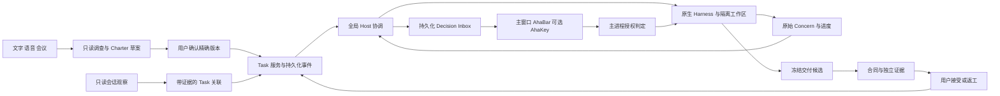

# AhaStudio 完整可运行版本开发计划

初稿：2026-10-04。复核更新：2026-10-19。状态：基于当前本地代码核查的开发建议，尚未进入产品实施。新增 [开工安排与验收证据](./08-r1-execution-readiness-2026-10-19.md)。

建议以 **AhaStation 0.18.4 现有 Electron 程序为基础，完成 AhaStudio 的完整本地软件闭环**：发现真实工作 → 自然表达或会议 → 确认任务边界 → 启动原生 Agent → 关键决策 → 验证证据 → 用户接受交付。当前主要工作是把已有模块连接成可靠的任务系统，并修复基线回归。首发支持 macOS Apple Silicon、Codex 和 Claude，AhaKey 可选；移动、同步和托管服务继续沿同一任务事实扩展。

本计划面向产品负责人、开发负责人和验收人员，给出范围、代码依据、架构增量、交付顺序和发布门。配套 [WBS](./07-runnable-release-wbs-2026-10.md) 包含 51 个工作包的责任角色、人日、依赖、接入点与完成标准，也提供 [CSV](./07-runnable-release-wbs-2026-10.csv)。其中 R1 完整本地软件为 35 项、132 基准人日，含 25% 预留为 165 人日。建议 3 名开发加半职 QA；2026-10-19 增加人员约束排程后，采用约 22 周的计划预算，G0 后重新估算。原 16 至 20 周仅保留为资源优化后的争取目标。

## 输入和代码基线

产品依据为 [竞品对标策略](../research/orca-paseo-multica-ahastudio-strategy-2026-10.md)、[共享产品语言](../../CONTEXT.md)、[现有技术方案](./05-technical-architecture.md) 和 [代码整合方案](./02-integration-plan.md)。竞品判断沿用提供的研究快照，本轮没有重新核实其最新版本、性能或市场数据。开发取舍以给定策略与当前源码为依据。

| 位置 | 核查事实 | 本计划的处理 |
| --- | --- | --- |
| 当前 Orca 工作目录 `https-github.com-ShawnyinsGit-ahastation-internal-3`（同名 internal-2 同样为空） | HEAD 为 `0139617` Initial commit，无已跟踪项目文件 | 不作为已有主程序；B01 将实际代码基线导入或建立正确 worktree |
| `/Users/heartline/Documents/Claude/AhaStation` | HEAD `bb765223e34cd2ca7c08052cd24b34e9f7bd84ac`，package 0.18.4，已有 Electron 主程序 | 本轮源码核查和隔离构建基线；本地 package-lock 有修改，需冻结和对账 |
| 同目录 `main-work` | HEAD `eae5b70`，有未提交 terminal adapter、调度及 UI 工作 | 单独保留并审查，不把它当已合并最新主线 |
| 同目录 `ahastudio` | HEAD `93f1ff0`，package 0.17.0，有大量未提交 UI 改造 | 作为可选择移植的设计资产，不替换较新主程序 |
| `/Users/heartline/Documents/Codex/ahakey-studio-community` | HEAD `16a553f`；Swift 配置器、BLE、语音和 VibeBar 库；有用户修改及未跟踪文档 | 产品文档与硬件资产来源；本计划写在其 `docs/ahastudio`，不覆盖原文档或代码 |

以上都是本地检出状态，不声称等于远端最新 main。旧技术文档的“已合并”和测试数反映当时状态；本计划只更新开发顺序建议，不擅自改写旧实施记录。后续执行以这里的验收门与 WBS 为建议基线，历史方案用于追溯。

### 2026-10-19 复核结果

源 SHA、package 版本与初稿相同。重新通过 `git archive HEAD` 取已跟踪文件，在独立临时目录复用现有 `node_modules`，Node 为 `v25.9.0`。类型检查和生产构建通过；默认测试 888 项中 871 通过、16 失败、1 跳过。仅在隔离目录补入被 `*.log` 忽略的两份 Kimi 样本后，定向运行 `observe-kimi.test.mjs`，14 项全部通过，其中包括原来失败的 4 项。其余 12 项仍待修复；本轮没有补样本后重跑完整套件，不能把 875/12 宣称为新的全量实测。

没有执行 `npm ci`，未验证真实 Worker、签名公证或非开发机安装，因此 G0 仍未通过。[当前证据摘要](./evidence/2026-10-19-baseline-audit.json) 保存命令、退出码、日志 hash、锁文件 hash 与 16 个失败项；原始日志只在临时目录，不能作为永久证据链接。后续正式验收需保存脱敏原始报告。

### 2026-10-04 历史实测结果

在临时隔离目录复制主程序已跟踪文件，复用其现有 `node_modules`，本机 Node 为 `v25.9.0`，执行类型检查、生产构建和默认测试；没有运行付费真实 Worker、创建日历或 IM 通知、打签名安装包，也没有改动运行中的应用。

| 检查 | 结果 | 能说明什么 |
| --- | --- | --- |
| `npm run typecheck` | Renderer 与 Electron 两侧通过 | 当前源码可通过现有类型检查 |
| `npm run build` | 通过，Vite 提示部分 chunk 超过 500 kB | 已能生成生产 JS；尚不能证明新机器安装与真实闭环稳定 |
| 仅复制已跟踪样本后 `npm test` | 888 项：871 通过、16 失败、1 跳过 | 干净文件检出存在失败；本轮没有重新 `npm ci` |
| 补齐本地全部 fixture 后 `npm test` | 888 项：875 通过、12 失败、1 跳过 | 其中 4 个额外失败来自缺失 fixture；仍有 12 个行为或契约不一致待诊断 |

发现两份 `tests/fixtures/observe/home/.kimi-code/.../logs/kimi-code.log` 在本地存在但被 Git 忽略。补齐后 4 个 Kimi 测试转绿，说明测试资料不闭合，需要入库脱敏 fixture 或运行时生成。其余失败集中在能力门、profile 持久化、多后端并行、事件 ID、计划归一化和授权决策。失败断言中也可能存在过时规格，B02/B03 必须先确定期望行为再修复；不可直接把 12 项都归因于同一个运行时 bug。

本轮验证复用了开发机依赖、没有完整 Git 历史，因此不是安装可复现性验收。G0 仍需使用 CI 对齐的 Node 22，从选定 SHA 完整检出、`npm ci` 后重跑，并确认跳过用例是否合理。原始日志所在临时目录仅用于本轮诊断，关键失败清单见本文末尾。

## 当前能力和产品缺口

“已有”表示源码中存在实现，除上节构建和测试外，不等于已经完成真实用户验收。

| 产品能力 | 代码依据 | 当前判断 | 要补的闭环 |
| --- | --- | --- | --- |
| 会话发现 | `electron/observe/observe-service.ts`、`statefiles`、`mapping.ts` | Claude、Codex CLI/Desktop、Kimi 有观察链路；Qoder 有 parser 资产，不能据此宣称完整接入 | 历史和活会话体验、兼容矩阵、准确率实测、格式漂移与自身排除 |
| 跨客户端任务事实 | `ObservedSession.id` 为客户端、原生会话 ID 和 cwd 的 hash；`TasksView` 聚合两来源 | Codex CLI/Desktop 同 thread 合并已有；这与不同 Harness 对同一用户任务的关联不同 | 稳定 Task ID、Session 与 Run 关联、置信度、证据、人工拆分与撤销 |
| 原生执行 | `backends/registry.ts`、Claude/Codex adapter、worker-scheduler | 多后端和执行能力声明已有；Codex 当前声明 executeTasks=true，旧文档的 Host-only 描述已过时 | 精确版本真实烟测；结构化 adapter 与 terminal adapter 分开评级；不要把“能 spawn”当 stable |
| 授权和上下文 | `task-authority.ts`、`task-context.ts`、`task-collaboration.ts` | TaskAuthorityGrant、ContextPackage、profile 等有 schema 和持久化接线 | Charter 统一入口、版本绑定、只读调查、预算及停止条件编译 |
| 全局 Host | `host-group.ts`、`orchestrator.ts`、`useCrossProjectTasks.ts` | 多 HostGroup 和跨项目任务列表已有，HostGroup 仍绑定具体会议与 cwd | 全局用户注意力所有权、跨项目协调与内部专家角色分离 |
| 异步消息和决策 | `task-mailbox.ts`、`decisions.ts`、`TaskMailboxPanel.tsx` | 任务邮箱可持久化；旧决策是 Markdown 文件和 Calendar/Reminders 侧通道 | 任务级统一 Decision Inbox、Concern 原文、阻塞语义、Attention Policy、重启恢复 |
| 预算自治 | `task-budget.ts`、worker-scheduler | 预算字段和暂停机制已有，但默认采用 UNLIMITED_TASK_BUDGET，直接跳过预算与非收敛判断 | 有限默认值、运行中计时与预留、用量未知处理、预算耗尽停止 |
| 批准表面 | permission-broker、`src/lib/risk-classify.ts`、approval-gesture、ApprovalCard、AhaBar | 批准 UI 和主进程策略分别实现，存在多处风险判断 | 主进程权威判定与版本化动作身份；所有表面一致；直接 IPC 不能绕过手势与权限 |
| 交付验证 | delivery-harness/verifier/candidate/reviewer/integrator | 有命令验证、候选冻结、协调审查和集成链路，值得复用 | Evaluation Contract 冻结与信任、证据 provenance、冲突升级、默认验证策略对齐 |
| 人工验收 | CommandDeliveryVerifier 对 manual 返回 manual-pending，整体可以 passed=true | 当前 passed 更接近“没有自动失败”，不能用它证明所有验收项通过 | 分开自动通过、待人工、不确定、用户接受；不能因此自动 loop 或 accepted |
| AhaTalk | `ipc/asr.ts`、xfyun-iat、asr-polish、useAsr | 当前主程序是讯飞 IAT；润色依赖 Anthropic 配置；旧文档的本地 whisper 不能当当前事实 | 恢复本地路径、provider 选择、BYOK、词库；语音目标进入 Charter |
| AhaMeet | meeting-tools、orchestrator、语音与恢复模块 | 会议编排与展示已有 | 明确提取“新增任务、既有任务变更、未决问题”，保留来源并确认变更 |
| 设备和服务 | community Swift BLE/协议；UpcomingSettingsPanel | 主程序账号、AhaTalk 三路径、设备配置、同步仍有“开发中”占位 | 设备服务统一安装；Sync、移动和 Cloud 另立里程碑 |
| 分发 | electron-builder、build-matrix、签名校验脚本 | 产品名/appId 仍是 AhaStation；CI 有多平台脚手架和未签名 macOS 打包 | AhaStudio 品牌和数据迁移、依赖闭包、签名公证、非开发机安装、开放资产梳理 |

## 完整可运行程序的范围

### R1 完整本地软件

用户不购买硬件、不注册 Aha 账号、不订阅 Pro，也能完成以下体验。AI 执行需要用户已有原生客户端及有效凭据；免费本地软件不代表模型调用免费。

1. 安装一个 AhaStudio 程序，完成只读发现，看到真实活会话和历史工作；空机器能主动创建任务，不依赖导入结果。
2. 用文字或本地中文语音表达目标。系统只读调查相关项目，生成可编辑 Charter，通常最多三个逐个询问的阻塞问题。
3. 确认该 Charter 的范围、预算和验收项后，Claude 或 Codex 在隔离工作区实际开工，用户可查看产物、停止、转向和继续。
4. 两个项目并行时只有一个用户注意力入口。Worker 问题归入同一 Inbox，AhaBar 展示当前最值得处理的项，风险动作正确确认。
5. 普通任务完成时给出产物和“是否验证”；用户明确指定的重要任务才进入已授权自动验证或自治流程。
6. 自动检查证据或待人工验收项清楚展示；用户接受或返工。接受交付与发布到远端是不同授权，不能自动 push。
7. 重启后恢复任务、决策与证据，不擅自恢复写操作；断网或服务不可用有明确状态。既有客户端数据和配置不被观察层修改。
8. 在未参与开发的 macOS 机器上，安装包能独立启动、引导、运行、验收和导出诊断。

默认 UI 为全局任务和待决定事项，项目为筛选维度。任务详情承载边界、进度、Diff、证据和接受入口；AhaMeet 和 AhaBar 都是同一任务系统的视图。保留已有终端、IDE 和浏览器用于深入查看。

### 后续版本和首发设备演示

| 版本 | 交付范围 | 发布前置 | 人日基准 |
| --- | --- | --- | ---: |
| R1 | 上述完整本地软件 | G0 至 G6 全通过 | 132 |
| R1H | AhaKey X1 语音、实体批准、屏幕灯效和配置接入统一安装 | H03 通过；若首发宣传硬件联动则与 R1 一起交付 | 11 |
| R2 | 可信移动网页、Decision Link、第一家 IM、语音补充、停止和低风险批准 | R1、身份与动作验证 | 17 |
| R3 | 开源本地 Sync Vault、Trusted Device、Recovery Kit、手动交接与租约；Windows/Linux 核心适配 | R1，单机证据和恢复稳定 | 32 |
| R4 | Recipe/Verifier 生态、AhaTalk Cloud、托管中继和商业服务；AhaStation 真机路线 | 对应 R2/R3/硬件前置通过 | 34 |

后续范围包含完整产品路线，**R1 不宣称已经交付 CONTEXT 中定义的全部未来软件能力**。本地同步、Recipe 和连接器依旧遵守完整社区能力的开放原则，不做 Pro 功能锁。R4 的 34 人日只是初步工程占位，未覆盖硬件设计制造、合规认证、服务规模化运营与采购等待；需立项后另做详细 WBS，不能当作完整商业化或量产预算。

R1 不以五家以上 Harness、原生手机终端、多人协作平台、自动跨主机迁移、订阅计费和硬件量产作为发布门。保留已有实验 adapter，但明确 observe/control/stable 等级，不承诺其与 Claude/Codex 等价。

## 架构增量和关键约束

保持 Electron、React、现有 backend 和 journal，不先迁 monorepo。新增模块先在 `electron/` 和 `src/` 内形成清楚边界。现有代码名保留兼容，再做必要的产品名与安装迁移。

### 一份任务事实的持久化边界

保留易失 `observed-store` 负责扫描结果。原始观察 tick 不进入 meeting journal。新增持久 Task 索引及关联事件保存“用户确认了哪些关系、哪个 Run 属于哪个任务、决策与交付是什么”；它可以从 journal 与关联事件重建，UI store 只是投影，不成为授权来源。先通过 repository facade 兼容现有 MeetingRepository，避免一次重写所有恢复逻辑。

建议新增或完善以下对象：Task、TaskCharterVersion、SessionAssociation、RunRecord、WorkerConcern、DecisionRecord、EvaluationContractVersion、EvidenceRecord、DeliveryAcceptance。Run 记录 nativeSessionId、attempt、backend/runtimeVersion、sourceRevision、Charter/合同 hash 和用量来源。Decision 记录 taskId、动作及参数 hash、Charter 版本、风险、到期时间、状态和解决来源。

不要把 cwd 相同当作任务相同。相同原生 thread ID 的 CLI/Desktop 证据可以合并；跨 Harness 有明确 Task 关联 token、已记录接续关系等强证据时关联；标题、路径和时间只构成建议。跨项目关系需用户确认。全部关联可解释、可撤销，合并不抹去原始会话。

### 授权和注意力

Charter 确认编译为现有 TaskAuthorityGrant、执行 profile、工作区策略、预算和验收合同。主进程校验后再启动。只读 Preflight 必须通过真实工具能力限制，而非单靠提示词；不安全或不支持的 adapter 不进入自动调查执行链。

统一主进程风险判定，前端只展示其结果。若仍保留 renderer 预览，可共享纯函数，但所有批准都在主进程重新验证 Decision/action identity。高风险详细确认保留原生防伪造保障。`off/read/all`、TaskAuthorityGrant 和新 Charter 权限的优先级须明确，旧全局 auto-approve 不能覆盖新任务边界。

旧 `decisions.ts` 文案要求 Host 先按推荐方案开展，再等用户修改。迁移时必须区分建议与阻塞：仅已经在 Operating Envelope 内的可逆工作可以继续；新授权、预算扩展、冲突和验收必须等待决定。文件、提醒或日历只做投影，推荐分数和超时不产生批准。Calendar/IM 为用户显式配置的通知渠道。

只有全局 Host 服务能向用户发布 Decision。Worker Concern 原文及证据不可变；Host 可以合并摘要，但安全、隐私、异常成本、权限越界、数据丢失风险和实质验证冲突必须升级。提醒调度处理紧急程度、关键路径、时段与限频，不改变批准状态。

### 验证和停止

复用 delivery-harness 的冻结候选、验证、审查与集成，将 Evaluation Contract 加上版本、hash、确切检查、证据规则、可信来源及人工项。普通任务不默认进入无限自动复核。Autonomous Loop 必须显式调用且有可靠合同和预算。

冻结合同应同时保护检查定义和检查来源：Worker 修改项目中的测试脚本后，不能仅因为同名命令退出 0 就判定通过。记录检查定义、相关脚本或基准 revision 的 hash，在独立验证工作区检验冻结候选；检查能力范围同样经过任务授权。模型审查可辅助，但不替代独立证据。

把“自动检查通过”“有待人工”“无法判断”“用户接受”分开存储。manual-pending 不允许推导为用户接受，验证冲突不能投票覆盖。达标停止；预算耗尽、未知用量超出预留、连续相同失败、合同变更都停止 loop 并产生明确状态。监控应覆盖活动 Run，而不仅在 attempt 结束后算账；总时间包含调查之后的执行、验证、排队和重试阶段，计时口径在 Charter 中可见。

预算初始建议作为可调产品参数：最多 3 次尝试、30 分钟、用户确认的 Token 或费用上限；这些不是已实测的最优值。适配器无法报告精确费用时，展示未知或估算并保守预留，不显示假精确余额。价格与提供商额度规则在实现时再核验，不能用本计划固定数字代替供应商数据。

### 语音和设备复用

主程序当前仅讯飞 ASR，应把现有链路包进 provider 契约，再补本地识别和用户自带凭据路径。本地模型按需下载、校验、可取消及恢复，用户明确选择处理路径。无麦克风或模型不可用时文字入口仍完整；不能自动转用收费云处理。润色服务解除 Anthropic 单一路径依赖，保留原始转写和用户词库。

AhaMeet 优先把会议作为任务输入与变更来源：会议产物显示新增任务、既有任务的范围或验收变化、仍待决定的事项；每条有时间片段依据。会议说出改变范围，不等于自动增加授权。

AhaKey 首先以 Swift 设备代码构成本地版本化服务，由一个进程拥有 BLE，通过明确 IPC 向任务表面提供事件和状态。设备不能直接按终端 Y/Enter 来证明批准；动作必须绑定当前 Decision 版本。高风险实体键只打开详细确认，断连回退 AhaBar。已有固件与配置器是复用资产，新的硬件批准语义仍需真机测试。

## 开发顺序与发布验收门

按可验证切片推进，前置不满足不进入下一发布门。语音 provider、安装工程与核心任务服务可独立开工，但完整验收依赖它们接入同一任务链。各门编号表示验收主题，不要求 G5 语音等到 G4 完成才写代码。

| 门 | 可运行结果 | 主要 WBS | 必须通过的验收 |
| --- | --- | --- | --- |
| G0 基线 | 一个可重复构建和测试的程序 | B01 至 B04 | 干净检出 npm ci；双 tsc、build、默认套件通过；跳过项解释；失败不靠减弱安全断言消除 |
| G1 任务事实 | 首屏真实任务和可解释关联 | T01 至 T05 | 观察零配置写入；同 cwd 不误合并；CLI/Desktop 去重；重启恢复关联；空态可新建 |
| G2 实际开工 | 文字目标经 Charter 启动 Claude/Codex | C01 至 C04、R01 至 R04 | 确认精确版本；两项目任务可并行；隔离工作区；停止转向恢复；能力降级诚实 |
| G3 可信决策 | Inbox 与 AhaBar 使用统一批准语义 | D01 至 D05 | Concern 保留；到期不批准；中高风险不可快捷绕过；预算耗尽停；应用退出待决策不丢失 |
| G4 证据交付 | 可以看到产物、验证并接受或返工 | V01 至 V04 | 合同冻结；人工项不伪装通过；冲突升级；达标停止；接受不含远端发布；脏工作区不丢数据 |
| G5 自然输入 | 本地中文语音和一次会议推进既有任务 | A01 至 A03 | 本地语音进入同一 Charter；否定词和数字正确；会议变更有依据且等待确认；无静默云回退 |
| G6 发布 | 新机器安装完成整条动线 | U01/U02、P01 至 P04 | 签名公证依赖完整；精确版本真实测试；故障恢复；外测通过；Apache 发布资产检查完成 |
| GH 设备 | 可选 AhaKey 现场闭环 | H01 至 H03 | 一键语音、正确风险批准、状态反馈、断连回退；高风险仍需详细确认 |

### 首个十个工作日

第一天确认源 SHA、锁文件、未提交资产和目标工作目录，完成 B01 的基线记录。第一周启动 B02 能力门诊断、B04 样本修复，Core 并行完成 T01 对象契约，Desktop 使用现有组件准备任务和 Charter 交互。第二周 Runtime 推进 B03，把未知 backend、授权持久化与多后端纵切作为优先修复；QA 用干净检出复核。

十天交付目标是 G0 和任务对象契约，不是十天实现全部产品。允许 T02/A01/P01 的独立工作先开始，但 G0 不通过不能对外宣传稳定闭环。B03 的实际根因和 adapter 真机版本漂移将决定后续排期。

## 人力和排期

R1 工作量按角色为 Core 39、Runtime 52、Desktop 30、QA 11 人日。建议三名开发分别负责 Core、Runtime、Desktop，QA 半职持续参与，产品与交互设计每周参加契约评审及体验验收。Device 可在 H01 开工时短期加入。这里的角色可以由同一人兼任，但兼任必须进入资源约束排期。

WBS 有向无环依赖已核验。忽略资源争用，按基准人日计算，R1 到 P04 的最长依赖链为 **68 个工作日**，约 14 周，这是没有预留、没有等待、无限可并行人员下的下界。2026-10-19 按上述角色配置、一人同时一个工作包、最早可开始时间优先且同时间按 WBS 行序排序，得到 **88 个工作日**的可执行排程示例；它不证明全局最优。加 25% 预留为 110 工作日，约 **22 周**。完整安排和计算口径见 [开工安排](./08-r1-execution-readiness-2026-10-19.md)，机器可读结果见 [WBS 校验记录](./evidence/2026-10-19-wbs-audit.json)。不能把 132 人日直接除以三个人，得出九周就发布的承诺。

| 相对开工时间 | 建议里程碑 | 用户能做什么 |
| --- | --- | --- |
| 第 1 至 2 周 | 基线和契约 | 能安装开发版、查看真实观察；测试回归关闭 |
| 第 3 至 5 周 | G1 | 全局任务事实、关联依据、历史与活会话，不宣称完整新任务执行闭环 |
| 第 6 至 10 周 | G2 内部 Alpha | 文字目标确认后实际启动原生 Agent；两项目隔离执行和停止恢复 |
| 第 11 至 13 周 | G3/G4、G5 集成 | 可信决策、有限预算、证据交付和自然输入进入同一链；G5 可提前研发 |
| 第 14 至 18 周 | G6 候选版 | 打包、真机矩阵、故障注入、外测与修复 |
| 第 19 至 22 周 | 预留和正式首发 | 所有验收门通过后发布；需要设备演示则 GH 同步通过 |

以上为建议区间，不是从今天起的承诺日期。16 至 20 周须有可核对的资源优化排程才能承诺。两名或单名开发的配置应按实际兼任角色重新排程，本轮不沿用初稿未加入人员约束的周数估计。AI 可辅助实现、fixture 和排障，但未有该团队实测吞吐前不扣减人日。可在 G2 内测后按实际吞吐压缩时间。

后续版本基准为 R1H 11、R2 17、R3 32、R4 34 人日；全部工作包合计 226 基准人日，统一加 25% 约 283 人日。后续估算置信度较低，尤其同步密钥恢复、三平台差异、托管服务和硬件；应在 R1 稳定后再次评估，不据此承诺全产品完成日期。

## 验收样例与发布质量

以下是建议发布阈值，尚未实测达到。验收记录应标机器、OS、原生 CLI 版本、应用 SHA、数据规模和时间，便于区分性能与功能问题。

| 场景 | 验收步骤 | 发布门槛 |
| --- | --- | --- |
| 首启发现 | 一台新测试用户环境，有 100 个历史样本和 4 个活会话；两原生客户端及多项目 | 30 次启动首个真实卡片 P95 ≤5 秒；测试集高置信度归并误判为 0；大规模历史异步加载 |
| 目标到开工 | 中文语音“给这个项目修复 X，并保持 Y，最多运行 Z 分钟”；确认 Charter | 20 条固定输入关键范围、否定和预算保留；通常 ≤3 阻塞问题；未确认不写项目 |
| 双 Harness | Claude、Codex 各 10 个公开样例任务，覆盖测试、构建和可复现 UI；两项目并行 | 所有关键 start/steer/interrupt/resume/permission/evidence 检查通过；接受率记录不由模型自判 |
| 可信批准 | 两端同时答复、批准过期、旧版本或参数被替换、直接调用 IPC | 不允许越权；同一决策最多一次生效；中高风险不能通过 AhaBar 或实体键跳过确认 |
| 验证和预算 | 改坏测试、人工项未完成、Verifier 冲突、Token 未报告、耗尽时间、重复失败 | 不误判 accepted；触顶停止新 attempt；活动进程终止或隔离且状态真实；证据可重放 |
| 恢复与数据 | 在执行、验证、待决定和集成中退出/杀进程；保留用户脏目录 | 重启不丢决策证据，不自动恢复写授权；无用户变更丢失；不重复启动 Worker |
| 会议闭环 | 一次中文会议改变已有任务、创建新任务并保留一个未决问题 | 三类结果可见且引用时间片段；范围改变须确认；两视图显示同一 Task |
| 非开发机安装 | macOS 最低拟支持版本与当前支持版本各一台 Apple Silicon 机器 | 无 Node 开发环境也可启动软件；缺 CLI/登录/模型可修复；本地流程无账号或订阅门槛 |
| 外测体验 | 5 至 10 位目标用户独立安装并复现样例 | 安装失败、误批准、数据丢失、错误验收、无法停止等发布阻塞为 0；其它问题有恢复路径 |

North Star 记录每周从自然表达或会议开始、最终被用户接受的有效交付数。另记录首次真实任务时间、归并误判、Charter 确认率、阻塞澄清数、每次有效交付打断数、Decision 响应、返工和 Token/时间来源。所有私有工作度量默认仅本地保存；用户选择贡献证据后才上传。先建立可用口径，不在发布门中虚构留存或转化目标。

## 风险与范围管理

| 风险 | 当前证据或原因 | 应对和触发条件 |
| --- | --- | --- |
| 代码基线分叉和未提交资产 | 当前 Orca 树为空，多个旧 worktree 有变更 | B01 冻结完整基线；资产逐项选择移植；不直接合并整个旧目录 |
| “能编译”被当成“稳定运行” | 类型与构建通过，但默认测试仍有失败 | G0 清零；稳定 Harness 必须有精确版本真实纵切证据；mock 只能证明局部契约 |
| 私有日志格式与 CLI 版本漂移 | 观察器及 runtime 合同依赖具体形状 | 容错 fixture、版本矩阵和 unknown 状态；不能保证长期无条件兼容 |
| 多处风险判断和 legacy auto-approve | renderer、approval-gesture、permission broker 分别存在 | D02 主进程统一；所有快捷路径都做同一身份和授权校验 |
| 评价合同被执行者影响 | 命令检查运行在项目环境，manual 被归为整体 passed | 冻结定义及来源；独立证据；人工项和冲突显式；不无限尝试直到偶然通过 |
| 用户批准过多 | 逐工具卡可能与任务级授权叠加 | Operating Envelope 编译；Host 合并 Concern；打断数按已接受交付记录并优化 |
| 本地 ASR 重新接入成本 | 当前主程序本地链路已不在所读源码中 | A01 前验证模型和目标机性能；保留文字闭环；本地语音仍是 R1 发布门 |
| 签名、权限和数据迁移 | 现有产品名 AhaStation，CI macOS 包未签名 | 提前做 P01/P02；保留旧数据读取；非开发机验收先于正式首发 |
| 开放许可与资产边界不一致 | community 已有 Apache LICENSE，主程序 README 写“待定”；仓库含固件和第三方资产 | 发布前确认权属和分发清单；开源本地程序不夹带闭源固件或未知授权素材；不自动改所有 LICENSE |
| 同步双写和恢复失败 | Execution Lease/Recovery Kit 尚需实现 | 放到 R3 真双机验收；网络分区拒绝双写；不宣称文件同步等于原生会话迁移 |

遇到延期，优先缩减长尾客户端、界面装饰、云托管与原生移动覆盖。不得用取消预算、跳过验证冲突、放宽跨项目误归并、隐藏风险或减少恢复验证来换发布时间。若团队必须更早首发，可先交 G2 Alpha 供内测，但对外清楚标为受限预览；不把它命名为完整 R1。

## 本轮失败清单与证据索引

补齐本地 fixture 后仍失败的 12 项如下，供 B02/B03 定位。这里列的是症状，不预判每项根因。

| 测试文件 | 失败主题 | 数量 |
| --- | --- | ---: |
| backend-capability-gates.test.mjs | 不可执行 backend 和未知 backend 未按断言拒绝 | 2 |
| backend-task-profile.test.mjs | profile 持久化先于 workspace/session 的调用链未完成 | 1 |
| collaboration-vertical-slice.test.mjs | Claude/Codex root Workers 未在预期时间内并行启动 | 1 |
| meeting-command.test.mjs | bounded validated plan | 1 |
| multi-backend-worker-smoke.test.mjs | 一个 meeting 并行启动四个 backend；renderer worker-eventId 与 journal 的一致性 | 2 |
| permission-approval-memory.test.mjs | 同根目录 peer 的任务级授权 addendum 扩展 | 1 |
| plan-task-profile.test.mjs | legacy plan 的保守授权归一化 | 1 |
| task-authority.test.mjs | canonical allow 持久化、重复拒绝终止、不同拒绝不累加耗尽 | 3 |

源码路径均相对于 `/Users/heartline/Documents/Claude/AhaStation`；Swift 路径相对于 community 仓库。初稿临时检查目录曾记录在 `/tmp/ahastudio-plan-audit-path`，2026-10-19 复核时该路径已不存在。请使用本次 [版本化证据摘要](./evidence/2026-10-19-baseline-audit.json) 追溯当前结果。G0 接手时应把重新验证的结果和脱敏日志作为新的版本化验收证据；临时文件不构成长期发布依据。
