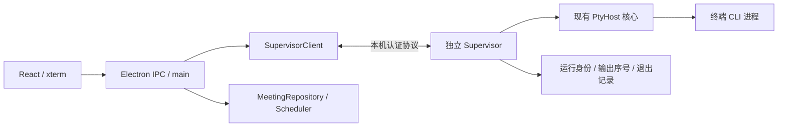

# PTY Supervisor 改造方案（待评审）

2026-10-23 更新：本地终端工作区优先按 [后续重构规划](2026-10-23-terminal-daemon-roadmap.md) 实施，不依赖 CLI 主持人阶段。本文保留早期备选与 Worker/task 绑定设计；本地关闭语义、屏幕快照及验收顺序以新规划为准。

日期：2026-10-17。依据：本地 `main` / `c134de2` 的源码静态核查。
本轮仅新增设计文档，没有安装依赖、启动真实 Agent 或运行存活测试。

后续以 [多 CLI 实施规划](2026-10-17-multi-cli-implementation-plan.md) 第三交付为准。本文件保留技术备选与风险分析，不要求提前实现全部机制或测试矩阵。

定位补充：本文件是终端生命周期子方案。对照桌面 Orca 源码后，多 CLI 同等任务能力还需通用 Worker 通信、完整代码报告和可靠输入门控，详见 [多 CLI 主方案](2026-10-17-orca-multi-cli-parity.md)。独立 supervisor 不能单独补齐这些能力。

## 目标与范围

让终端模式 Worker 在 AhaStation 界面重启或主进程意外退出后，仍可连接到原来的 CLI 进程，并正确归属原会议和任务 attempt。

首期覆盖 Claude/Codex/Kimi/Qoder 的 terminal backend。SDK backend、Pocket Vibe 远程任务的生命周期不在此改造范围。普通 shell 共用新的传输接口，但保留用户关闭终端即终止的产品语义，不自动成为后台任务。

边界：不保证操作系统重启、supervisor 崩溃后的原 PTY 存活；不增加 Agent 数量、自动信任 hook、工具级遥测或自动交付判定。已有任务审批、预算、审查和最终验收继续生效。

## 当前证据与评估修正

| 源码 | 已确认的行为 | 对方案的影响 |
|---|---|---|
| `electron/pty-host.ts` | main 内的单例持有 PTY、约 200 KiB 内存回放和监听器 | renderer 重挂载可以回放，main 重启不能凭此重连 |
| `electron/main.ts` | `window-all-closed` / `before-quit` 调用 `shutdownAllSlots()` | 正常退出会主动结束会议；不能仅修改 spawn |
| `electron/orchestrator.ts` | `end()` 结束 HostGroup 并写入 ended；另有 process exit 清理钩子 | 需要独立的断开客户端路径，覆盖所有退出入口 |
| `electron/backends/terminal-cli-adapter.ts` | `end()` kill PTY、删除 hook/config；`snapshot()` 返回 null | 必须保存会话绑定并区分 detach 与 terminate |
| `electron/worker-scheduler.ts` | dispose 调用 session.end 并释放 workspace 管理状态 | 后台存活的 attempt 不能进入现有终结流程 |
| `electron/ipc/worker-pty.ts`、`src/hooks/usePtyTerminal.ts` | 先订阅事件、返回 replay；事件没有序号 | 跨进程重连要定义回放与实时流的交接边界 |
| `electron/task-recovery.ts` | 未完成任务保守恢复为 interrupted，按权限决定后续动作 | live reattach 要与死会话恢复分开处理 |

附件中的“核心链路已有实现”有源码支持，但真实四家 CLI 并行、跨平台表现和所谓“70%”没有在本轮运行验证。正常退出主动终止可由源码确认；各种崩溃后的操作系统实际清理行为仍需实测。

“恢复都是重放”只适合描述当前 terminal backend 的缺口，其他 backend 已有 native session snapshot/resume 接口，不能一概而论。“增加一家约 100 行”也不包含登录、ready 门控、完成信号及平台回归的成本。

此外，Codex terminal 的 `read` 审批档映射到 `--full-auto`。这是本地映射名称，不是只读能力证明；本次不改变该映射。

## 建议结构

Supervisor 仅管理进程与传输。任务授权、调度、预算、审查和发布仍归会议层。避免为了终端存活再造一套业务调度器。

## ADR-002：独立本机 supervisor，而非仅把对象搬进普通子进程

状态：Proposed。

决策：每个应用数据目录至多一个 supervisor。main 通过可重新建立的本地 socket 通信；Windows 使用 named pipe，Unix 使用 domain socket。renderer 不直接连接 supervisor。

运行方式先做独立 `spawn` 原型，候选为打包 Electron 可执行文件的 Node 模式，避免依赖用户 PATH 上的 Node。入口须兼容打包资源路径、原生 PTY 模块及当前签名配置。不能只在开发环境证明可用。

Node 的 detached/unref 和独立 stdio 是原型起点，不是跨平台存活保证。Windows 还需验证 Job Object 的父子关联，且后台启动不得弹控制台。若打包应用被强杀仍连带终止 supervisor，再评估窄范围 native launcher；M0 失败时不先铺开业务改造。

替代方案：保留 main 内 PTY 无法满足目标；worker thread 不能获得独立进程寿命；Electron utilityProcess 不作为跨 main 生命周期的默认保证；首期不直接引入系统安装服务，以免增加权限、安装和升级成本。

代价：增加一个后台进程、版本握手和显式退出管理。supervisor 死亡仍会丢失其 PTY，首期接受这一限制。

## ADR-003：进程身份独立，写入只允许一个控制者

状态：Proposed。

运行记录最少保存：`schemaVersion / protocolVersion / supervisorInstanceId / terminalId / meetingId / hostId / taskId / attempt / workerId / backendId / canonicalCwd / pid / startedAt / dimensions / lifecycle / lastOutputSeq`。Host 终端允许没有 taskId；绑定必须明确区分角色。native CLI sessionId 若可获得则另存，不能替代 PTY 身份。

main 重启后的临时 sessionId 不作为进程主键。接管须同时核对 supervisor 实例、terminalId、会议、attempt、backend 和规范化 cwd；PID 仅作辅助，禁止按同目录或 PID 猜测接管。

每个终端只有一个可写 controller lease，带 generation；旧连接的 input/resize/kill 在接管后失效。lease 失效只撤销写权限，不杀 CLI。普通只读订阅与控制权分开。

本机握手验证协议版本和随机凭证，限制 pipe/socket 与凭证文件的当前用户访问。凭证不通过 renderer、命令行参数或日志暴露。请求需限长、校验归属，并防止未认证连接触发进程操作。此机制不声称能抵御同一用户账户下的恶意进程。

运行台账不落完整 env、API key 或原始提示词；env 仅启动时在认证连接上传递并驻留所需内存。会议 journal 仍是任务业务状态的权威；supervisor 的 live list 是进程状态的权威。

## ADR-004：detach 不终结任务，reattach 不重新发 prompt

状态：Proposed。

拆开生命周期：

- `detachClient`：停 main 本地 watcher、timer、订阅和控制 lease；保留 PTY、worktree、hook 文件及其配置，不写 ended、不终结 attempt。
- `terminateTerminal`：明确停止指定进程及其自有后代，确认退出后释放 hook/config；保留任务证据和原有失败恢复规则。
- `endMeeting`：继续执行会议层的显式结束流程，终止所属终端。应用退出不再复用它表示“只断开界面”。

产品语义：有活跃终端时，“退出界面并保留任务”与“结束任务并退出”是两个明确动作；首期沿用停止任务的普通退出默认值，保留任务是用户选择。用户选定保留后，记录意图再断开，不能被后续 window-all-closed、before-quit 或 process exit 钩子反向终止。

意外断连时，已授权且已在运行的终端可继续；界面必须在启动任务前说明后台存活行为。断连不允许调度新任务、自动回复权限或自动发布。已有 CLI 原生审批档不会因界面退出自动收紧；后台 TUI 可继续在其既有权限内执行，不把它描述为已暂停。

恢复时按以下顺序处理：

1. 连接并认证既有 supervisor，验证实例及协议，取得 live/exited 终端列表。
2. 读取 durable meeting/task 绑定，对 live terminal 进行身份核对。
3. 创建 attach 型 session，恢复当前 attempt 和 workspace 管理关系，不调用原 `start()` 截断事件文件，不走 spawn、ready 定时器或首次 prompt 注入。
4. 恢复输出、hook/transcript 游标和控制权。Worker 显示“已重连”，重新核对完成提示；完成仍由用户确认并走原交付管线。
5. supervisor 明确报告已退出的会话进入现有恢复流程；连接暂不可用显示“连接状态未知”，不能自动启动替代 CLI。

pending 输入默认不自动重放。spawn 使用稳定 requestId/terminalId 去重；响应丢失先查询结果。stdin 写入 ACK 丢失时无法证明 CLI 是否执行，标记结果未知，禁止自动重发。即使有 requestId，也不宣称任意崩溃窗口下副作用 exactly-once。

## 传输、输出与 hook

建议最小协议：`hello / list / spawn / attach / detach / input / resize / terminate`；事件为 `output / exit / connection-state`。以现有 PtyHost 为 supervisor 内核，抽出异步 `PtyClient` 接口，迁移 terminal adapter、worker IPC 和 shell IPC；不伪装成原来的同步远程调用。

每个输出帧携带 terminalId 和单调 seq。attach 原子取得回放快照与 high-water seq H，实时流只发送 H 之后的帧；renderer 必须先缓存后续帧，再安装回放并去重。必须一并覆盖退出与 attach 竞态、慢客户端和背压。慢客户端允许断开重连，不能阻塞 CLI 输出或无限占内存。

首期保留有界内存回放，由 supervisor 持有；台账不承诺完整终端日志。客户端游标早于 buffer 起点时返回 gap。环形字节回放不能保证完整 TUI 屏幕状态，界面要提示历史截断；精确屏幕快照另作后续需求。

hook/config 的生命周期跟随 terminal，不能跟随 main 的 session 对象。先保留 CLI 继续向原文件 append 的实现，main 重连后重新挂 watcher，恢复持久化字节游标。事件以 terminal/attempt 和稳定 eventId 去重；若现有事件缺少身份则补字段。游标只在相应会议事件持久化后推进，重复消费不可产生第二次交付、预算结算或完成动作。

跨 main 的 transcript 文件归属也需持久绑定，不能再仅依靠进程内 static Map。无法验证归属或游标时，允许显示终端并标记业务状态待核对，不猜测完成、不自动注入恢复提示词。

## 实施分段与停止条件

| 阶段 | 交付 | 进入下一阶段的证据 |
|---|---|---|
| M0 存活原型 | 独立 supervisor、真实 PTY、认证连接、最小 attach/terminate | 无付费模型；开发与打包应用中主动退出/强杀 main 后，原 PTY PID 和持续计数器仍存活；重连可输入；无额外窗口；显式停止后自有后代全退出 |
| M1 进程与输出协议 | 异步 client、单实例启动锁、身份台账、序号回放、终态记录 | 并发启动只有一个 supervisor；spawn ACK 丢失不重复启动；回放/实时流无重复遗漏；认证与旧 lease 拒绝；不影响其他终端 |
| M2 接入产品 | terminal adapter、scheduler/orchestrator detach/attach、UI 重连与退出选项 | 活跃 attempt/worktree 不被终结；hook 不截断不删除；重连不 spawn、不重新注入 prompt；shell 保持关闭即终止 |
| M3 回归与发布验证 | 多终端、hook/transcript 游标、版本不兼容与安装包验证 | 完成以下验收矩阵，并记录平台、应用/CLI 版本和真实运行证据 |

M0 不过就停在启动/生存机制；M1 不过不接任务；M2 只完成屏幕显示而不能接管同一 attempt 时，不报告“会话恢复已完成”。各阶段实现可以保留旧模式用于新会话选择，但不能用旧模式接管仍活着的 supervisor 会话。

## 验收矩阵

- 区分 renderer reload、保留任务退出、结束任务退出、main 强杀、supervisor 强杀、OS 重启。只对前四者中设计允许的存活情形承诺原进程重连。
- 至少四个无模型 PTY 并行；退出界面期间继续输出，重连各自 pid/terminalId/attempt 不变，输入和 resize 不串台。
- Windows 中文/空格路径、`.cmd` shim、ConPTY、无弹窗；macOS/Linux 在各自原生环境运行同类测试，不能用编译代替。
- attach 时突发输出、输出超 buffer、终端恰好退出、旧客户端迟到输入、控制 ACK 丢失；验证没有重复 spawn 和隐式重放。
- hook 在 main 不在时完成一轮；重连只补一次业务事件，仍等待人工确认；损坏记录、未知进程与身份不符均拒绝自动接管。
- 所有后台输出继续有界；supervisor 没有连接时仍读 PTY，日志轮转；最后一个终端退出且无连接后，经宽限期可回收空 supervisor。
- 协议不兼容不强杀旧 supervisor，不创建会接管同一组任务的第二实例；提示结束或保留旧终端后再升级。运行路径被更新/删除的影响需覆盖打包测试。
- 显式结束终端/会议后确认自有进程树退出，只清理其自有文件，不删除用户 worktree 或任务证据。
- 完成双侧 `npm run typecheck`、相关协议/退出/恢复测试，再跑项目要求的 `npm test`；真实 CLI 冒烟单独记录，付费模型调用需已有相应授权。

## 参考与待验证项

- [Node child_process detached](https://nodejs.org/api/child_process.html#optionsdetached)：独立进程、stdio 与 unref 的要求。
- [Windows Job Objects](https://learn.microsoft.com/en-us/windows/win32/procthread/job-objects)：父子关联、breakaway 与终止语义。
- [Electron utilityProcess](https://www.electronjs.org/docs/latest/api/utility-process)：另一种运行方式的接口，不能据此推导跨 main 存活保证。

尚未验证：当前打包 Electron 的 Node 模式、原生 PTY 加载和 Windows Job 链下的真实生存行为。这些是 M0 的结果，不是本设计已解决的事实。
