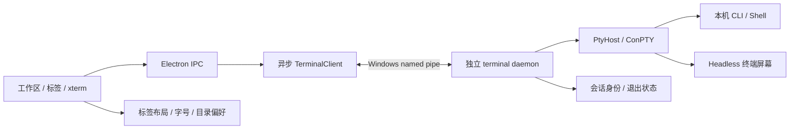

# Orca 方式的本地终端后续重构

日期：2026-10-23。状态：D0 功能离线验收、D1 Windows 可行性关卡及复核修复已完成；新增 V1 视觉交付，优先于 D2；V1、D2–D5 未实施。工程验证不代表已达到 Orca 的视觉效果或通过用户产品验收。

## 目标与基线

最终体验：点加号选择本机 CLI 或 shell；原生终端接收键盘、中文和粘贴；切换标签保持屏幕、光标和滚动位置；退出界面或主进程崩溃后，已运行的终端仍在；重新打开应用接回同一个进程；明确关闭终端才结束其进程树。

视觉目标以用户 2026-10-23 提供的四张 Orca 截图为准：紧凑浅色工作区、项目/目录导航、贴近标签的加号菜单、带 CLI 图标的列表、白底原生终端、协调的字体与 ANSI 颜色。此前把“保持 CLI 原生”理解为使用 xterm 默认深色外观不准确；原生指 CLI 的内容、布局、控制序列和交互仍由 CLI 决定，终端宿主负责主题与字形。D0 的功能完成记录保留，不能据此宣称视觉完成。

基线：`C:/Users/JHJ/Desktop/ahastation-internal1`，分支 `codex/multi-cli-phase1`，HEAD `c134de22efed4fbf17bb5af1c727f6f7c36a15f6` **加当前未提交改动**。不能从 HEAD 单独重建后覆盖当前开发。保留 `.workbuddy-ai/`、性能审计文件及其他任务修改；不批量暂存。

起点已接入 `LocalTerminalSessions`、renderer `TerminalSession`/store、Unicode11、输出序号及本地 CLI 启动。上一轮双端类型检查、构建和 16 项定向测试是历史记录；D0、D1 的新验证见文末。复杂字符与完整 CLI 输入兼容仍留在 D3/D4。生产工作区进程仍属于 main；D1 daemon 仅供隔离测试客户端使用。

范围是用户确认的**本地终端工作区整条链路**。不把这次需求扩大成多 Agent 调度重写。SDK 后端、Pocket Vibe、远程 SSH/WSL、移动端暂不迁移；普通文件夹和 Git 项目都支持。

本文件是后续本地终端实施入口；它取代旧 supervisor 文档中“必须先完成 CLI 主持人再做 daemon”的本地终端依赖顺序。旧方案中的 Worker/task 恢复仍保留为独立后续工作。

## Orca 源码依据

参考目录为 `C:/Users/JHJ/Desktop/orca`，只读比较，不修改其仓库。

| 源码 | 已确认的机制 | 本项目采用方式 |
|---|---|---|
| `src/renderer/src/components/Terminal.tsx`、`use-terminal-controller.ts`、`lib/pane-manager/pane-dom-creation.ts` | 界面、控制器、终端实例分工 | 保留现有会话管理器，补齐控制器和薄界面 |
| `src/main/daemon/daemon-hello-protocol.ts` | 凭证、协议版本和 daemon 实例身份 | 小型本地协议，显式握手与实例校验 |
| `src/main/daemon/daemon-host-relocation.ts` | Windows host 放在安装目录外，避免更新时被清理 | 最后落实到打包产物，不能只测开发命令 |
| `src/main/daemon/headless-emulator.ts`、`daemon-pty-buffer-snapshots.ts` | headless xterm、屏幕序列化、输出序号、终端模式 | daemon 持有权威屏幕，重连恢复快照再接增量 |
| `src/renderer/src/components/terminal-pane/pty-connection/reattach-live-data-deferral.ts` | 重连期间暂存输出，快照后才应用新输出 | 有界队列和连接代次，拒绝旧连接事件 |
| `src/shared/terminal-unicode-provider.ts` | Unicode11 之外处理 ZWJ 组合字宽 | renderer/headless 使用一致的字宽策略 |
| `src/renderer/src/components/terminal-pane/terminal-bracketed-paste.ts` | bracketed paste、换行和 Windows 输入差异 | 原生模式优先，确有证据时加 CLI 专属适配 |

采用相同的核心架构，不照搬 Orca 面向远程、多端和历史兼容的全部模块。引用实质源码时保留其 MIT 版权声明，并记录来源；优先迁移机制和少量必要实现。

## 架构与职责



- daemon 是进程、退出状态、屏幕和输出序号的权威；main 是认证客户端和 UI 桥接层；renderer 管布局、显示和当前输入。浏览器不能直接连接 daemon。
- 复用 `pty-host.ts` 的 Windows 启动修复。将 `local-terminal-sessions.ts` 的进程职责移入 daemon，而非再维护一套同用途服务。
- daemon 模块不得依赖 `electron.app`、IPC 或会议设置：当前 `mergedSubprocessEnv`、`ipc/ide-pty` 依赖需解耦。本机 CLI 环境由启动配置层生成；纯输入限额逻辑按需要提取。Worker 在原路径，避免间接迁移。
- 新增文件按职责控制在 `electron/terminal-daemon/{entry,protocol,client,launcher,sessions,screen}.ts` 一组；具体拆分服从代码规模。不要机械复制 Orca 的文件数量。

## 持久化和协议决策

**身份与存储。** 使用稳定 terminal UUID；daemon 启动生成 instanceId。pid、启动时间、实例与 terminalId 一起校验，不能只按 pid 或目录接管。利用现有应用数据目录存放小型版本化 JSON 元数据，原子替换；不新增数据库。保存启动标签、初始 cwd、CLI/shell profile、退出记录和 UI 布局。环境与凭证不落会话清单，完整输出默认不落盘。磁盘记录只用于发现，连接到 daemon 后的 inventory 决定是否仍存活。

**传输。** Windows named pipe；跨平台适配口使用 Unix socket，但 Windows 先验收。协议包含 `hello/list/spawn/attach/detach/input/resize/terminate` 及 output/exit 事件。按用户数据目录唯一启动，处理两客户端同时启动的竞争。使用随机本地凭证、当前用户访问控制、协议版本与能力协商；限制帧/队列大小，凭证不进入 renderer、命令行或日志。

**操作。** `spawn` 用稳定 requestId 去重，并拒绝同 ID 不同参数；响应丢失先查询。`terminate` 可重复查询结果，不能仅凭调用 kill 就显示已结束。输入 ACK 丢失不自动重发，显示断连；输入不是可承诺 exactly-once 的事务。连接不明时不生成替代 CLI。单可写客户端带连接代次，接管后旧客户端不能写入或关闭终端。

**屏幕。** 初次挂载/重连获取包含输出水位 H 的快照，之后只消费 H 之后的数据；快照必须等对应 headless 写入解析完成。按原尺寸恢复屏幕，再应用新尺寸及增量，排队 resize/输出顺序。保留主/备用屏幕、光标、颜色、滚动区、粘贴/鼠标/键盘模式与未完成转义序列。缓冲溢出时重新取快照，不静默丢字节或无限增长。

**终端查询回复。** headless 与 renderer 不能双重回答 CLI 的设备/颜色/光标查询。制定单一回复归属，保证 UI 离线时仍可应答；快照重放禁止向 PTY 发送查询回复。用伪终端查询样例验证，避免重连产生额外输入。

**关闭语义（建议产品行为）。** 关闭标签=终止该会话；返回首页、关闭窗口、选择“保留终端并退出”=detach；另外提供“结束全部终端并退出”。在出口明确说明后台仍运行，沿用 CLI 已授予的权限；界面退出不等于暂停模型。没有会话时 daemon 空闲退出。主进程重启不创建任务、不重发提示词。

**能力边界。** 承诺跨 UI/main 重启，依赖 daemon 仍存活。系统重启、daemon 崩溃、整棵进程树被外部强杀不保证保活；恢复时如实标记终端已丢失，CLI 自身的 resume 只能由用户显式启动为新进程。

## 分阶段交付

### D0：收口当前工作区（前置）

完成搜索式加号菜单、PowerShell/CMD/Git Bash 选择及目录快照；接通已有 `listShells` 和 `shellId` 全链路。标签显示启动/运行/退出/错误状态，接入字号设置、键盘切换和关闭。UI 不强制 CLI 主题，不注入模型任务。

检查 `TerminalSession.connect/close` 竞争：关闭后 connect 不能恢复为可输入；失败 create 清理订阅与队列；主进程停止只由一个关闭路径执行；`stageWindowStore` 不再重复 kill。重连缓冲设上限。统一“用户键入”和终端自动应答的生命周期，不能在 CLI 启动握手时遗漏回复。

落点：`src/lib/terminal-session*.ts`、`ShellTerminal.tsx`、`StageTabBar.tsx`、`LocalTerminalWorkspace.tsx`、`stage-window-store.ts`、`electron/local-cli.ts`。

验收：两个离线 PTY 标签切换/返回再进入，进程和 xterm 实例不变，后台输出持续；关闭创建中的标签不留进程；已退出标签不自动复活。检查不同窗口尺寸下中文、光标、滚动、错误提示。通过才将现有重构标为完成。

### D1：独立 daemon 的 Windows 可行性关卡

提取纯 PTY 服务，以随应用打包的运行时启动后台 daemon，不依赖用户 PATH 中的 Node；开发态入口与打包态资源路径分别验证。入口使用异步 client，禁止伪装成原同步方法。先只让隔离测试客户端使用，不切业务。

检查 Electron Node 模式、detached/unref、stdio、Windows Job Object 和 ConPTY 归属；`detached: true` 不是存活证据。显式停止要清理该终端拥有的后代，不能按命令名扫描杀进程。若普通启动方式不足，只补必要的 Windows launcher/进程树处理。

验收：在独立测试数据目录启动两个无模型会话，记下实例、terminalId、pid；先正常退出测试 main，再只强杀测试 main；daemon 与两个 PTY 不变，第二客户端可读写/resize；停止一个不影响另一个，全部停止后无自有残留。至少在 Windows 解包应用上证明一次原生模块可加载。未通过就修启动层，不向上铺开恢复 UI。

### V1：按 Orca 参考图完成可见体验（新增，下一交付）

目标是用户能直接看到并使用的终端工作区。先完成 V1，再进入 D2，避免继续推进底层而留下粗糙外观。此阶段不迁移 daemon，也不修改 Worker 调度。

**布局与菜单：** 采用参考图的浅灰侧栏、紧凑顶栏/标签栏、细分隔线、平铺终端内容和窄底栏；收掉当前大标题、过大的边距和圆角终端卡片。加号跟随标签排列，菜单在视口内展开，提供搜索、Shell/CLI 分组、准确图标、键盘焦点和状态反馈。仅展示实际可用项目，不添加无功能的浏览器、自动化、额度或移动端占位项。

**项目导航：** 复用已有目录选择和标签状态，以真实目录分组展示本地终端，支持选择目录、新开终端和切回已有标签。持久化最近目录偏好，不自动扫描整盘、不新增 Git worktree 管理器；侧栏中的运行/退出状态来自实际会话。不要伪造 Orca 的任务完成/忙闲信号。

**浅色原生渲染：** 集中配置终端背景、默认前景、ANSI 16 色、光标、选择颜色和等宽字体，浅色作为该工作区默认主题，提供深色选择。对照 Orca 的实际主题/字体配置确定参数，验证 Windows 缩放和中文回退字形。保留 CLI 显式 RGB/256 色及原始 ANSI 语义，不把输出解析重画为 HTML 聊天，不靠 CSS 滤镜、强行加粗或全局对比度重映射伪造效果。

**颜色协商：** 核查 TERM/COLORTERM、背景查询和 CLI 自己的浅色/深色选项，确保宿主宣称的颜色与实际画布一致。已有用户主题和 NO_COLOR 等明确偏好优先，不静默改全局配置或删除变量。某 CLI 需要本身切换主题时明确记录和提示；不能承诺所有 CLI 仅换宿主底色即可自动匹配。代码/diff 的语义着色由 CLI 输出，颜色准确与可读性由实际画面验证。

**落点：** `LocalTerminalWorkspace.tsx`、`StageTabBar.tsx`、`styles.css`、`terminal-session.ts`/store，必要的目录状态及小型终端外观配置模块。复用已接通功能，先拆清样式和显示职责，不复制 Orca 全部产品功能。

**验收必须包含真实应用画面：**

1. 记录运行版本、构建时间、窗口尺寸、系统缩放和 CLI 版本，确认查看的是本轮构建。不得为加载新版强行结束用户现有终端。
2. 在实际 Electron 工作区检查加号菜单、空白页、多标签、目录分组、错误/退出状态，保存与参考图对应的截图；正常尺寸和较窄窗口均无裁切，菜单不越界，终端占主要空间。
3. 使用本机 Codex、Claude、Qoder 的启动/空闲页验证实际原生渲染，至少完成 Codex 与另一种 CLI 的对照。仅启动界面，不提交真实模型任务；受登录阻塞则记录为未验收，不能用模拟界面代替通过。
4. 用离线 ANSI 样例或可获得的脱敏真实 CLI 输出验证中文、代码、红绿 diff、选择和滚动。注明其为回放证据；未验证的模型生成内容不能宣称完成。菜单、启动页与输出页三类截图一起交付，不能只有空白启动页。
5. 功能、视觉、真实 CLI 兼容分别列结论与差异。双端类型检查和构建必做，测试限定相关路径；视觉微调不增加复述 CSS 的测试。展示真实截图供用户判断，不以“测试通过”代替“达到参考效果”。

未覆盖的分屏、拖动排序、任务标题自动命名等作为明确差异记录，不能暗示已具备；它们不阻塞本轮已确定的布局、菜单和原生浅色显示目标。

### D2：接入本地工作区并恢复同一会话

`shell-pty` 改用异步 daemon client；保留 IPC 外观，添加 inventory/attach，区分创建与连接。应用启动先连接旧 daemon，再恢复标签，不通过重建标签触发 spawn。持久化 UI 布局与必要身份；断连显示“正在重连/状态未知”，屏蔽输入并允许用户查看状态。

修改本地终端的 `webContents.destroyed` 清理为 detach。逐项检查 `main.ts` 的窗口关闭、before-quit、异常退出：保留本地会话不得被旧清理路径反向 kill。会议 Worker 的关闭语义不随之改变。只保留原有已运行 CLI，不在后台新增调度。

验收：3 个会话分别持续输出、等待输入、已经退出；renderer reload、正常保留退出、main 强杀后重新打开应用都恢复正确归属。运行会话 pid 不变、spawn 次数不增；退出标签不复活；恢复期间新增输出和退出不丢失；用户关闭时终止回执与进程实况一致。

### D3：屏幕恢复与渲染兼容

daemon 引入与 renderer 兼容版本的 `@xterm/headless`/serialize，统一 Unicode provider。将当前字节尾部回放升级为屏幕快照与增量；旧尾部仅作诊断，不作为精确恢复证据。完成上述快照水位、终端查询回复归属和尺寸顺序。

覆盖中文双宽、组合字符、ZWJ emoji、ANSI 16/256/truecolor、反色/背景、备用屏幕、清屏、滚动和窗口缩放。优先使用稳定公共 API；对 Orca 使用 xterm 私有接口的修复，先用本项目依赖版本复现再决定移植，集中封装并固定兼容版本。

WebGL 作为可选加速，失败或 context lost 时退回 DOM；不能把加速作为正确性的前提。控制后台标签刷新和输出批处理，限制慢客户端队列。快照/回放不改写成应用聊天内容。

验收：无模型 ANSI/TUI 样例在重连前后对比 cell 内容、字宽、光标、屏幕模式与截图；恢复期间连续输出仍按序。四个标签持续输出时界面能输入、切换，队列不随运行时间无限增加；超限后可明确重新同步。失败样例作为回归，不新增大规模性能框架。

### D4：输入兼容与真实 CLI 空闲界面验收

按 native xterm 路径处理普通输入；CLI profile 只保存有证据的差异。统一输入分发，避免按键和 paste 双重提交。处理 IME composition、Enter/Shift+Enter/Ctrl+Enter、Ctrl+C、复制粘贴、Alt/AltGr、选区、CRLF 和 bracketed paste。菜单快捷键不能抢 CLI 正常按键。

大段粘贴先检查可接受容量，不允许 limiter 静默截断半个 paste；有序分块须保持粘贴边界，断连不自动补发未确认内容。不通过计时器自动补 Enter。IME 确认候选不能同时发送任务。登录和信任弹窗交给用户。

验收先用记录输入字节/按键的离线 PTY；再对本机 Codex、Claude、Qoder，Kimi 可用时加入，检查原生启动与无提交输入。中文组合只提交一次，多行粘贴不误执行，Ctrl+C/复制含义符合当前上下文。真实模型任务仍遵守此前“另行安排”的边界；未做的 CLI/组合明确列为未验收。

### D5：Windows 打包、更新与交付收口

daemon host 放在 `%LOCALAPPDATA%` 下本应用拥有的版本化 runtime 目录，包含入口、必要依赖和 ConPTY 原生文件；验证来源指纹，不覆盖正在使用的运行时。build 输出清理不能删除活跃 daemon 的代码。旧 runtime 只有确认无人使用才清理。

新 main 对旧 daemon 先协商兼容；不兼容时保留活跃会话和旧 host，给出需结束后升级的说明，不能悄悄杀进程或再建同一会话。不做跨版本 PTY 热迁移。按实际 installer 行为验证安装目录替换不会连带终止已迁出的 host。

验收以 Windows x64 解包版及本地安装测试为主；测试数据隔离，升级实验不覆盖用户现用安装。无系统 Node 依赖、中文/空格安装路径、应用重启、实例重复启动、旧版本连接和显式停止均可用。仅在实际通过后声明对应平台/架构；macOS/Linux 保留接口但另行实机验收。打包检查不等于发布授权。

## 后续接 Worker 的边界

本地工作区 D0–D5 完成后，再决定迁移 `terminal-cli-adapter.ts`/Worker。迁移必须一并恢复 task/attempt、worktree、hook/config、Worker CLI 桥地址与报告回执；daemon 仍不接管任务调度。不能仅让 Worker 进程存活就宣称任务系统恢复。旧 `2026-10-17-pty-supervisor-design.md` 的业务绑定章节继续作为该阶段依据。

## 验证方式与交付记录

每阶段记录实际修改路径、运行命令、证据与未覆盖项。当前现成命令：

```powershell
npm.cmd run typecheck
npm.cmd run build
node --test --test-timeout=120000 --import "data:text/javascript,import { register } from 'node:module'; import { pathToFileURL } from 'node:url'; register('./tests/electron-stub.mjs', pathToFileURL('./'));" tests/local-cli.test.mjs tests/shell-pty.test.mjs tests/pty-host.test.mjs tests/windows-cli-launch.test.mjs
```

已有 D0/D1 测试和证据见文末；V1 真实应用视觉、D3 快照与 D4 输入兼容测试在对应阶段补齐，不预先报告通过。定向检查通过后仅在共享生命周期改动、失败或未解决问题需要时扩大测试。真实窗口/模型验收与离线证据分开；不重复跑全量来替代实际重连验证。

开发顺序：D0 → D1（已完成及修复）→ **V1 参考图视觉交付** → D2 → D3 → D4 → D5。V1 完成可见体验，D2 证明进程重连，D3/D4 补齐屏幕恢复及输入兼容，D5 验收 Windows 打包产品能力。本次仅调整规划，未实施 V1，不提交、不发布、不调用模型。

### D0 交付记录（2026-10-23）

实际基线仍为 `codex/multi-cli-phase1` / `c134de22efed4fbf17bb5af1c727f6f7c36a15f6` 加交接时混合未提交实现。在现有文件上续作，保留其他任务修改；没有暂存、提交、推送或发布。

实际改动：

- `StageTabBar.tsx`：搜索 CLI / shell，调用已有 `listShells`，显示启动、运行、退出、关闭和错误状态。`shell-pty.ts` / `types.ts` 为 shell 列表补充用户目录，创建时把目录值与 shellId 一起固定在标签上；`stage-window-store.ts`、`ShellTerminal.tsx`、`ScreenStage.tsx` 接通 shellId，不因之后选择目录而改变已有会话。
- `LocalTerminalWorkspace.tsx` / `styles.css`：10–24 字号设置影响所有会话并保存在现有字号键；Ctrl+Shift+PgUp/PgDn 切换，Ctrl+Shift+W 关闭。快捷键在工作区捕获，避免同时发送给 CLI；搜索框和目录对话框保留自己的按键。
- `terminal-session.ts`：关闭请求独立于显示状态，create 完成或 exit 事件不能重新开放输入。关闭失败保留标签、显示错误、禁止输入并允许重试；返回页面仍能显示原终端。create 失败释放输出/退出订阅与队列；创建期间输出最多 1 MiB base64 / 4096 个事件，超限明确显示错误并要求关闭重开，不静默丢弃后继续运行。先设定可输入生命周期再解析初始输出，使自动查询回复与用户输入使用相同通道。
- `stage-window-store.ts` 删除额外的直接 kill，renderer 会话成为唯一标签关闭 owner。`local-terminal-sessions.ts` / `pty-host.ts` 为本地标签启用严格 kill 错误传播，失败时保留主进程中的所有权和订阅；其他调用者维持原有 kill 行为。
- 新增 `tests/terminal-session.test.mjs`；扩展 `tests/local-cli.test.mjs`、`tests/pty-host.test.mjs`。没有改 Worker、SDK、Pocket Vibe 或 Orca 源码。

本轮验证：

1. `npm.cmd run typecheck`：renderer、Electron 均通过。`npm.cmd run build` 通过；Vite 保留现有大 chunk 提示。
2. 下列定向回归 **25/25 通过**，包含关闭竞争、失败 create、关闭失败重试、输出上限、初始查询回复、sequence 交接、shell 路由、单标签隔离及 Windows 原生 ConPTY launcher：

   ```powershell
   node --test --test-timeout=120000 --import "data:text/javascript,import { register } from 'node:module'; import { pathToFileURL } from 'node:url'; register('./tests/electron-stub.mjs', pathToFileURL('./'));" tests/local-cli.test.mjs tests/shell-pty.test.mjs tests/pty-host.test.mjs tests/windows-cli-launch.test.mjs tests/terminal-session.test.mjs
   ```

3. Playwright + 本机缓存 Chromium，`http://127.0.0.1:5284/__d0.html`，1440×1000 / 900×650。临时页面挂载真实 `LocalTerminalWorkspace`、store、xterm、IPC handler 和 `PtyHost`；用测试 binding 替代 Electron preload 传输，独立 CMD/ConPTY 运行本地无模型 Node 探针。两个会话从不同中文/空格目录启动；切标签、返回模拟首页再进入，实际 shell / 探针 PID、xterm 与 DOM 实例不变，无新增 spawn，后台输出继续；暂停探针后比较全部 cell 文本、光标坐标、viewport/base、行列值一致。
4. 实际 xterm 检查“中”字宽为 2、ANSI 红色索引为 1，调整字号影响后台会话；两尺寸截图无裁切/横向溢出。启动失败、关闭失败提示可见，失败关闭不再发送输入。已退出 shell 保持退出码 7，返回页面没有复活。延迟真实 create 响应 600 ms 后关闭，仅发一次 terminate，真实 shell PID 消失；其余自有 shell / 探针 PID 也已确认退出。
5. PowerShell 7、Windows PowerShell、Git Bash 均通过菜单实际启动、输入离线命令并正常退出；CMD 是上述双终端测试。ConPTY 自己处理了探针的设备查询；另用真实 xterm 初始 replay 独立确认 `ESC[0n` 与 `ESC[1;1R` 回复，未把 ConPTY 回复当成 renderer 回复证据。页面无框架 overlay、console error 或 warning。

本机临时验证入口与证据：`C:/Users/JHJ/AppData/Local/Temp/aha-terminal-d0/smoke.mjs`、`evidence.json`、`terminal-1440.png`、`terminal-900.png`、`chinese-900.png`、`error-900.png`、`close-error-900.png`。Browser 插件未提供，使用已安装 Playwright 和缓存 Chromium；未安装浏览器依赖。临时脚本可从项目根以相同 `--import` loader 运行，所有生成物位于上述隔离目录。测试未连接或中断用户现有 CLI 会话。

验收边界：这是作者本机 Windows 的 D0 离线证据，使用真实 xterm / ConPTY，但不是 Electron 完整窗口、安装包或用户验收。未运行真实 Agent CLI 登录/模型任务、IME / 复杂 emoji / 多行粘贴全矩阵、macOS/Linux，也未进行 main 崩溃保活、跨应用重启、daemon 或 Worker 恢复；对应 D1–D5 仍未开始。不能据此宣称与完整 Orca 一致。

### D1 交付记录（2026-10-23）

**结果：Windows x64 的 D1 正常路径可行性关卡通过，停在 D1。** 后续独立复核发现启动失败隔离与持久化队列问题，修复记录见文末。当前生产工作区和 Worker 仍使用 main 内 PTY；没有实施 D2 接入、D3 屏幕快照、D4 CLI 输入验收或 D5 安装升级。以下是作者本机、无模型的工程验证，不是独立验收或用户产品验收。

沿用上述分支、HEAD 和混合未提交基线；没有 reset/clean、暂存、提交、推送、发布或安装。`.workbuddy-ai/`、性能审计和原有 backend/orchestrator/Worker 修改均保留。改动前涉及文件的原始副本在 `C:/Users/JHJ/AppData/Local/Temp/aha-terminal-d1-baseline/`。

实现路径与技术选择：

- `electron/terminal-sessions.ts` 从原 `local-terminal-sessions.ts` 提取会话、输出序号、尾部回放、输入限额和退出生命周期。原文件成为应用启动配置 wrapper，仍在原 main 路径运行；daemon 复用同一服务，核心不导入 Electron、IPC、会议设置或 CLI backend。`pty-input-limiter.ts` 提取纯限额逻辑，`ipc/ide-pty.ts` 重新导出原 API。
- `electron/terminal-daemon/{entry,protocol,client,launcher,storage}.ts` 实现独立后台入口和异步 client。使用应用自身 `process.execPath` 对应的 Electron Node 模式、`detached/unref`、独立 `stdio: ignore`、隐藏窗口；不搜索系统 Node。固定数据目录派生 named pipe，由成功绑定者发布实例记录，处理并发启动。随机凭证原子发布、用户目录 ACL、协议版本、instanceId、能力声明及握手先于任何操作；凭证不进入命令行、renderer 或日志。
- 协议提供 inventory/spawn/attach/detach/input/resize/terminate 和 output/exit。terminal UUID、spawn request UUID 去重，同 ID 不同参数拒绝；并发重复创建等待同一启动结果。单写控制权带连接代次，接管或断开后旧连接不能输入、resize 或 terminate。帧、输入和请求/输出队列有上限；输入 ACK 丢失只报未知，不自动补发。JSON 清单只保留必要身份/状态，不落 env、凭证或完整输出，不从旧清单自动复活进程。
- `pty-host.ts` 保留已有 Windows batch launcher，增加异步 PID 就绪和确认停止。实测当前 ConPTY 在 `spawn()` 返回时可能仍是 PID 0，因此等待真实 PID 后才确认 daemon 创建。显式停止通过系统绝对路径 `taskkill.exe /pid <自有存活根> /t /f` 清理树，再释放 node-pty/ConPTY 句柄并等待退出事件。树清理失败保留 `terminationError`，根退出不能掩盖部分失败；重复查询不会误报停止成功。该异步停止仅 daemon 使用，原同步调用者未切换。
- Windows 默认 pipe ACL 实测包含 Everyone/Anonymous 读取项。最小 `windows-pipe-acl.ps1` 通过 Windows API 将本应用 pipe 对象限制为当前用户，在发布发现记录前执行；后续连接再次读取 ACL 确认仍受限。`scripts/copy-preloads.mjs` 复制 helper，`electron-builder.json` 仅增加对应 `asarUnpack`。PowerShell 使用进程级 `-ExecutionPolicy Bypass`，未修改系统策略或用户配置。
- 空闲且无认证客户端/活跃会话时退出 daemon；清单写完后释放宿主进程，避免 ConPTY 输出 worker 让空 daemon 常驻。attach 当前仅提供约 200 KiB 字节尾部和 sequence，**不是权威屏幕快照**。

验证命令及退出码：

```powershell
npm.cmd run typecheck                    # 0，renderer / Electron 均通过
npm.cmd run build                        # 0，Vite 保留原有大 chunk 提示
npm.cmd run build:electron               # 最终 Electron 修改后再次通过，0
node --test --test-timeout=120000 --import "data:text/javascript,import { register } from 'node:module'; import { pathToFileURL } from 'node:url'; register('./tests/electron-stub.mjs', pathToFileURL('./'));" tests/local-cli.test.mjs tests/shell-pty.test.mjs tests/pty-host.test.mjs tests/windows-cli-launch.test.mjs tests/terminal-session.test.mjs tests/ide-pty-files.test.mjs tests/terminal-daemon.test.mjs tests/terminal-sessions.test.mjs
# 0，40/40；覆盖既有生命周期、PID 0 就绪、清理失败保持未确认、真实并发启动/创建去重、认证与旧控制权拒绝
node scripts/terminal-daemon-windows-smoke.mjs
# 0，开发态正常退出 / 强杀两轮 allExited=true
node node_modules/electron-builder/cli.js --config scripts/terminal-daemon-package-smoke.cjs --win dir --x64 --publish never
# 0，仅生成 unsigned 解包应用，不生成 installer / 不发布
node scripts/terminal-daemon-windows-smoke.mjs --runtime release/d1-smoke/win-unpacked/AhaStation.exe
# 0，打包态正常退出 / 强杀两轮 allExited=true
```

打包采用正式 `electron-builder.json` 的代码、依赖和 unpack 规则，仅测试配置将 `main` 替换为包内 `d1-main/main.cjs`。这是 `app.isPackaged=true` 的真实 Electron main，不加载生产会议/工作区。它从 `app.asar/dist-electron/terminal-daemon/` 导入 launcher/client，以同目录 `AhaStation.exe` 的 Node 模式运行包内 entry；原生 `@lydell/node-pty-win32-x64` 从 `app.asar.unpacked` 加载并创建真实 ConPTY。包内 8 个核心 JS 文件及 ACL helper 与最终构建逐字节一致。Electron `42.3.0`、内置 Node `24.15.0`；验证工具的系统 Node 与 daemon 运行时分开。测试 main 的 PATH 只保留 Windows System32；PTY 探针使用系统绝对路径 PowerShell 5.1，包含子/孙进程，不依赖系统 Node。

未运行语音模型和 CLI 配置预置下载；构建器提示 `build/claude-defaults` 不存在。本次 D1 原生 PTY 验证不使用该资源，不代表完整发行资源或签名/安装验证通过。

身份对照摘要（每轮独立数据目录、两个无模型会话；完整 terminalId、requestId、OS 创建时间、父子关系、ACL、退出记录和构建指纹见 JSON）：

| 模式 | 测试 main PID | daemon instanceId / PID | 两个 PTY PID，退出 main 前后相同 | 最终残留 |
|---|---:|---|---|---:|
| 开发态正常退出 | 19884 | `48a1a5e9-dc45-4354-9c7c-2cafe9b0d562` / 4920 | 3264 / 26724 | 0 |
| 开发态只强杀 main | 30404 | `aefdc7c0-4c44-4848-a171-cc449e123dc7` / 29244 | 19448 / 5440 | 0 |
| 解包应用正常退出 | 34468 | `605b6514-bacc-475b-9e37-f325a29fbeb0` / 34488 | 12320 / 11992 | 0 |
| 解包应用只强杀 main | 28268 | `67ad0610-9be5-418c-bc5c-3dd6ba8f5c45` / 11876 | 27084 / 6348 | 0 |

每轮检查 16 个自有进程，其中 daemon 子树 13 个；`IsProcessInJob=true`，未声称逃离任意外部 Job。正常路径由测试 main 执行 `app.quit()`；强杀路径只调用测试 main 的 `ChildProcess.kill('SIGKILL')`，没有 `/T`。二次客户端观察到 instanceId、terminalId、PID、OS CreationDate 和 daemon 全部子树身份不变；持续接收输出，探针实际报告输入 `ping` 和尺寸 `117x37`。相同 requestId 重试仍只有两个会话。停止第一个的根、子、孙后，第二个仍能回显输入；停止全部并断开后，包含 ConPTY conhost 的已知自有进程全部消失，最终复查 `remaining=[]`。没有按 CLI/应用名称扫描杀进程，也没有连接用户会话。

可复核证据：仓库内 [D1 作者证据 JSON](2026-10-23-terminal-daemon-d1-evidence.json)。原始测试目录为 `C:/Users/JHJ/AppData/Local/Temp/aha D1 dev 中文 YYRDkf/` 和 `C:/Users/JHJ/AppData/Local/Temp/aha D1 packaged 中文 SAJyMx/`。入口与进程/Job/ACL 检查见 `scripts/terminal-daemon-windows-smoke.mjs`、`scripts/terminal-daemon-inspect.ps1`、`tests/fixtures/terminal-daemon-main/` 和 `terminal-daemon-probe.ps1`。最终 exe SHA-256 为 `BD5E67BBA29CEBC4591E6DEAEE669C7E51291E45273009AE627243A3133918CD`，app.asar 为 `727320968F040BCBC9B98A26BE6F129485C4395B78891F09F376006E88C1A46F`。

未覆盖：现有工作区 UI 重连、生产 main 关闭路径接入、Worker/task/hook 恢复、权威屏幕、真实 CLI/模型任务、IME/粘贴矩阵、安装/升级/运行时迁出、签名、Windows ARM64、macOS/Linux。daemon 崩溃、系统重启或外部结束整棵 Job/进程树仍不保证会话保活。D2 尚未实施，不能据 D1 宣称完整应用重启恢复或 Orca 全量等价。

### D0/D1 独立复核及修复（2026-10-23）

复核重跑双端类型检查、40 项定向测试、D0 浏览器真实 xterm/ConPTY 检查，以及 D1 开发态/解包版正常退出和强杀 main 测试，正常路径均通过。额外故障注入发现：无效 Windows 可执行文件会在 node-pty 的延迟 connect 中抛异常，令整个 daemon 及其他终端退出；一次磁盘写入失败使 metadata Promise 链永久拒绝。用户随后授权修复。

- 新增 `electron/windows-pty-startup.ts`：仅对单个 Windows PTY 的延迟 connect 接住启动异常，清理该实例的 native PTY、conout worker 和输入输出管道，发出一次失败退出；`readyPid` 返回原始启动错误。正常启动和退出沿用原生路径，不安装全局 uncaughtException 忽略器，也不改 node_modules。因当前依赖未公开异步启动错误接口，私有接口兼容集中在此文件，依赖锁定为 `@lydell/node-pty 1.2.0-beta.12`；升级需复跑该失败回归。
- `terminal-daemon/entry.ts`：后续持久化先恢复上一项失败的队列再尝试新写入；失败的那次请求仍返回错误，下一次成功必须来自真实写入。
- `tests/terminal-daemon.test.mjs` 增加真实无效 exe、无效 cwd 与存储失败后恢复测试。可用 `AHA_D1_TEST_RUNTIME` 指向解包应用，测试会启动包内 entry，覆盖 packaged native 模块与兼容代码。

修复后：双端 typecheck、Electron 构建通过；原定向集合加回归 **41/41**；新生成 Windows x64 解包应用后，包内 daemon 协议及故障回归 **2/2**。无效 exe/cwd 均只令新会话退出，原 daemon/CMD 存活且继续回显；恢复 sessions.json 可写后 resize 能更新磁盘，terminate 成功。开发态和打包态各两轮（正常退出、只强杀测试 main）均 `allExited=true`，自有进程残留 0。

本轮原始保活证据：`C:/Users/JHJ/AppData/Local/Temp/aha D1 dev 中文 YRl2tK/evidence.json`、`C:/Users/JHJ/AppData/Local/Temp/aha D1 packaged 中文 plfWHt/evidence.json`。独立复核 D0 的截图/记录位于 `C:/Users/JHJ/AppData/Local/Temp/aha-terminal-review-4af0594a774a40baaf796569f63566dd/`，这是修复前复核，不能冒充修复后 UI 重跑。修复后解包 exe SHA256 `63A1CCD7D0FBF36E98AA3B32BF58A3822EBE46A938004C9FE5317089082A5966`，app.asar `CC0B13617C250C45B2A4E0EDAD722111B3AE79708D0225E7C33E95A87714A9FA`；原 D1 作者 JSON 及哈希作为历史记录保留。

修复仍停在 D1，未调用模型、未提交或发布。解包构建仍提示缺少 claude-defaults，本测试不依赖该资源，不代表完整安装发行验收。
