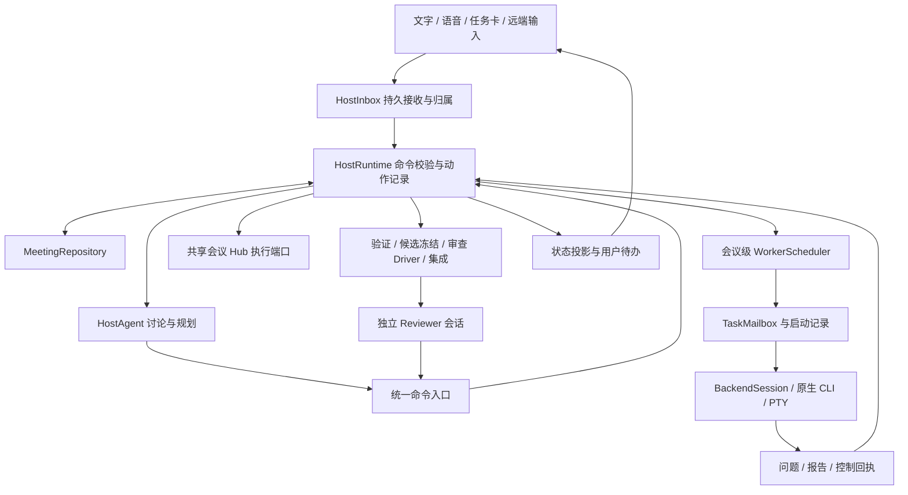

# Host 全链路修复与重构执行计划

日期为 2026-11-04，Asia/Taipei。状态为待实施方案。本次交付范围是制定计划，实施从用户重新授权后开始。

## 目标与基线

让用户能持续与 Host 讨论、规划、修改要求，由应用可靠地启动本地原生 CLI Worker，派发任务与补充，接收问题和结果，完成验证、审查与最终交付。任何时刻，界面都能解释工作由谁持有、正在等待什么、最后确认到了哪一步。

| 项目 | 已核实情况 |
| --- | --- |
| 审计基线 | `f597251f950dbc294010bcaa52ca03df5a630120`，本地 `codex/codex-native-production` |
| 执行计划位置 | `codex/host-superagent-refactor`，独立工作树 `C:/Users/JHJ/.codex/worktrees/host-superagent-refactor/ahastation-internal1` |
| 原生接线工作树 | `C:/Users/JHJ/.codex/worktrees/codex-native-production/ahastation-internal1`，当前有 terminal adapter、RealTerminal 和对应测试三处未提交修改，涉及 Hook 审核提示与终端呈现 |
| 已暂停的草稿 | 本计划工作树的 `electron/host-group.ts`、`electron/orchestrator.ts` 已有未提交调度器拆分草稿。只通过 Electron 类型检查，尚未通过修改后行为回归，不计入完成情况 |
| 参考方案 | [既有 SuperAgent 对照提案](2026-11-04-host-superagent-refactor.md)，本计划具体化其中 H0–H5，并补入本次复现的缺陷 |
| 参考项目 | `C:/Users/JHJ/Desktop/dsh-superagent-prototype`，已阅读版本 `8c32a9d`，用于参考状态归属、持久化动作、通知与读取机制 |
| 验证边界 | 基线两侧类型检查、Electron 构建与 38 项定向测试通过。另用临时假会话复现下述缺陷。复现脚本尚未成为仓库回归测试，真实模型、GUI 全流程和跨平台结果仍待验证 |

实施前重新记录基线、差异和依赖版本，逐项判断原生接线工作树的修复是否应纳入。保留其他任务文件，草稿按本计划逐块核对后再使用。每阶段验收针对行为和证据，提交、推送、合并与发布按用户已有授权执行。

## 缺陷清单与覆盖关系

“已复现”指离线假会话或真实领域方法复现，“源码确认”指已定位调用链，“待验证”指仍需端到端验证边界。

| 编号 | 优先级与证据 | 触发与后果 | 修复阶段 |
| --- | --- | --- | --- |
| F01 | P1，已复现 | Host 退出后发送文字，调用正常返回，输入既未进入会话也没有正文恢复记录 | R2、R7 |
| F02 | P1，已复现 | Host 重启后，旧会话迟到的 ended 清掉新会话引用 | R1 |
| F03 | P1，已复现 | A 提案被 B 替换后，旧表单提交 A 仍能安装 A 并清掉 B | R3 |
| F04 | P2，已复现 | 同一提案并发确认产生两条同版本授权记录；第二次实际安装被任务 ID 冲突拦住 | R3 |
| F05 | P1，已复现 | Worker inbox 首次响应丢失，服务端已标 acknowledged，重复读取返回空列表 | R4 |
| F06 | P1，源码确认 | “打断 Host 当前的回复”沿会议 interrupt 路径给 Worker 也发送中断 | R1、R7 |
| F07 | P1，源码确认、真实 CLI 待验证 | 内部 running、PTY 启动、输入框就绪与首轮投递混用；仅排入适配器内存的消息可以被记为 delivered | R4 |
| F08 | P1，已复现事件错配 | Codex 发 turn-status completed，审查推进只认 message result，忙碌状态与审查推进失配 | R1、R5 |
| F09 | P1，源码确认 | Codex 内置 portable 命令缺少审查读取和判定接口；Host 被允许协调却缺少完成自动审查的工具链 | R5 |
| F10 | P2，源码确认 | 全局 MCP review gate 阻断规划、任务沟通等工具；portable 入口没有对应一致边界 | R5 |
| F11 | P2，源码确认 | 专家消息未绑定 requestId，用户消息可清除专家等待计时器；同一专家的后一个问题覆盖前一个计时器 | R2、R6 |
| F12 | P2，源码确认 | 提示词要求派工后宣称已安排执行，实际工具结果可能只是 proposed 等待批准 | R6、R7 |
| F13 | P2，源码确认 | 待批准提案只保存在内存，恢复初始化没有重建 pendingPlan；审批窗口与会议恢复脱节 | R3、R7 |
| F14 | P2，源码确认 | 每个 HostGroup 创建调度器，实际任务入口却使用 default 组调度器，生命周期职责分散 | R1 |
| F15 | P1，源码确认、故障注入待补 | 终端交还过程中直接确认积压消息，缺少接收端持久接收或处理证据 | R4 |

核心代码入口为 `electron/orchestrator.ts`、`host-group.ts`、`worker-scheduler.ts`、`task-mailbox.ts`、`worker-cli-bridge.ts`、`worker-cli.ts`、`meeting-command.ts`、`meeting-mcp.ts`、`backends/codex-adapter.ts`、`backends/terminal-cli-adapter.ts`、`ipc/session.ts` 和 `src/lib/meeting-store.ts`。

## 端到端成功标准

1. 用户得到“已接收”后，可以通过稳定 inputId 找回完整内容、目标和状态。Host 正在启动或重启时也适用。写盘失败清楚报错，停止操作仍能执行。
2. 一次计划确认只安装所确认版本的任务。重复提交返回同一个结果，旧提案表单得到版本冲突，新提案保留。
3. 同一场会议只有一个本地执行池。Host 会话切换、崩溃、重启和审查都保持任务身份、工作区与执行归属一致。
4. 任一启动或投递崩溃窗口都能恢复为有证据的状态。无法判断外部动作是否发生时显示待核对，并阻止盲目重复启动或发送。
5. Worker 收件箱可以重取未确认消息。回执表达应用实际可证明的阶段，模型是否读取没有证据时显示未知。
6. 用户能只打断 Host、停止指定 Worker、停止整场执行。每种操作的按钮、API、持久记录与实际效果一致。
7. 原生 CLI 保留用户原生登录、工具、权限交互和可见终端。计划范围、任务控制、交付验收各自有独立语义。
8. Host 在审查期间能接收用户输入、回答问题、调整待执行计划并停止任务。候选仍须满足完整证据、分片覆盖和最终接受要求。
9. 明确归属的补充和问题在原任务内继续。普通日志只更新视图，重要问题和失败有可恢复的待办。
10. 本机与共享会议各有唯一派发方。共享任务继续由 Hub 分发，远端目标失败时明确返回对应目标的错误。

## 架构与主要技术决策

沿用 TypeScript、Electron、Zod、MeetingRepository、TaskMailbox、WorkerScheduler、BackendSession 和现有交付链。借鉴 SuperAgent 的领域边界与持久化动作机制，领域名称继续使用 meetingId、taskId、attempt、sessionId。



| 状态或职责 | 唯一归属与接口 |
| --- | --- |
| 会议协调、Coordinator、Host 会话 generation、动作意图 | `electron/host/runtime.ts`，Orchestrator 在迁移期提供兼容入口 |
| Host/Expert/Reviewer 会话与回合 | HostGroup 逐步收敛为会话适配层，必要时迁入 `electron/host/agent.ts` |
| Host 输入、专家问答、通知 | `electron/host/inbox.ts`，复用 MeetingRepository；Worker 内容仍由 TaskMailbox 持有 |
| 已接受计划、依赖、attempt、执行容量、Worker 生命周期 | WorkerScheduler；Runtime 通过命令调用，读取其投影 |
| 待批准提案与审批结果 | 版本化 proposal 记录与审批投影，计划安装由 Scheduler 执行 |
| CLI 进程与会话证据、启动与停止 | terminal adapter、PTY 与现有原生生命周期模块 |
| 候选、验证、审查覆盖、集成、最终接受 | 现有 DeliveryHarness、ReviewDriver、IntegrationQueue、MeetingDelivery |
| 界面与语音 | 消费后端事实投影，前端只暂存编辑与发送中状态 |

具体文件拆分以实际状态归属为准。Runtime 负责协调边界，领域逻辑继续放在对应模块，避免把现有 Orchestrator 整体搬进一个同样庞大的新类。

采用现有 JSONL journal。每个协调转换用一条带 schemaVersion 的记录保存命令身份、状态变更和待执行动作，append 成功后执行副作用。跨 Scheduler、邮箱和 CLI 的操作通过稳定 ID、接收端去重及结果回写衔接。JSONL 的串行 append 本身只能保证记录顺序，业务命令还需要显式串行校验与幂等处理。

命令入口只串行处理短状态转换。模型、进程启动、网络与审查在锁外执行，结果返回时检查 generation、attempt、proposalVersion 或 candidateHash。停止立即使受影响动作失效，执行控制操作，并补记结果；磁盘故障需要显示诊断。

首版 Reviewer 并发设为 1，按需启动，使用用户选定且通过能力检查的后端。代价是额外会话和上下文成本，收益是前台讨论与审查各自有可核对的回合和权限。并发与预算复用现有配置，能力不足时显示明确原因和人工处理入口。

## 分阶段实施

依赖顺序为 `R0 → R1 → R2 → R3 → R4 → R5 → R6 → R7`。每阶段形成独立可审查的行为变更。先实现可靠性基础，再切换审查与用户展示，便于定位回归与收口兼容代码。

### R0 固定证据与建立回归

任务名 `baseline-and-reproductions`，依赖为无。

- 固定 SHA 与工作树差异，检查原生接线的未提交修复；把本任务拆分草稿作为待复审输入。
- 将 F01–F05、F08 的临时复现转成仓库自动化回归。特别保留“重复审批被调度器拒绝，但仍有重复授权记录”的真实结果。
- 为 F06、F07、F09–F15 补正常入口和故障注入场景，逐项记录实际失败、已有覆盖和未验证项。
- 记录当前 Host 唤醒次数、派工等待、用户提问与审查推进事件，缺少历史数据的指标从本阶段开始采集。

验收为每个缺陷拥有触发条件、预期行为、测试入口和证据级别。基线失败与新回归失败分开记录。此阶段以假模型、假 PTY、临时目录为主。

### R1 会议级执行归属与 Host 生命周期

任务名 `meeting-runtime-and-host-lifecycle`，依赖 R0，覆盖 F02、F06、F08、F14。

- 将唯一活动 Scheduler 的构造、配置和关闭提升到会议 Runtime。现有 taskOwners、taskId、attempt 与工作区保持映射。核对旧非 default 组是否存在存量任务，冲突身份进入显式迁移诊断。
- HostGroup 只管理会话。对每次启动分配 generation，启动 promise 去重；结束、移除、失败使 generation 失效。异步初始化前后均校验归属，关闭期间不得创建迟到会话。
- 所有事件、MCP handler 和 portable handler 绑定实际会话 generation，替换会话的迟到回调只能记录诊断。已开始的异步命令在副作用前再次检查有效性。
- 统一 BackendSession 回合事件，把 message result 与 turn-status completed 归一到同一 turnId 结束事实；同一轮重复完成只推进一次。
- 独立实现 Host 当前回复中断、指定 Worker 停止、整场执行停止。停止 Worker 使用既有整树终止与退出证据；Host 中断保留用户补充的可查询状态。
- 会议关闭等待受控 Worker 清理、回执写入与必要恢复快照完成，明确处理失败；切 Coordinator 只转移协调职责。

主要文件为 HostGroup、Orchestrator、BackendSession 契约、各 Host adapter、`ipc/session.ts` 与主界面控制入口。

验收包含慢启动时关闭、并发重启、旧 ended/错误/工具命令晚到、Coordinator 切换、重复回合完成，以及只打断 Host 时 Worker 继续运行。相同检查覆盖本地和共享入口。

### R2 持久接收、输入归属与反馈

任务名 `durable-host-input-and-routing`，依赖 R1，覆盖 F01、F11。

- 以 inputId 接收文字、语音转写、附件引用、专家回复、Worker 问题和重要状态通知。保存来源身份、正文或受控正文引用、目标、replyTo、优先级与内容 hash。
- UI → preload → IPC → Runtime 全链路等待持久接收结果。重试复用同一 inputId，相同 ID 不同内容返回冲突；Host 暂不可用时保留排队项和可见原因。
- 显式 taskId、questionId 或任务卡回复通过既有 TaskMailbox 投递，记录 inputId 到 messageId 的稳定映射。需要理解开放式请求时交给 Host，目标歧义作为持久待办。
- 引入动作记录与回执投影，先保存投递意图，执行后记录 adapter 能证明的结果。模型调用若已发出但缺少回执，恢复进入不确定状态；只有接收端有幂等能力时才自动重试。
- 专家咨询以 requestId 关联答复和计时器。用户输入、工具结果和普通进度不能结束待答问题。旧协议缺少关联 ID 时显示未关联回复，要求显式归属。
- 处理连续补充、取消与优先级，优先用户控制和待答问题；普通进度通过状态视图呈现。关闭时清理计时器与订阅，重启从持久待办重建。

主要文件为 HostRuntime、HostInbox、MeetingRepository、TaskMailbox、CrossHostBus、IPC、preload、`src/types.ts` 和 meeting store。

验收包含 Host 启动中和退出后发送、断盘、发送确认丢失、重复输入、正文超限、跨任务回复、同一专家两个并发问题、超时后晚答。100 条普通进度产生零次新增 Host 模型回合，问题与失败仍有待办。

### R3 提案版本、审批幂等与恢复

任务名 `versioned-plan-approval`，依赖 R2，覆盖 F03、F04、F13。

- 为提案保存 proposalId、proposalVersion、basePlanVersion、完整规范化任务、可读计划、内容 hash 和状态。待确认、替换、拒绝、安装中、已安装、安装失败均可恢复。
- UI 提交所见提案身份和编辑版本，服务端原子比较后受理。编辑后的内容生成确定版本并校验其范围，旧表单不能清除新提案。
- 审批以 approvalCommandId 幂等化。同一请求重试返回原结果，冲突内容明确拒绝。状态转换先记录接受意图，再按稳定安装 ID 调用 Scheduler，成功后记录实际版本和任务 ID 映射。
- 将任务 ID 分配纳入可重放安装契约，避免重试被当作“复用旧任务 ID”而生成带后缀的新任务。审批日志、authority 引用和最终安装任务对应同一批内容。
- 计划修订的版本比较与执行放进同一命令边界。跨 await 后重新检查版本和任务状态，多操作修订中的投递动作需有独立可恢复结果。
- 待批准提案从 journal 重建，snapshot 作为加速投影。审批失败保留可重试记录，前端仅清除对应 proposalId。
- 核对 autoOrchestration 与 autoApprovePlans 的实际产品入口，统一持久配置与恢复语义，并按已有用户选择执行。

主要文件为 Orchestrator、Scheduler、meeting-tools、meeting-command、MeetingRepository、plan IPC、PlanMeetingModal 和 meeting store。

验收包含 A 被 B 替换后的批准与拒绝、双窗口确认、重复请求、安装前后崩溃、任务 ID 冲突、批准时关闭、并发计划修订、重启后继续编辑。重复批准最多产生一个安装结果，所有记录指向实际计划版本。

### R4 原生 CLI 启动、消息回执与控制闭环

任务名 `native-launch-and-delivery-receipts`，依赖 R3，覆盖 F05、F07、F15。

- 为 Worker 增加独立 launchPhase 与输入投影，表达准备、进程已创建、等待原生交互、可接收输入、输入已写入、执行观察和启动失败。既有任务状态保留业务含义，界面从组合事实展示启动进展。
- CLI 创建前记录 launchId、taskId/attempt、工作区、后端及启动意图；绑定已有进程/会话身份后记录证据。检查命令行预装初始任务与 TUI 粘贴两条路径，避免重复发送首条任务。
- adapter 返回明确的 queued、written 或 rejected 结果。登录、信任目录、Hook 审核、人工接管和启动超时都有可见状态。PTY 写入成功只支持输入写入结论。
- Worker inbox 改为“读取可重取批次 + 显式确认消息 ID”。读取本身不消耗消息，确认验证 meeting/task/attempt 和稳定消息 ID，重复确认返回同一结果。
- 定义 transport receipt 与 handled 两种事实。CLI 客户端可将返回批次写入任务运行目录后确认持久接收；运行时恢复必须读取该本地副本。stdout 输出或调用结束单独不足以证明模型已经读到内容。
- 若协议不能证明消费，则保留消息供显式重读，并标记消费未知。自动重试限定于具备接收端去重或可核对证据的操作。
- 投递器按任务与消息串行领取，解决 turn boundary、用户补充和 inbox 拉取并发取走同一消息的问题。不同投递通道共享 receipt 状态，完成事件不能给之后才发送的消息补确认。
- 交还终端时先送工作区检查结果与用户说明，再送积压内容；以实际投递回执更新状态。读取变化失败保持待处理，终止发生时冻结当前 attempt 的投递。
- 统一停止、重试、接管与 report 校验，保留整树退出证据和旧 attempt 拒绝规则。进程已启动而回执缺失时优先核对，证据不足交给恢复待办。

主要文件为 Scheduler、worker-cli、worker-cli-bridge、TaskMailbox、terminal adapter、PTY、worker-runtime-contract、WorkerWorkbench 和 RealTerminal。

验收覆盖首次 inbox 响应丢失、确认丢失、客户端写盘失败、服务端重启、并发拉取与自动投递、登录/Hook 门槛、首轮命令行启动、等待输入期间停止、交还期间停止、旧报告晚到、进程存活不明。每个故障点核对消息、进程数量和任务状态。

### R5 命令一致性与独立审查

任务名 `command-parity-and-reviewer-session`，依赖 R4，覆盖 F08–F10。

- 对现有 MCP 与 portable 工具逐项列能力表，包括计划、任务控制、状态读取、问题处理、审查证据与结论。两种入口转换到相同应用命令，并使用同一角色、会话 generation、范围与参数校验。
- 补足 Codex portable 审查读取和提交能力。命令结果通过结构化返回或带 commandId 的工具结果输入到对应会话，证明调用方能收到完整证据与错误。单纯执行 JSON 指令还不足以完成审查循环。
- 以实际后端能力决定 Host 和 Reviewer 可承担的角色。选择已有配置中的适配器，能力不齐时清楚呈现缺口。
- 每个 reviewId 绑定候选 hash、taskId/attempt、reviewer session 和 generation。Reviewer 只访问本候选的受控证据与审查工具，前台 Host 继续讨论、查询与控制。
- 将全局 review gate 迁到 Reviewer 会话范围，前台 Host 的普通文本与 Worker 报告无法写审查 verdict。跨 reviewId、旧 generation、旧 candidateHash 的提交拒绝。
- 审查回合、无进展超时和用户等待分别计数，重复事件只计一次。暂停与恢复保留已验证覆盖记录；候选变化使对应旧会话失效。
- 验证、冻结候选、chunk hash、覆盖率、需人工确认的证据、集成与最终接受继续由原有领域模块决定。

主要文件为 meeting-command、meeting-mcp、HostRuntime、Host 会话适配、Codex adapter、CoordinatorReviewDriver、CoordinatorReview 和 DeliveryHarness。

验收在 Claude/Codex 两条路径分别完成“取证据 → 逐块提交 → 完成审查 → 原交付链继续”；同时用户可以发新要求或停止。补多候选排队、恢复、旧结论晚到、跨候选访问、预算耗尽测试。

### R6 规划策略、上下文与通知

任务名 `host-context-and-notification-policy`，依赖 R5，覆盖 F11、F12，并完成全链路使用体验收口。

- 将 Host 提示词拆成讨论规划、专家、审查与交付表达片段，记录 promptRevision。工具结果中的 proposed、installed、launching、running、candidate、accepted 对应明确表达。
- 简单解释与目标讨论由 Host 回答；执行需求按授权和任务边界派工。同一任务后续要求优先复用 taskId；复杂计划清楚给出目标、范围、依赖、验收与需要用户决定的问题。
- 使用现有 ContextPackage 和范围校验提供分页资源读取，覆盖会议摘要、计划、任务、邮箱、报告、决策与审查证据。响应携带 hash/version、游标和内容完整性标记。
- 每轮注入最新约束、未处理事项、任务摘要与重要增量。历史详细日志按需读取，压缩记录来源游标，原文保留在受控存储。
- 规则处理精确消息路由与通知去重；需要理解语义和协调取舍时调用 Host。以 questionId/reportHash/candidateHash 等稳定身份去重，新的同类问题仍可出现。
- 独立任务按现有 deps、priority 与预算推进，某项 blocked 仅影响其依赖。保留 reviewed/accepted 等依赖门槛，并在界面解释下一任务等待的实际条件。

验收包含讨论不派工、等待审批时准确表达、连续补充归属原任务、长报告完整读取、上下文版本冲突、普通进度突发、独立任务继续和重复失败受预算约束。

### R7 UI、历史兼容与端到端收口

任务名 `recovery-ui-and-end-to-end-acceptance`，依赖 R1–R6。

- 更新 meeting store、PlanMeetingModal、任务详情、WorkerWorkbench、终端与最终交付界面。展示持久接收、排队原因、启动门槛、待答、审查中、恢复不确定和最终接受。
- 清晰连接三种停止动作。语音只播报当前答复、关键结果与待决定事项，文本时间线保留详情。
- 为新事件、快照、提案和邮箱协议加版本。旧记录按已有证据映射，旧 acknowledged 仅说明旧协议的确认语义，保留证据缺口。
- 重建待批准计划、未回答问题、未确认投递、Reviewer、Coordinator 选择与任务负责人。恢复入口先校验 schema 和身份，损坏记录显示诊断。
- 本地、共享 Hub、Pocket Vibe 远端指定会话分别运行验收。对共享输入适配复用其已有持久身份，避免在两端重复持有同一个执行任务。
- 清理已切换路径上的直接通知、重复调度器和重复状态写入，检查所有公开入口确实走新契约。

验收从干净启动与恢复启动分别完成完整用户路径，记录精确代码版本、运行方式、模型/CLI 版本、检查结果和剩余限制。

## 迁移与回退

1. 新会议记录 runtimeVersion、eventSchemaVersion 与 transportProtocolVersion。已有运行中会议完成或经过显式迁移后切换执行所有者。
2. 新投影可先读取旧 journal 做影子比对，只计算状态。切换时同一会议始终指定一个执行所有者。
3. inbox 新协议与 CLI shim 同步版本协商。旧 Worker 仍在运行时保留兼容读取并显示旧回执语义，待明确重连或新 attempt 才切换确认协议。
4. 旧提案缺版本时重建为可见的恢复提案，确认动作绑定新生成的稳定版本。旧未知消费状态保留待核对，避免自动重放副作用。
5. Reviewer 切换通过会话失效和候选绑定交接覆盖状态。回退必须停止新 Reviewer 并验证旧路径能读取当前状态。
6. 旧程序遇到不支持的新 schema 时提供只读恢复或明确阻止带执行恢复。回退保留原始 journal、运行目录和工作区。

## 验证矩阵与完成证据

| 层次 | 必须提供的证据 |
| --- | --- |
| 纯规则 | 身份/版本校验、状态转换、通知分类、上下文权限、迁移和去重测试 |
| 应用入口 | renderer/preload/IPC、MCP、portable 各入口的等效行为，含重复与过期请求 |
| 故障注入 | 接收前后、落盘前后、CLI 创建前后、写入前后、receipt 前后、确认前后的暂停/异常/崩溃 |
| 进程夹具 | 隐藏自有进程验证启动、停止、子进程清理、未确认退出与容量占用 |
| 真实环境 | 获得相应执行及费用授权后，Windows Claude/Codex 原生 CLI 全链路；macOS/Linux 在原生环境分别验证或明确列为未验收 |
| 产品流程 | 用户规划、批准、可见 CLI、补充、问题回答、接管交还、候选审查、接受、重启恢复和共享任务路径 |

复用现有测试入口，并按实际缺陷增加必要回归。

- 生命周期与控制使用 `meeting-host-lifecycle`、`orchestrator-cleanup`、`backend-capability-gates`、`unified-meeting`。
- 计划使用 `meeting-command`、`meeting-command-execution`、`plan-revision`、`meeting-plan-brief`、`renderer-plan-validation`。
- 输入与投递使用 `task-mailbox`、`worker-question-redelivery`、`host-ask-watchdog`、`host-message-truncation`。
- 原生链使用 `native-cli-worker-n1-n8`、`native-cli-worker-review-fixes`、`codex-terminal-adapter`、`worker-report-files`。
- 审查与恢复使用 `coordinator-review-driver`、`coordinator-review-loop`、`meeting-recovery`、`meeting-restore`、`meeting-restore-ipc`、`meeting-final-delivery`。

实现每阶段运行两侧类型检查与受影响的定向测试。以下 PowerShell 命令以当前仓库脚本为准。

```powershell
npm run typecheck
npm run build:electron
$loader = 'data:text/javascript,import { register } from "node:module"; import { pathToFileURL } from "node:url"; register("./tests/electron-stub.mjs", pathToFileURL("./"));'
node --test --test-concurrency=1 --test-timeout=120000 --import $loader tests/meeting-host-lifecycle.test.mjs tests/orchestrator-cleanup.test.mjs tests/unified-meeting.test.mjs
```

测试集合随阶段变化。最终按项目 CI 执行全量、renderer 构建和平台包装检查，记录同一版本的结果。优先使用隐藏夹具，清理仅限测试拥有的进程与目录。

核心完成要求为 F01–F15 各有关闭证据、原有原生 Worker 回归通过、全部普通入口连接到新契约、历史恢复可用、用户完整流程可验收。真实平台证据不足时明确列为未完成验收项。

效率用相同任务集与配置对照 Host 自动回合数、用户重复介入次数、上下文体积、派工等待、返工次数和可接受交付时间。模型未提供 usage 时保留未知；性能提升幅度根据实测填写。

## 实施前需核实的技术问题

| 问题 | 当前拟定处理 | 核实点 |
| --- | --- | --- |
| 原生 CLI 能证明哪些输入阶段 | 按 adapter capability 输出事实，消费未知时保留可重读内容 | Windows/macOS/Linux、不同 CLI 版本的启动与输入证据 |
| 旧会话如何继承新回执协议 | 协议版本协商与旧状态兼容投影 | 活跃 Worker shim、客户端本地副本与清理时机 |
| Codex 审查工具怎样返回证据 | portable 命令结果关联 commandId，并经相同范围校验返回模型 | 当前 app-server 回合与结果输入能力，确认可闭合多步审查 |
| Host 如何在长回合中接受高优先级输入 | 先持久接收，使用适配器真实支持的排队/打断能力 | 不能把 priority 参数存在当作后端已实现优先调度 |
| 审查额外会话的成本 | 单并发、按需启动、明确预算 | 当前后端配置、实际 usage 和超预算行为 |
| JSONL 性能与恢复时长 | 先用现有仓储，限制单条大小与分页读取 | 同机故障夹具和长会议样本测量，达到瓶颈再评估存储变更 |

上述事项属于实施中的技术核实。涉及新增费用、改变用户控制含义或扩展产品范围的选择，需要在具体方案可审阅时向用户说明。
