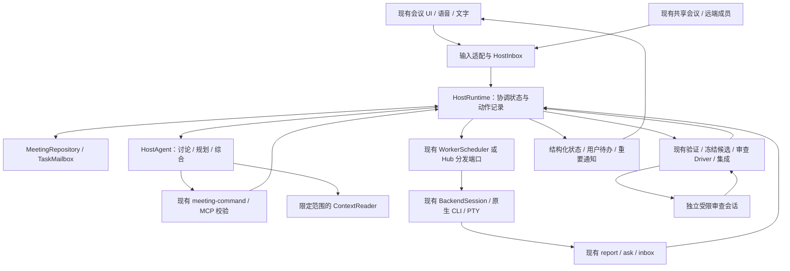

# Host 重构提案：参考 dsh-superagent，保留 AhaStation 的讨论与原生 CLI 执行链

日期：2026-11-04（Asia/Taipei）。状态：**设计提案，尚未实施**。

11-04 后续决定：本机 Worker 已在本地改为统一原生 CLI 路由，并接入自动任务终端标签，详见[接线规划](2026-11-02-native-cli-worker-integration.md)。这是现有执行链的独立增量，不代表本文 H1–H5 的 Host 全面重构已完成；后续重构必须保留该路由与实际执行过程可见性。

## 1. 建议与预期效果

建议把 Host 重构为“能持续讨论和规划的协调代理 + 可恢复的应用协调逻辑”。模型理解目标、拆任务、综合意见；应用代码负责输入归属、任务状态、消息投递、取消、恢复和验收事实。

最值得借鉴 SuperAgent 的是这条职责边界，以及围绕它的少打扰、按需读取、持久化投递和结构化待办。AhaStation 已有 WorkerScheduler、TaskMailbox、MeetingRepository、ContextPackage 和交付审查链，应在这些模块上整合。

完成核心阶段 H0–H5 后，用户应能：

- 与 Host 讨论并修改计划，让现有 Claude/Codex 原生 CLI 执行任务；小问题直接回答，不强制派工。
- 在任务执行、审查期间继续提问、纠偏、停止或接管；Host 不因审查某份 diff 而失去日常协调能力。
- 看到明确的“已接收、已投递、等待回答、候选待审、已验收”状态，避免把 CLI 空闲、进程退出或报告中的 completed 当成交付完成。
- 收到重要结果、阻塞和待决问题；普通工具日志留在任务详情，不不断触发 Host 和语音播报。
- 重启后恢复任务事实、未处理消息和待办；对无法确认的原生进程/投递状态明确显示待核对，不重复启动工作。

首个可用增量是 **H0 → H1 → H2 的单 Host、单原生 Worker 闭环**。H3 优化上下文与提示词，H4 分离审查，H5 完成界面、恢复和兼容收口。H6 是独立扩展，不属于核心重构完成条件。

效率目标补充：在交付质量与授权边界不降低的前提下，缩短从提出任务到可接受交付的时间，减少用户介入次数和无必要的模型回合。第 6.6 节给出默认协作规则，第 9.2 节给出度量方式；不以 Agent 数量或同时运行的任务数作为效率指标。

## 2. 探索依据与范围

### 2.1 已检查的基线

| 对象 | 本地位置与版本 | 本轮证据边界 |
| --- | --- | --- |
| 参考项目 | `C:\Users\JHJ\Desktop\dsh-superagent-prototype`；HEAD `8c32a9dc5d72c033816c6a8110b37f40cf94fba4`；检查时工作区干净 | 阅读领域、调度、投递、提示词、上下文资源及相关测试源码；未安装或运行 DSH，未验证线上表现 |
| AhaStation | `C:\Users\JHJ\.codex\worktrees\codex-native-production\ahastation-internal1`；分支 `codex/codex-native-production`；HEAD `31fde4f34feb2677d2429c29c652ef49de918f10` | 阅读 HEAD 加当前工作树；存在上一轮复审修复的未提交改动，不能把 HEAD 当作这些修复的完成版本 |
| 当前 Worker 依据 | [11-02 原生 CLI Worker 接线规划](2026-11-02-native-cli-worker-integration.md)、[N1–N8 证据](../c0/b04-runtime/native-cli-scenarios.md) | 沿用最新产品约定；本提案不把历史 Host 工具审批/定制沙箱要求重新加回 |

当前未提交改动涉及 `cli-backend.ts`、`terminal-cli-adapter.ts`、`delivery-harness.ts`、`orchestrator.ts`、`worker-report-files.ts`、`worker-scheduler.ts` 和相关测试，包括新增的 `native-cli-worker-review-fixes.test.mjs`、`worker-report-files.test.mjs`。这些文件由原修复任务收口；本轮只新增此规划，不覆盖它们。文件行号是检查时的定位，实施前以固定基线再确认。

参考项目 README 自称研究原型，并说明文章中的部分设计尚未实现。因此下文只以此检出的源码为参考，不将文章设想或原型测试当作本项目生产证明。其根目录 LICENSE 为 MIT，版权属于 DeepSeek Harness Team；本提案借鉴设计，不引入其运行时依赖。后续若复制实质代码，保留相应版权与许可文本。

### 2.2 已确定的产品约束

1. **不修改 Codex/Claude 引擎，不替换原生登录和工具。** Worker 继续走现有 Scheduler → BackendSession → terminal adapter → PTY。
2. **原生 Worker 的工具执行不回 Host 审批。** 原生 CLI 按用户选择的权限策略执行，需要用户时在原生终端处理；任务澄清、计划范围变更、候选审查、最终接受和发布授权分别处理。
3. 本机 Worker 统一原生 CLI，不退回 SDK/无头 Worker；Host 后端与跨设备已有的用户权限流程独立，不把其机制强加给原生 Worker。
4. 保留语音/文字讨论、多 Host/Expert、点名、任务负责人、跨端入口与已有交付标准。默认一个 Coordinator；专家只按需要参与。
5. 先完成本机关键路径，不以新增云服务、数据库、全局权限服务或后台常驻进程为前提。
6. 本轮仅交付规划。没有真实模型调用、系统配置变更、代码发布或远端消息动作。

## 3. SuperAgent 中哪些值得采用

下表“参考源码”均相对参考项目根目录；“采用方式”是本提案，不代表 AhaStation 已实现。

| 机制 | 参考源码 | 在 AhaStation 中的采用方式 |
| --- | --- | --- |
| 运行时组装与业务规则分离；领域命令集中进入 | `src/app/runtime.ts:59`、`src/core/engine.ts:24`、`src/core/ports.ts` | 把 Orchestrator 的组装/适配、协调状态和外部执行分开；领域对象沿用本项目名称 |
| Ticket 与 Assignment、Session 分开 | `src/core/model.ts`、`src/core/assignments.ts`、`docs/001-domain.md` | 沿用 taskId、attempt、backendSessionId，另以 Host turn 标识模型回合；不再由会话结束推断任务结束 |
| 先保存状态和待执行动作，再执行 | `src/app/store.ts:139`、`src/app/effects.ts:46`、`src/app/outbox.ts:22` | 在现有 Meeting journal 上增加可恢复的 Host 投递记录；不照搬 SQLite 或新消息中间件 |
| 消息有来源与稳定 ID，区分已投递和已读取 | `src/app/delivery.ts`、`src/core/assignments.ts` | 对 Host 输入统一身份、游标与回执；native PTY 无法证明已读时保留 unknown，不伪造 DSH 级能力 |
| 普通进度不打扰主代理；问题和结果才唤醒 | `src/app/notices.ts:121` | 确定性分类与合并通知，任务日志可展开；避免“为了过滤消息再调用一次模型” |
| 小摘要 + 按需分页读取 | `src/app/resources.ts:24,299` | 提供限定范围的 Host 资源读取；任务、报告、计划版本、审查证据以 ID/hash 引用 |
| 提示词拆分、版本化、可预览 | `src/app/prompts.ts:102,135`、`src/app/sessions.ts` | 拆分协调/讨论/审查/专家提示词，记录每轮使用版本；先内置版本，后做编辑 UI |
| 从结构化事实计算“谁需要行动” | `src/core/stage.ts:9` | 从已有任务/交付/问题状态派生用户待办，不通过总结文字猜测是否 blocked |
| 人的继续输入优先于新任务 | `src/executor/dsh.ts:171` | 采用优先级和取消直达；不照搬原型的额外并发槽，仍遵守现有资源和费用上限 |
| 收到后续消息时找到原任务，不随意开新任务 | `src/core/intake.ts`、`src/core/tickets.ts` | 显式 taskId/回复目标先路由到现有 TaskMailbox；有歧义时只问归属，不广播给所有 Worker |

### 不直接照搬的部分

- **纯分流主代理。** `prompts/orchestrator.md` 要求 Worker 调查实现、主代理不添加实施计划。AhaStation 要保留 Host 与用户讨论、规划、组织专家的能力。
- **原型的自动接单规则、GitHub/飞书权限模型。** 本轮入口是现有本地/远端会议，不建立陌生人的自动派单系统；来源身份沿用现有本地或 Hub 验证。
- **PR 关闭即 Ticket 结束、消息自动恢复已结束 Ticket。** 本项目按交付链和用户最终接受判断完成；取消任务不会被 CI/Hook/普通新消息自动复活。
- **DSH Session 的幂等收件箱和后台子代理能力。** 原生 CLI 不一定提供对应协议，必须按适配器能力给出投递/恢复语义。
- **命令包装等于安全隔离。** 原型文档也说明其 shell wrappers 可被绝对路径绕过；不据此宣称能强制限制原生 CLI。
- **原型默认的自动合并规则。** 本提案不改变提交、推送、发布和合并的授权要求，也不新增自动合并。

## 4. 现有 Host 的实际问题与可复用资产

| 已核实的代码事实 | 重构目标 |
| --- | --- |
| `electron/orchestrator.ts` 检查时约 3,488 行，包含 Host 管理、计划、恢复、消息路由、权限接入、审查、最终交付；`worker-scheduler.ts` 约 5,605 行 | 按状态与生命周期归属拆职责；行数只说明维护范围，不作为重构完成指标 |
| `host-group.ts:217` 附近构造自己的 Scheduler；`orchestrator.ts:766,1237` 又把 default 组的 Scheduler 作为会议执行入口 | 把 Scheduler 生命周期提升到会议 Runtime；HostAgent 只负责会话，切 Coordinator 不更换执行池。迁移前查清旧组内存量任务，不能直接删除组内 Scheduler |
| `host-group.ts:307` 启动时组合 Talker、角色/审查提示词和历史记忆 | 提示词按角色/当前回合组合；恢复摘要与业务状态从 journal/领域模块取值，不只依赖长会话记忆 |
| `orchestrator.ts:1668` 路由用户输入，`1244` 转发专家回复；`worker-scheduler.ts:5505` 附近有进度合并，其他高价值通知仍多处直接 `sendUserText` | 已有降噪保留，进一步把 Host 入站集中到有来源、优先级、回执的入口；不声称当前完全没有队列或过滤 |
| `meeting-mcp.ts:260` 附近在 active review 时拒绝所有非审查工具；`COORDINATOR_REVIEW_PROMPT` 要求审查期间不转去其他话题 | 审查使用独立受限角色和会话；前台 Host 能继续接收新要求，原有 hash/覆盖率门槛保留 |
| `MeetingRepository.append` 已串行写入并 sync；`Orchestrator.safeEmit` 在持久化后通知 renderer | 复用可靠写入基础；补 Host 输入/动作的一致记录，不能简单再加另一份“唯一真相” |
| `TaskMailbox` 已先落盘后投递；`ContextPackage` 已有选择范围、脱敏、冻结和 hash | 扩展 Host 消息和资源视图，Worker 邮箱与上下文继续复用 |
| `CoordinatorReviewDriver`、DeliveryHarness、IntegrationQueue、MeetingDelivery 已有审查与交付领域 | 调整调用方和审查会话归属，不重写候选冻结、验证、集成和最终接受 |
| `collaboration/unified-host.ts:30` 复用 Orchestrator，但共享模式由 Hub 分发任务 | 新 Runtime 必须允许注入“本地执行/共享分发”端口；共享模式不能意外再启动本地 Worker |

## 5. 目标架构与责任边界



这里的 Runtime 是 **AhaStation 的 TypeScript 协调代码**，与 Codex 引擎内部无关。保持 Electron 内模块，不引入微服务。

### 5.1 模块拆分建议

新文件名为建议；实施时可以按代码规模合并小文件，不为了图中的每个框建立框架。

| 建议位置 | 负责 | 不负责 |
| --- | --- | --- |
| `electron/host/runtime.ts` | 组装现有服务；接收已验证命令/事实；管理 Host 生命周期、回合绑定、协调输入与动作 | CLI 执行、文件内容审查、完整任务状态的第二份写入 |
| `electron/host/agent.ts` | 包装现有 BackendSession；Host/Expert/Reviewer 的角色、输入及输出适配 | 创建 Worker 池、直接改任务状态 |
| `electron/host/inbox.ts` | 输入身份、优先级、归属、合并、投递状态、恢复游标 | 从任意文本猜出用户授权 |
| `electron/host/effects.ts` | Host 待执行动作的 journal 投影、重试、过期取消及回执 | 取代 TaskMailbox 或对原生 PTY 承诺 exactly-once |
| `electron/host/context.ts`、`prompts.ts` | 分页资源、摘要、提示词构建与版本绑定 | 全盘索引、自动写全局 memory、读个人凭证 |
| `electron/host/presentation.ts` | 派生待办、通知等级和视图，语音/文字输出策略 | 另存一套任务状态，靠 LLM 判断是否真正完成 |
| 现有 `orchestrator.ts` / `host-group.ts` | 迁移期兼容外观与旧接口适配，逐步变薄 | 继续增加新的平行生命周期规则 |

### 5.2 状态唯一归属

| 状态 | 唯一责任模块 | Host 如何使用 |
| --- | --- | --- |
| Host 输入、回合、当前 Coordinator、未发送通知 | HostRuntime + HostInbox，写入现有 MeetingRepository | 直接维护；命令串行化，模型/网络调用在串行段外 |
| taskId、attempt、依赖、执行预算与 Worker 生命周期 | 现有 WorkerScheduler 及 task 领域接口 | 发命令/收事实；不在 Runtime 再维护可写 task map |
| Worker 消息内容与确认 | 现有 TaskMailbox | Host 输入映射到同一条 task message，用稳定消息 ID 去重 |
| 原生 CLI 会话与进程身份、接管、整树停止证据 | 现有 terminal adapter / PTY | 只显示真实结果；不因模型称“停止了”而确认停止 |
| 候选、验证、审查覆盖、集成、最终接受 | 现有 DeliveryHarness / ReviewDriver / IntegrationQueue / MeetingDelivery | 路由与展示；不能用普通 Host 答复替代验收命令 |
| renderer 展示 | 现有 meeting store 消费后端投影 | 可乐观显示“发送中”，不得提前显示“已投递/完成” |

task、attempt 和模型 session 不改名为 Ticket、Assignment；不新增独立 Mandate 表。任务来源、范围和现有授权记录作为已有计划/任务的引用保存。原生工具权限仍属于原生 CLI。

### 5.3 单写入入口与持久化动作

借鉴原型的事务加 Effects 思路，但适配现有异步 JSONL：

1. 同一会议的 Host 命令通过一个串行入口，校验来源、角色、planVersion、task/attempt 和当前 Host 回合。
2. 在一条有版本的 `host-transition` journal 记录中保存本次协调状态变更及对应动作意图；记录大小沿用 Repository 上限。大正文使用已有受控附件/证据存储，以 hash 引用，不截断用户要求后冒充完整记录。
3. 等 `append` 成功后更新可重建投影并执行动作。落盘失败不得启动本轮的新工作；已有 Worker 的停止/接管应仍能作为紧急控制执行，并显示记录失败，不能让磁盘故障阻止用户停止。
4. 动作使用稳定 `effectId` 和 generation。执行完成重新进入命令入口，核对 epoch/attempt/planVersion；过期回调只记诊断，不能覆盖新一轮任务。
5. 涉及 Scheduler 的状态变更仍由 Scheduler 处理。使用同一 commandId/taskId/attempt 建立幂等入口，完成后回写回执；不假装两个模块的独立 append 构成数据库事务。
6. 复用 TaskMailbox 管理 Worker 投递。Host effects 只记录“把 inputId 路由到 messageId”的意图；重试得到已有 messageId，不能重复 enqueue 新消息。
7. 启动原生 CLI 属于非幂等外部动作。崩溃在启动与回执之间时先核对已记录的会话/进程证据；证据不足进入 `delivery-uncertain`/恢复待办，不自动再启动。该状态是投递/恢复视图，不新增任务成功状态。

这条链只保证有证据的持久化和可判定的重试。它不承诺模型调用、终端输入或外部发布严格只执行一次。已持久化回执丢失时必须依赖接收端幂等或核对；不能靠固定延迟重发。

## 6. Host 的具体工作方式

### 6.1 输入、路由和打断

每个协调输入包含 `inputId`、来源类型、已验证的来源身份引用、meetingId、可选 taskId/attempt、时间、正文引用、replyTo 和预期计划版本。内部报告、专家回复、CLI hook、用户消息保持不同来源，即使 BackendSession 都使用文本输入接口。

优先处理顺序：用户停止/接管 → 用户新要求或回答 → Worker 阻塞/待决问题 → 候选与审查结果 → 普通进度。停止/接管直接调用现有生命周期接口，不等 Host 模型回合结束。用户连续补充可以按顺序批量送入下一轮；不能因合并丢失约束或把“撤销”变成新任务。

路由规则：

- 有明确 taskId、回复的 questionId 或任务卡输入：交给现有 TaskMailbox，Host 得到归属通知；不重复创建任务。
- 面向 Host 的目标/规划问题：进入 Host 回合。改变任务范围时更新计划/版本，沿用已有确认规则与用户已授予的权限。
- 有明确 @Expert：保留现有点名与回复归属；专家能影响其负责的任务，不能静默成为 Coordinator。
- 无法唯一定位“那个任务”：先保留输入并澄清目标；不会同时投到多个 Worker。
- 普通进度：保存并更新视图，默认不启动 Host 回合。错误/问题/候选需要动作时才唤醒。
- 已取消任务：新消息不能自动复活；继续执行使用明确的恢复/新 attempt 操作，保留原任务证据。

输入生命周期区分 `queued`、`dispatched`、`acknowledged`、`handled`；证明不了的阶段保持未知。`handled` 需要关联命令结果/明确回答；CLI `write()` 成功、Stop hook、模型输出一段文字，都不能单独证明特定 inputId 已被处理。具体枚举通过兼容映射接入现有 schema。

### 6.2 上下文与提示词

Host 每轮默认接收：当前目标与最新用户约束、当前计划摘要/版本、活跃任务卡、待处理问题、重要状态增量和资源引用。源日志、长报告、全量聊天、完整 diff 不默认注入。

新增只读 Host 资源入口，复用现有数据与安全选择逻辑：

- `meeting/summary`、`plan/<version>`、`tasks`；
- `task/<id>`、`task/<id>/messages`、`task/<id>/report/<hash>`；
- `review/<id>`、`review/<id>/chunk/<chunkId>`（沿用现有审查证据接口）；
- 当前会话授权可见的附件与决策摘要。

资源响应包含版本/哈希、分页游标和是否还有内容。检查 meeting/task 可见范围，拒绝任意文件路径和跨会议读取。缺失、过期与被截断的证据明确返回状态，不能当成空内容或“没有变化”。长文本默认 4,000 字符一页、列表默认 20 条是初始提案，按本项目实测调整；安全和正确性不依赖这些数字。

提示词分四类：讨论与规划、专家咨询、审查、交付表达。共有部分只放角色边界、工具语义、语言/语音风格和当前产品约束。团队偏好与项目摘要另外装配；每轮记录 promptRevision、使用的计划版本和资源引用。

上下文超限时优先丢弃可再读取的旧进度，保留最新用户约束、未解决问题、取消事实及证据指针。压缩摘要绑定 eventCursor；模型摘要不能覆盖领域事实。首版只使用当前应用内的版本化提示词，不改真实 `~/.codex` / `~/.claude`，不增加自动学习或自修改提示词流程。

### 6.3 审查独立运行，验收要求不降低

将“前台 Coordinator”与“执行 frozen diff 审查的会话”分开，保留 `CoordinatorReviewDriver` 作为审查规则的权威。

- 一个 reviewId 绑定一个候选 hash、taskId/attempt 和 reviewer session/epoch；审查会话通过现有 BackendSession 工厂创建，按预算使用，不建新的执行引擎或独立 Worker 池。
- Reviewer 只获得既有审查工具及对应证据。前台 Host 保留讨论、查询、计划和控制工具，但不能伪造审查 verdict 或绕过候选门槛。
- 工具权限绑定实际 reviewer 会话与当前 reviewId，不能只信模型传入 `role=reviewer`；旧的全局 activeReviewGate 迁移成审查会话局部 gate。MCP 与 portable command 两种入口都覆盖。
- 编写候选的 Worker 会话不能同时是审查会话；模型可以相同，但上下文和操作权限独立。专家意见不是已覆盖 chunk 的证据。
- 暂时只允许一个审查会话运行；它与专家/Host 共用可见预算。新输入不会不断取消并重启审查；候选变化才使旧审查失效。
- 新候选、停止、返工、会话重启后，旧 reviewId/epoch 的返回不能使新候选通过。用户可暂停/取消审查，所有进度可恢复查看。
- 审查不通过：输出结构化 findings，沿用已有 rework 新 attempt；审查通过：继续已有集成/最终交付链。用户最终接受和发布授权仍是独立动作。

该变化是解决 Host 响应性的一项行为变更，应独立交付与回滚。验证前保留旧审查路径；不能仅删掉 activeReviewGate 就宣称完成。

### 6.4 待办和通知

使用已有 TaskInspector、会议消息、计划与交付组件逐步呈现：

| 用户所见 | 来自什么事实 | 可执行动作 |
| --- | --- | --- |
| 正在执行 / 已排队 | Scheduler 与投递记录 | 查看任务、补充、停止 |
| 需要补充信息 | 结构化 questionId 与未回答状态 | 回答对应问题 |
| 原生终端需要用户处理 | 适配器明确提供的状态；否则显示未知 | 打开/接管已有终端；不让 Host 代为工具审批 |
| 候选验证 / 审查中 | Delivery 与 ReviewDriver | 看证据、暂停审查 |
| 等待最终接受 | 完整 MeetingDelivery | 接受或请求返工 |
| 投递不确定 / 恢复待核对 | 缺失回执、进程身份或恢复证据 | 查看诊断、确认恢复/重试 |

语音默认只播报用户请求的答复、阶段性可用结果、阻塞与待决定事项。文字保留可展开时间线。按 `questionId`、`reportHash`、`inputId` 等稳定键抑制重复；不能永久去掉同一任务以后出现的新问题。

Host 对外状态摘要区分“本地验证”“CI”“候选审查”“用户接受”。没有当次 CI 信息就不说 CI 已通过；本轮 Host 重构也不自动获得外部消息发送权限。

### 6.5 恢复、取消和预算

- Host 会话重启从已持久化输入/回执、计划版本、未解决问题和候选状态重建，不依赖旧模型会话永不压缩。
- Host 崩溃不意味着 Worker 已停止；Scheduler/PTY 管理真实生命周期。恢复时原生进程不能确认存活或归属，沿用显式恢复流程。
- 用户接管期间自动投递暂停；交还前读取工作区实际变化，读取失败进入待处理状态。依次交付恢复说明和积压输入，保留输入顺序。
- 停止优先建立失效标记，阻止新启动和旧报告推进，再执行现有整树停止；只有取得相应证据才展示“已停止”。
- 对可重试的内部通知使用有上限退避；取消、不兼容能力、权限缺失、未知外部副作用不无限重试。失败不自动切换模型或由 native 转 SDK。
- 复用任务预算；Host 与 Reviewer 补充回合数、自动唤醒次数、上下文字节和实际可获得的 usage。无法取得 native token usage 时显示未知，不填写估算成本为真实消费。
- 空闲期间不轮询模型。优先用户输入不等于扩大并发上限；长模型调用不占用协调命令串行锁。

### 6.6 高效协作的默认规则

这是对前述架构的运行策略补充，仍为待实施提案。先遵守用户与仓库关于委派的要求；没有派工授权时不自动创建 Worker。已有授权覆盖的常规继续执行，不因这些规则新增确认步骤。

**A. 按任务需要投入会话。**

| 工作类型 | 默认协作方式 | 增加参与者的条件 |
| --- | --- | --- |
| 解释、状态查询、目标讨论 | Host 回答；能从状态读取的事实直接查询 | 缺少具体专业判断时，向一个专家提出有边界的问题 |
| 单一修复、局部实现 | 一个 Worker 负责调查、实现和相关自检；Host 保持可响应 | 出现真正独立的工作，且交接收益高于额外上下文/审查成本 |
| 多个独立交付 | 首批试用以两个并行 Worker 为起点，受用户设置和现有上限约束 | 数据表明排队是瓶颈、写入不冲突且预算允许时，再调整并发；首版不做自动扩容 |
| 跨模块、强依赖变更 | 先确定公共契约和唯一负责人；独立部分再并行 | 前置成果满足原有依赖门槛后释放后续工作 |

Host 不因任务较小就获得文件写入权限；需要改代码仍交给执行端。Reviewer 按 H4 独立启动，不让所有 Expert 对每个任务轮流表态。不把“调查一个文件、改几行、跑一个测试”机械拆成三个 Worker。

**B. 一次给清任务，执行中只补变化。**

沿用现有 task prompt、ContextPackage、执行 profile 与 WorkReport，不新建另一套任务 schema。派工内容至少讲清：目标、修改边界、输入与依赖版本、验收方法、交付证据、需要返回决策的问题。单任务用简短说明即可，复杂计划才写完整步骤。

同一任务的后续补充通过 TaskMailbox 继续当前会话；每条消息带稳定 ID、对应 taskId/attempt 和变更的计划版本。安全复用需要身份、工作区、模型配置和能力匹配；不复用不明归属的 CLI 会话。普通补充在适配器支持的下一接收点处理，紧急停止立即走控制路径；不为每次状态查询或措辞调整重启 Worker。

Worker 在已授权范围内自行完成局部实现与自检。只把影响目标、范围、成本或无法继续的缺口交给 Host；问题带上已查明事实、可选做法和建议，减少“卡住了 → 问哪里卡住 → 再补背景”的往返。同范围返工复用仍有效的工作区、证据和问题引用，按现有协议进入新 attempt；工作区已回收时从明确的候选/集成基线重建，不重新做无关调查。

**C. 用好已有依赖调度，减少全局等待。**

当前 `worker-scheduler.ts` 的 `spawnReadyWorkers` 已按返工、显式 priority 和阻塞后续任务数量安排就绪任务，并检查依赖门槛。本轮复用这些机制，先保证 Host 给出正确的 deps、范围和 priority，不另写预测工时或复杂最优调度器。

- 已满足原有依赖门槛的任务由 Scheduler 自动启动，不再让 Host 模型额外回答一次“是否继续”。
- 某个 Worker 等用户回答时，其他已授权且无依赖的工作继续；一个任务 blocked 不自动暂停整场会议。
- 控制在途工作：先完成已有任务、返工和阻塞关键路径的工作，再不断开新任务。保留用户优先级与现有预算，不通过抢占用户正在接管的会话腾位置。
- 共享契约或同一写入区域有明确负责人；发现范围重叠时调整顺序/边界。独立 worktree 只能隔离文件，不能自动消除语义冲突。
- 不降低既有 `reviewed` / `accepted` 依赖门槛。候选摘要不是下游可用代码；只有确实不依赖未接受代码的调查工作可先进行。

例如“接口 + 前端 + 联调”：先确定接口契约；前后端在兼容的基线与明确范围内各自推进；联调等待所需实现通过既有门槛。无需让前端等待后端所有无关收尾，也不能把尚未集成的接口假定已经存在。

**D. 减少人工转述与重复决策。**

明确 taskId/questionId 的用户回答直接进入对应邮箱。Worker 的进度、候选到达、检查完成等结构化事实由程序路由；Host 只在需要解释、协调或决策时参与。已经有结论的问题按决策 ID 与适用范围引用，不每轮重新询问；任务范围、基线或预算变化时再判断旧结论是否仍适用。

保留现有 Coordinator-mediated 的 Worker 通信边界：程序可以投递已验证消息，不代表允许 Worker 任意互发指令或自行扩权。每项用户待办有明确问题、影响对象和下一步；只呈现当前真正阻塞决策的内容。

**E. 将自检、审查和返工连成流水线。**

Worker 交付时附实际变更、执行过的检查、结果及未解决项；缺失证据由现有验证入口给出具体反馈。验证通过后按候选自动进入审查队列；一个候选在审查时，其他独立任务和 Host 对话继续。

同一候选重复上报按候选身份去重，不重新创建审查。新候选仍满足完整覆盖与现有证据要求；首版不引入跨候选自动跳过 diff 分片。验证证据只有在代码/基线、命令、相关配置和环境身份均匹配且现有验证规则允许时才可复用；身份不明则不能拿旧“通过”替代当前检查。

返工只围绕具体 findings 与新变化推进；相同失败在没有新信息时不得无限重复相同动作，按现有预算返回可处理的阻塞。项目规定的最终检查、CI 和用户接受保持完整，不用省掉检查来制造速度提升。

**F. 先落实轻量规则，再增加自动化。**

H0 即可确定简短派工模板、单任务单 Worker、按需专家、问题一次问清等行为规范。H1–H2 落实身份、邮箱、继续执行和依赖调度；H3 落实消息分流、上下文复用与通知降噪；H4 做审查流水线；H5 用实际结果验证收益。

首版没有自动模型竞价、递归派工、投票委员会或自适应并发控制。模型使用用户指定/已配置的 profile；后续若提供不同任务的模型策略，应明确显示选择和限制，不静默降级。

## 7. 关键设计决策（ADR 草案）

以下均为 Proposed，实施时可按仓库 ADR 编号规则正式登记；这里不抢占已有编号。

| 决策 | 背景与选择 | 备选与取舍 |
| --- | --- | --- |
| H-ADR-1：渐进提取，保留旧外观 | 当前入口、原生 Worker 与共享会议已接通；先引入 HostRuntime 端口再切换调用方 | 整体重写更容易失去兼容与故障证据；继续只堆提示词无法解决状态竞态。渐进路线短期多一层外观，收口时删除双路执行 |
| H-ADR-2：复用 Meeting journal 和领域模块 | 新 Host 协调状态及动作意图写入同一仓储，单条 versioned transition 解决协调意图原子性；跨领域用稳定 ID 和回执 | 引入 SQLite 可获得跨表事务，但增加迁移、Electron 打包和双数据源成本，本轮不选。若 JSONL 达不到实测要求再单独评估 |
| H-ADR-3：一个前台 Host，按需专家/Reviewer | 保留规划讨论，审查在独立受限会话完成 | 单个会话模式切换较省调用，但审查易阻塞用户；常驻多个规划代理增加成本和意见循环。采用按需启动，先串行审查 |
| H-ADR-4：小摘要加受控读取 | 当前已有 ContextPackage 与冻结证据，适合扩展可分页资源 | 每轮塞全历史易淹没约束；新建向量库没有必要。代价是多一次读取，必须提供稳定版本与缺失状态 |
| H-ADR-5：规则决定通知与投递，模型处理语义 | 精确 taskId/回复目标可直接路由；含糊意图再让 Host 判断 | 全部通过 LLM 增加延迟和无意义调用；全部固定规则又不能理解开放讨论。混合方式需测试来源与歧义边界 |
| H-ADR-6：不将来源授权扩成逐工具 Host 审批 | 用户已明确保留原生 CLI 自身权限语义 | 新建工具裁决器或修改引擎会偏离产品目标。代价是不能声称 Host 的计划范围提供 OS 级强制隔离；能力不支持时如实拒绝组合或提示用户选择 |
| H-ADR-7：少量会话、有界并行、事件驱动继续 | 优先减少重复调查、转述、重启和全局等待，复用现有 deps/priority/预算 | 一律串行会延长独立任务等待；一律多代理增加交接与冲突。采用单任务单 Worker、独立任务有限并行，按交付时间与返工结果调优 |

技术栈保持现有 TypeScript、Electron、Zod、BackendSession 和文件仓储。没有新外部服务/DSH 运行时依赖；不把选定 LLM 品牌写死在 Runtime 内。

## 8. 实施顺序与交付单元

每阶段以一个行为边界形成可审查变更；不把整个重构压成一个 PR。阶段验收是执行证据要求，不是每步再找用户批准的流程。

### H0 — 固定原生 Worker 与 Host 的可用基线

**前置：无；最高优先级。**

- 核对当前未提交修复的来源与最终 diff；完成原修复任务的审查/定向验证，再选择不丢失这些修复的基线 SHA。
- 对上一轮发现的 stale report、交付释放整树停止、readonly/native 不支持组合、交还输入顺序、工作区读取失败逐项留证；当前存在修复代码与测试不等于全部复验通过。
- 记录单 Host、专家点名、计划确认、原生 Worker、停止/接管/交还、候选审查、共享会议的现有行为与已知限制。
- 记录 Host 输入数量、模型唤醒次数、上下文大小和相关等待时间，作为 H3/H5 对照。没有记录时标注无基线，不编造收益百分比。
- 按第 6.6 节形成短派工模板和默认协作方式；从当前 journal 能取到的事件开始记录交付耗时、用户介入和返工，不先建设独立统计平台。

**验收：**固定 SHA/差异范围、相关测试结果、未完成的真实模型/平台项；实现任务不在正在改动的共享文件上盲目重构。无需等待与 Host 无关的所有项目任务完成。

### H1 — 提取 Runtime 和 Host 会话边界，保持行为兼容

**依赖：H0。**

- 新增 Runtime 与 Agent 包装，Orchestrator 保留现有公开接口。
- 把会议级 Scheduler 的创建/销毁从 HostGroup 移到 Runtime；任务的负责人映射保留。迁移旧快照及非 default 组任务时显式收养/映射，不丢失或复制。
- 本地/共享分发使用互斥的执行端口；共享会议继续只有 Hub 分发。
- 统一 MCP 与 portable command 的校验入口，保留 Coordinator/Expert 的现有权限规则；记录 Host epoch，确保重启后旧命令不生效。

**主要触点：**`electron/orchestrator.ts`、`host-group.ts`、`meeting-command.ts`、`meeting-mcp.ts`、`collaboration/unified-host.ts`、新增 `electron/host/runtime.ts` / `agent.ts`。

**验收：**旧测试行为保持；切换/重启 Coordinator 不重启 Worker、不改变工作区与任务负责人；共享模式不启动本地任务。仅拆文件不计为阶段完成。

### H2 — 统一 HostInbox 与持久化投递，跑通第一个增量

**依赖：H1。**

- 用户、专家、Worker 问题/报告通过同一 Host 入站接口；保留各自来源与权限。
- 实现稳定 inputId/effectId、transition 记录、过期回调防护和回执投影；通过同一 messageId 接入现有 TaskMailbox。
- 将 Scheduler 等调用方直接向 Talker `sendUserText` 的语义通知迁入入口；原始 CLI 通道仍由现有适配器掌管。
- 先支持本地一 Host 一 Worker：派单 → 用户补充 → Worker 问题/回答 → 候选报告 → 原有验证/审查。处理停止与消息晚到竞态。
- 只启用已证明幂等的自动重试；无法证明 native 接收状态时显式停在不确定状态。
- 验证已有依赖调度可直接接续已授权任务；用户回答按 questionId 回到原任务，单个 blocked 不阻止无依赖工作。

**主要触点：**新增 `electron/host/inbox.ts` / `effects.ts`，现有 Repository、TaskMailbox、WorkerScheduler、CLI bridge 与 backend 输入适配接口。

**验收：**同一输入重复提交不会创建两个任务；落盘前失败不启动；落盘后崩溃不丢已接收输入；回执丢失不盲目重启 CLI；旧 attempt 的报告与回调不能推进新 attempt。

### H3 — 上下文资源化、提示词分层与通知降噪

**依赖：H2。**

- 建立按需资源读取和统一上下文包；来源/权限检查共用已有上下文规则。
- 将单块 TALKER/Coordinator 提示词拆成角色与任务片段，绑定 promptRevision、eventCursor 和计划版本。
- 普通进度更新视图，结果/问题/异常启动必要的 Host 回合；把“播报过滤”与“是否需要新模型回合”分开。
- 提供上下文缺失/截断/版本变化的明确错误；保留原文及可追溯引用。
- 将第 6.6 节短派工模板、按需专家、决策引用和同任务增量消息落实到提示词与路由；不为执行固定流程额外调用 Host 模型。

**验收：**确定性测试中 100 条普通进度不启动新的 Host 模型回合；新的问题/候选不会被合并掉；用户状态查询优先从快照得到事实。长报告可读全且不能越权读取，压缩后最新约束与待办仍完整。

### H4 — 将审查从对话 Host 移到独立受限会话

**依赖：H2、H3。**

- 复用 ReviewDriver 和冻结证据接口，新增按需 Reviewer 会话绑定；预算和队列纳入现有 Runtime。
- 迁移全局 review gate 到 reviewer session/reviewId 范围；前台 Host 保留沟通和控制能力。
- 保留 chunk hash、覆盖率、人工证据确认、rework 和最终接受；新候选使旧审查回调失效。
- 先一个并发 Reviewer；不增加多模型投票或递归审查体系。

**主要触点：**`coordinator-review-driver.ts`、`coordinator-review.ts`、`meeting-mcp.ts`、`meeting-command.ts`、`orchestrator-prompts.ts`、Runtime/Agent 适配。

**验收：**审查长 diff 时用户能继续问答、修改尚未执行的计划或停止；没有审完的候选仍不能集成；旧 Reviewer/普通 Host/Worker 无法提交其他 reviewId 的 verdict。

### H5 — 现有 UI、恢复与多入口收口

**依赖：H2–H4。**

- 在现有 meeting store / TaskInspector / 交付组件显示投递状态、待回答、审查中、恢复不确定及下一步操作。
- 对语音输出应用通知规则，保留文字时间线；不用弹窗展示每条进度。
- 完成旧快照读取、新事件版本、Coordinator 切换、明确远端目标、共享会议单分发及停止/重启兼容。
- 删除已切换路径上的直接 Talker 通知与重复状态写入；兼容外观可以保留，不能留下两个活动执行分支。
- 在获得相应授权的环境完成真实 native CLI 和指定平台验收，并记录最终 SHA 的 CI；没有该证据时交付仍标记候选。

**主要触点：**`src/lib/meeting-store.ts`、`src/lib/unified-meeting-store.ts`、`src/components/TaskInspector.tsx`、`UnifiedMeetingFrame.tsx`、`FinalMeetingDelivery.tsx`、恢复与 IPC 接口。

**验收：**第 9 节核心场景有证据；工作流完成度由后端事实决定；本地、CI、真实模型/平台验收分别可查。核心 Host 重构在此收口。

### H6 — 后续扩展，单独排期

1. **项目级长期 Host：**以当前 meeting/task ID 建索引，在新对话中选择继续旧工作；只有一个实际 Runtime 拥有任务。先只读跨会议摘要，明确选择后才恢复原会议，避免两场会议共同执行同一任务。
2. **GitHub/飞书等 Source：**在已有输入契约上接入，先只读、仅展示建议；再依据用户明确规则开展自动任务。去重、来源身份、权限变化、对外通知回执各自验收，不默认自动发消息。
3. **可编辑团队提示词/能力配置 UI：**提供预览、版本冲突检测和回退；不能用提示词编辑绕过运行时权限。

本轮为这些方向保留窄接口，不提前构建通用插件市场、向量数据库、递归自改进、分布式调度或新权限引擎。

## 9. 验证与完成标准

### 9.1 必须覆盖的行为场景

| 场景 | 必须观察的结果 |
| --- | --- |
| 简单讨论 / 多任务规划 | 简单问题不派工；计划含目标、范围、验收与依赖；已有明确授权不被新入口遗忘 |
| 用户连续补充、重复输入、含糊任务指代 | 有序、幂等，歧义不误投；已取消输入不触发新工作 |
| 输入/动作落盘各阶段崩溃，外部调用后回执丢失 | 重放保留已接收输入；仅安全动作自动重试；不确定终端输入/启动保留待核对 |
| 停止/重试期间旧报告晚到 | 旧 attempt/epoch 无法改变当前任务与候选 |
| 普通进度突发，随后问题/失败/候选到达 | 进度不唤醒模型；重要消息不饿死、不重复制造待办 |
| 审查时用户继续讨论或停止 | 主 Host 可响应；审查证据与覆盖率要求完整；停止无需等待模型 |
| Host 退出、切换 Coordinator、重新启动应用 | Worker 生命周期按真实证据显示；未完成状态不会被解释为成功；不重复派工 |
| 用户接管后修改文件再交还，读取变化失败 | 先交还说明再处理积压输入；读取失败不能声称无变更 |
| 原生 CLI 权限交互 | 按原生配置执行；无逐工具 Host 许可通道；不静默改成 bypass 或 SDK |
| 专家点名、共享模式、远端指定会话 | 回复归属正确；一个分发者；未知/过期远端目标不误投本机 |
| 伪装用户指令的报告/外部文本、跨会议资源引用 | 保留来源，无法修改任务范围/权限或取得未授权上下文 |
| 候选、CI、最终接受、发布状态各不相同 | UI/Host 准确区分，不从“报告 completed”推断所有阶段结束 |
| 一个任务 blocked，另一个独立任务就绪；前置任务通过依赖门槛 | 独立任务继续；后继由 Scheduler 接续，不增加一次 Host 模型裁决，不越过原有依赖门槛 |
| 同任务连续补充、同候选重复报告、相同失败重试 | 补充归属原任务且不无故重启；候选只进入一次审查；无新信息的重复失败受预算限制 |

### 9.2 非功能要求与度量

- **可靠性：**确认已接收必须在 durable append 后；每个未处理输入可查询归属/状态；已取消 epoch 的回调无有效状态写入。
- **响应性：**Host 新输入持久化与排队不依赖 Worker/Reviewer 模型响应；停止进入后端控制路径不等待模型。H0 实测并记录 p50/p95，H5 对照同机器/同夹具，不预先承诺未经测量的毫秒数。
- **资源：**沿用当前并发上限；首版单 Reviewer；不新增驻留服务。Host 空闲零轮询模型；普通日志突发零新增模型唤醒可用 mock 断言。
- **上下文：**每个自动注入包有字节/token 预算和可读回引用；超限明确处理。模型 token 未提供时不宣称精确计费。
- **可观察性：**同一 inputId 能追到 commandId、taskId/attempt、effectId、投递回执、报告 hash 和候选结果；错误记录阶段与原因，不记录凭证和隐藏推理。
- **运维：**既有日志格式向后可读；损坏/未知版本不能当作空历史启动新任务；恢复不依赖模型自由文本猜测。

效率对照使用以下指标，按单任务/独立多任务/强依赖任务分别比较，不用不同难度的工作直接计算收益：

| 指标 | 口径与用途 |
| --- | --- |
| 可接受交付时间 | 用户提出请求至最终候选可供接受；另列用户实际接受时间。排队、执行、验证、审查、用户等待分别记录，找出真正瓶颈 |
| 用户介入次数 | 去重后的问题/需决定事项数量；区分必要授权或需求澄清与重复询问，不把“零询问”设为硬目标 |
| 协调开销 | Host 自动回合、专家咨询、额外会话重启、自动注入上下文大小；有真实 usage 才统计 token/费用 |
| 交付质量 | 首次审查通过情况、返工 attempt、集成冲突、验收后发现的问题；防止用更快但更差的交付换指标 |

H0 建立对照样例与事件计数；H5 在相同基线、任务集和模型配置下对照。隐藏夹具可证明少调用、少重启、无额外等待门槛；真实任务才能证明实际交付效率。核心正确性与已有验收标准必须保持，时间和成本收益按观测值报告；预算不足或样本太少时明确结论有限，不提前承诺提升比例。

### 9.3 测试执行策略

实施阶段复用已存在的测试：

- 生命周期/恢复：`tests/meeting-host-lifecycle.test.mjs`、`meeting-recovery.test.mjs`、`meeting-restore.test.mjs`、`meeting-restore-ipc.test.mjs`。
- 命令/上下文/投递：`tests/meeting-command.test.mjs`、`task-context.test.mjs`、`task-mailbox.test.mjs`、`host-ask-watchdog.test.mjs`。
- 审查/共享入口：`tests/coordinator-review-driver.test.mjs`、`coordinator-review-loop.test.mjs`、`collaboration-hardening-host.test.mjs`。
- 原生回归：`tests/native-cli-worker-n1-n8.test.mjs` 及当前新增复审测试；H0 固定其版本后再执行。

新测试应针对消息乱序、崩溃窗口、角色绑定、隔离与兼容这些行为，不写只验证模块被拆出来的测试。优先注入假模型、时钟和临时仓储；进程夹具必须隐藏且只清理自有进程，不启动真实个人 CLI 或模型。

实施时两侧类型检查为：

```powershell
npm run typecheck:renderer
npm run typecheck:electron
```

定向 Node 测试需要先构建对应 Electron 输出，使用项目已有 Electron stub；例如无真实模型的邮箱/上下文回归：

```powershell
npm run build:electron
node --test --test-concurrency=1 --test-timeout=120000 --import 'data:text/javascript,import { register } from "node:module"; import { pathToFileURL } from "node:url"; register("./tests/electron-stub.mjs", pathToFileURL("./"));' tests/task-mailbox.test.mjs tests/task-context.test.mjs
```

命令以 Node/npm 可用的 PowerShell 为前提；本机 Node 位于 `C:\Program Files\nodejs\node.exe`。每阶段只选择受影响测试，先检查是否会启动窗口/真实 backend；不把本机 `npm test` 全量进程测试当默认操作。仓库 CI 要求和最终打包验证仍应在对应环境完成。

本轮只有规划文档，验证范围为源码路径、引用、设计一致性与文档 diff；没有运行上述实施测试，也没有完成真实产品验收。

## 10. 迁移、回退与风险

1. **先固定版本再迁移。** 每个运行中的会议记录 runtime/schema 版本。切换只作用于新会议，或经过显式迁移的恢复会议；不在运行中把同一任务交给两个 Runtime。
2. **影子比对只算状态。** 需要对照时，新逻辑只读取历史事件计算计划路由/视图，不调用模型、派工或发消息。确认结果再切换唯一执行方。
3. **旧记录必须可读。** 新字段缺失时显式使用 legacy adapter；不能补造 input ack、CLI session 身份或审查证据。新快照带 schema 版本与已应用游标。
4. **回退不能重放外部副作用。** 未切换的会议继续旧路径。已写入新状态的会议由兼容读取器恢复或暂停显示诊断；旧版本不认识新 schema 时禁止带执行恢复。保留原始 journal 与任务工作区，不靠删除新事件回退。
5. **H4 单独开关。** 切回旧审查方式前停止旧 reviewer、使其 epoch 失效；已有候选 hash/覆盖记录继续保留，不能同时让两种方式推进同一审查。

| 主要风险 | 控制方式 |
| --- | --- |
| 当前修复仍在变动，重构掩盖缺陷 | H0 固定 SHA 与复现/回归证据；只在一致基线上动共享文件 |
| 新旧路径双重派工、重复报告或消息 | 每会议唯一执行端口，稳定 ID，阶段性迁移和崩溃测试 |
| 原生 CLI 不提供模型已读/幂等能力 | 能力矩阵记录 supported/unknown；未知动作停止自动重发，不修改引擎补齐 |
| 分离 Reviewer 增加模型成本 | 只按候选启动、单并发、可见预算；保留用户指定模型，不默认多代理投票 |
| 通知过滤隐藏重要失败 | 结构化事件分类；问题、失败、未知状态单独测试；原始时间线可查 |
| 长历史压缩丢约束、报告伪装指令 | 保留原文/来源/版本与未处理项；资源范围校验，模型摘要不写授权事实 |
| 共享/远端入口因本地重构退化 | 同一命令入口，不同执行端口；先跑已有共享测试再做真实设备验收 |
| 重构扩成另一套 Agent 平台 | 核心阶段不引入 DSH、数据库/服务/权限引擎；H6 独立排期，复用已有模块 |

实施派单应从 H0 开始，其次是 H1–H2 的闭环。首批交付说明必须同时列明：固定基线、实际改动、隐藏夹具/类型检查证据、未完成的真实验收，以及是否存在远端 PR/CI；不能以“文件拆分完成”或“规划写完”替代这些结果。
