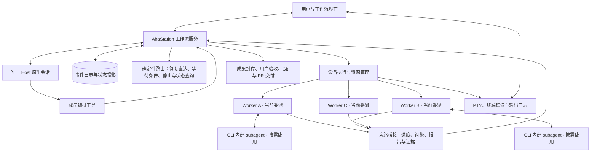

# 工作流、唯一 Host 与 Worker 架构草案

初稿日期 2026-11-08。2026-11-09 补充稳定工作身份、用户成果验收与 GitHub PR 交付。本文记录用户确认的产品模型及建议实现，代码迁移尚未开始。

本版在初稿基础上修订：补齐数据对象与状态机，明确完成判定、授权方式、确定性路由、终端回放和 V1 范围，并把初稿末尾的“进一步设计优化建议”合并进对应章节。第二轮修订补充了：交付按目标分支预期提交做条件更新、推送凭据的隔离分级、候选快照的唯一性与冻结、委派版本切换流程、轮次中断与进程退出分离、无 Git 交付委派的完成方式，以及终端快照与实时流的偏移一致。

## 模块详细设计入口

2026-11-08 新增 [V1 模块详细设计](workflow-v1/README.md)，包含原生执行、存储与状态、Host 消息、终端、成果交付、界面 IPC 及验证落地方案。

详细设计提出三项进一步收敛供实现采用。委派修订在轮次边界激活，运行中追加仅提前通知；Git 快照按明确文件清单采集；普通推送的并发保护范围与严格远端预期值更新分别说明。具体实现决策和待验证项见入口文档及各模块。第三轮复核补充了关闭窗口后台继续、空闲 CLI 唤醒与重启降级、冻结降级、无法核对执行的用户放弃路径、已检出目标分支的快进交付等内容，本文相应章节已同步。本文与详细设计不一致时，以详细设计为准。

## 用户确认的编排模型

工作流的编排关系为 Host → Worker。Host 把一个完整目标直接交给 Worker，Worker 自己安排实现、测试、修复和交付，并持续负责到目标完成。后续补充、返工、用户决定及恢复操作都直接回到这个 Worker。

工作流可以包含一个或多个仓库。Host 决定需要哪些 Worker、如何分工、何时复用已有负责人。一个仓库可以有多个 Worker，一个 Worker 的委派目标也可以覆盖多个仓库。

Host 根据目标、依赖、成员经验及实际进展动态拆分和调整分工，可以让一个 Worker 完成整体工作，也可以安排多个 Worker 并行协作。成员数量、职责粒度和执行顺序由 Host 在用户授权范围内决定。

Worker 执行时可以按需要使用所选原生 CLI 自带的 subagent，由 Worker 自己决定内部委派、汇总和纠偏。原生 subagent 的会话生命周期由对应 CLI 管理，其执行记录归属于父 Worker，父 Worker 对向 Host 提交的完整结果负责。

Worker 是具有独立上下文的长期成员。Host 派发的完整目标有稳定 workId，同一 Worker 的独立目标按项排队。Worker 交回已核对的成果后可处理下一项，原成果等待用户验收。界面呈现成员及其当前工作，执行步骤由 Worker 自行安排。

主 Host 负责理解上下文、派发、纠偏、转达用户决定、组织独立审查和汇总。成员间的协调经过 Host。共享资料对工作流成员可读，其他成员的会话记录需经授权读取，规则见“共享资料与成员互读”。

上述成员协调规则适用于 Host 管理的 Worker 之间。Worker 内部的原生 subagent 使用该 CLI 原生支持的通信机制，由所属 Worker 汇总对外报告。

## V1 范围

V1 先在单台设备上跑通完整的 Host → Worker 闭环，其余能力保留设计、推迟实现。

| 范围 | V1 | 后续版本 |
|---|---|---|
| 设备 | 单设备，Host 固定承载在本机 | 跨设备查看、Host 显式交接 |
| 事实存储 | Electron 主进程内的本地持久化存储 | 接入 Hub 作为共享权威服务 |
| Host 运行时 | Codex app-server | 其他实现 HostRuntime 的后端 |
| Worker 后端 | Claude Code、Codex 原生终端 | 其他已验证能力声明的 CLI |
| 仓库 | 工作流可包含多个仓库，每个委派对应一个仓库 | 单个委派覆盖多个仓库 |
| 推送隔离 | 防误操作级：Worker 的常规推送失败，不保证 Worker 无法主动绕过 | 强隔离级：独立系统账户、容器或沙箱 |
| GitHub PR | 同仓库分支交付，关联真实 PR 和逐文件差异 | 跨仓库 PR |
| 共享资料 | 本机文件加版本与哈希元数据 | 对象存储、远端发布与跨设备读取 |
| 自动化 | 不提供 | Host 提议、用户确认的定时触发 |

V1 的数据结构保留 Workflow ID、设备挂载、Host 运行代次等字段，后续版本不需要迁移数据格式。

## 架构图



工作流服务、确定性路由、设备执行、交付执行和事件存储是实现模块。Host 面向 Worker 编排，界面中的每张 Worker 卡片直接展示目标、负责人职责、执行位置、进度、等待原因及成果。

## 数据对象

| 对象 | 内容 |
|---|---|
| Workflow | 稳定 ID、名称、根目录挂载、唯一 Host、规则、仓库集合及整体完成条件（带版本） |
| Repository | 仓库身份、设备路径、工作树与分支信息 |
| Worker | 稳定成员 ID、名称、职责、后端、档案状态、当前委派引用、待生效修订引用、委派历史和成果索引 |
| Work | workId、工作流、仓库、指定 Worker、队列顺序、当前委派、最新成果版本和业务状态 |
| Delegation | workId、所属 Worker、版本号、背景、完整目标、允许的仓库与路径、分支及基线、资料版本、成果类型、交付要求、验收条件、输出位置、已确认决定、状态与等待原因 |
| Execution | 所属 Worker、NativeSession、PTY、进程身份、进程状态、生效过的委派版本序列、退出码与退出确认、会话资源占用 |
| Turn | 所属 Execution、生效的委派版本、起止时间、状态、中断核对结果、本轮启动的后台进程 |
| BridgeCredential | 绑定的 Workflow、Worker、Execution 与委派版本，状态（有效、仅限历史上报、失效） |
| NativeSession | 后端类型、原生会话引用、可恢复性、所在目录、替换记录 |
| Event | 工作流内单调递增序号、类型、来源、关联对象、requestId 与载荷 |
| Message | 发件方、收件方、关联 Worker 与 Delegation 版本、类型、投递方式、状态与各阶段回执 |
| Decision | 问题与原文答复，或对 workId 和 resultVersion 的接受／退回决定 |
| Grant | 授权对象（读取会话记录、提交、推送、创建 PR 等）、被授权方、范围、绑定版本、授予者与撤销记录 |
| Artifact | 逻辑路径、版本、内容哈希、来源 Worker、正文位置，分析类成果另记所依据的仓库提交与资料版本 |
| Candidate | 全局唯一 Candidate ID、所属 Worker 与 Delegation 版本、仓库、基线提交、允许路径、候选提交与树哈希、隐藏引用、文件清单、范围外改动清单、冻结核对结果 |
| Delivery | 所属 Work 与 Delegation、Candidate、目标仓库与分支、预期目标存在状态、交付提交、Git 回执、可选 PR 绑定及替换记录 |
| PullRequestSnapshot | GitHub 仓库身份、PR 编号及 URL、实际 base/head 与状态、Diff 哈希及逐文件索引 |
| WorkResult | workId 与递增 resultVersion、精确委派、成果、验证、交付和 PR 快照引用，封存后可独立查看 |
| Verification | 类型（机器检查或 Host 判定）、被验证的 Candidate 或 Artifact 版本、执行者、命令、工作目录、环境摘要、退出码、日志、产物哈希、结论与失效标记 |
| Lease | 类型（Host 运行代次或资源）、持有者、代次号、资源类别、获取与释放时间 |

Delegation 的内容一经下发即不可变。修订、返工和整体交接生成同一 workId 下的新委派，独立新目标先生成新的工作并入队。Turn、Verification、操作授权和 Candidate 引用具体的 Delegation 版本，用户成果决定引用精确的 WorkResult。一个 Execution 可以先后承载多个委派版本，每个 Turn 只对应一个版本。

成员档案（Worker）与原生会话（NativeSession）分开记录。复用负责人时可以继续原会话，也可以在需要变更目录或原会话不可恢复时创建新会话并写入替换记录，Worker ID 保持不变。

本地路径作为设备挂载。同一工作流跨设备使用相同 Workflow ID，设备路径可以不同。同一设备对根目录进行真实路径归一化和唯一性校验，避免路径别名重复创建 Host。

改名只更新名称和职责描述，权限范围需单独校验。

### 事件日志与状态投影

每个工作流维护一条只追加的事件日志，使用单一单调序号。Work、Worker、Delegation、Execution、Turn、Message 的当前状态是事件日志的投影，状态迁移与对应事件在同一事务中写入。

Host 收件箱、每个 Worker 的指令队列和界面订阅各自保存消费游标，重启后从游标继续。事件按序号去重，失联的执行或轮次保留待核对状态，核对后再写入结果事件。

改变状态的命令携带 requestId、Workflow ID、Worker ID 和必要版本。服务事务性保存状态、事件及待投递记录，相同请求重复到达时返回已有结果，请求 ID 相同而内容不同则拒绝。

## 状态机

每张表列出允许的状态和触发者。表外的迁移一律拒绝，并返回当前状态和原因。

### Worker 档案

| 状态 | 含义 | 进入方式 |
|---|---|---|
| `idle` | 没有未结束的委派 | 创建时；当前委派进入终态 |
| `engaged` | 持有一个未结束的委派 | Worker 领取排队工作并建立委派 |
| `archived` | 已归档，会话与历史可查询 | Host 调用 ArchiveAgent，排队及执行中的委派已处理，Execution 已确认退出 |

卡片上显示的“运行中”“等待决定”“空闲但进程驻留”等由 Delegation、Execution 与 Turn 状态推导，不另存一份。

### Delegation

| 状态 | 含义 | 触发者 |
|---|---|---|
| `pending` | 已领取工作或准备修订，Worker 尚未回执接收。修订切换前原版本仍是当前版本 | 服务 |
| `active` | Worker 已接收并在推进 | 服务，依据 Worker 的接收回执或继续消息的处理回执 |
| `waiting` | 等待用户决定、依赖成果、审查结果或交付授权，记录 `waitReason` 和条件 | Worker 提问；Host 设置等待条件；服务在验证通过但缺少交付授权时设置 |
| `candidate` | Worker 提交完成候选（Candidate、Artifact 版本或两者），等待验收 | Worker |
| `verified` | 机器检查全部通过，Host 判定条件全部通过 | 服务，依据 Verification 记录 |
| `done` | 本次委派结束，准确成果已封存，Work 进入待用户验收 | 服务 |
| `superseded` | 被新版本替换 | 服务（版本切换完成） |
| `handed_off` | 写入归属已交接给其他 Worker | 服务（Host 改派且原写入确认停止） |
| `cancelled` | Host 或用户结束该目标；也用于未生效即被撤回的修订 | Host 或用户 |

允许的回退迁移：

- `waiting → active`：决定送达、等待条件满足或授权到位。
- `candidate → active`：验收失败或收到审查意见，原 Worker 继续修复。
- `verified → active`：后续改动使相关验证失效，或目标分支前进后需要重新集成。
- `verified → waiting`：交付要求包含提交或推送但缺少授权，界面显示“实现已验证，等待提交确认”。

Worker 只能把委派推进到 `candidate`，不能直接宣布完成。

### Execution（CLI 进程）

| 状态 | 含义 |
|---|---|
| `starting` | 已请求启动，尚未确认进程与会话身份 |
| `running` | 进程存活，原生交互会话可用 |
| `stopping` | 已请求结束进程，等待退出确认 |
| `exited` | 已确认进程退出，包括内部 subagent 与相关子进程，记录退出码与原因 |
| `unknown` | 失联或启动结果不明，待核对 |
| `abandoned` | 身份始终无法核对，经用户确认放弃；记录已尝试的停止动作和剩余风险 |

`unknown` 只能经过核对迁移到 `running` 或 `exited`，或由用户确认放弃后进入 `abandoned`（Host 不能发起）。核对前不重复启动同一执行；`abandoned` 之后才允许创建替代执行。

### Turn（原生模型轮次）

Turn 只在 Execution 处于 `running` 时存在。

| 状态 | 含义 |
|---|---|
| `active` | 原生模型正在执行，可能产生写入 |
| `interrupting` | 已通过后端的中断路径请求停止本轮 |
| `stopped` | 本轮已结束（正常结束或中断确认），内部 subagent 与本轮启动的写入进程已核对停止，CLI 进程继续驻留 |
| `unconfirmed` | 已发出中断，但无法确认内部执行或子进程已停止 |

本轮启动的后台进程逐项记录。Host 或 Worker 声明为允许驻留的进程（如开发服务器）继续计入 Execution 的资源，其余进程停止后，Turn 才能进入 `stopped`。

中断一轮与结束进程分别处理：

- **只需轮次停止**：用户或 Host 中断当前工作、生成候选快照、交接写入归属、委派版本切换。CLI 继续驻留，用户可以在原终端里继续对话。
- **需要进程退出**：归档成员、切换执行目录、结束工作流、回收空闲进程。
- Turn 处于 `unconfirmed` 时视为仍可能写入，不能生成快照或交接写入归属。服务把证据报给 Host，Host 可以升级为结束进程。

### Message

| 状态 | 含义 |
|---|---|
| `persisted` | 已落库，尚未投递 |
| `deferred` | 暂不能投递：用户占有终端输入、后端不支持运行中追加指令或目标执行未运行，界面显示待处理 |
| `delivered` | 已写入目标的旁路通道或终端，并收到送达回执 |
| `consumed` | 目标已处理，收到处理回执 |
| `rejected` | 引用了过期的 Delegation 版本或越权，记录原因 |

### 完成判定

Delegation 声明成果类型和交付要求：

| 成果类型 | 成果形式 | 典型交付要求 |
|---|---|---|
| 代码变更 | Candidate | 仅产出已验证的 Candidate、Git 分支交付，或要求真实 GitHub PR 及差异 |
| 资料 | Artifact 版本，记录分析所依据的仓库提交与资料版本 | 无 |
| 两者兼有 | Candidate 与 Artifact 分别列出 | 按代码变更部分确定 |

验收条件分两类，在 Delegation 中分别列出：

- **机器检查**：命令、工作目录、期望退出码和必需产物。代码变更在 Candidate 的检出目录上执行；资料可以检查文件存在、哈希和格式。服务执行检查并写入 Verification。
- **Host 判定**：无法用命令表达的条件。Host 阅读证据后写入类型为 Host 判定的 Verification，并注明依据。

两类条件全部通过后，Delegation 进入 `verified`。服务在必要交付核对完成后封存一个 WorkResult，结束本次委派，并将 Work 置为 `awaiting_acceptance`。资料和仅产出候选的工作也提交用户验收。

用户接受当前成果版本后，Work 进入 `completed`。用户退回时记录原成果、版本和意见，由 Host 在同一 workId 下安排返工。成果历史与 Worker 当前委派分开查询，服务的状态与回执见 [存储与状态](workflow-v1/02-store-and-state.md) 和 [成果与交付](workflow-v1/05-artifacts-and-delivery.md)。

工作流的整体完成条件由 Host 随目标确定并带版本保存，包括必要交付、验收和待用户决定事项。成员空闲或最后一轮发言结束都不代表整体完成。

## Host 工具与派发语义

| 工具 | 行为 |
|---|---|
| ListAgents | 返回成员职责、当前委派与状态、所在目录、原生会话可用性和最近成果 |
| SpawnAgent | 创建成员和首个完整工作，返回 workerId、workId 及排队或启动回执 |
| SendMessage | 向已有成员追加要求、转达补充说明、下发修订或下一项完整工作 |
| GetWork / RequeueWork / CancelWork | 按 workId 查询历史、成果与决定，重新安排排队或退回的工作，或取消指定工作 |
| SetWaitCondition | 让某个 Worker 等待指定成员的成果版本或用户决定，条件满足后由服务投递继续消息 |
| WaitAgents | 按事件游标等待进度、问题、完成候选或异常 |
| InterruptAgent | `scope=turn`（默认）中断当前轮次，CLI 保持驻留；`scope=process` 结束 CLI 进程。返回对应的停止确认状态 |
| HandOffAgent | 把委派或部分写入归属交接给另一成员，按“调整分工与交接”执行 |
| RenameAgent | 更新成员名称和职责 |
| ArchiveAgent | 归档已无活动执行的成员，保存会话和历史 |
| ReadAgentHistory | 读取已获授权的成员记录 |
| GrantAccess | 授予或撤销成员读取其他成员会话记录的权限 |
| ReadArtifact / WriteArtifact | 读取和维护带版本的共享资料 |
| AskUser | 产生持久化问题，可绑定提问的 Worker 与 Delegation 版本 |
| RequestDelivery | 基于指定 Work、Candidate 和目标引用发起交付申请，服务核对目标并执行各动作的用户授权 |

SendMessage 区分协调留言、继续当前目标、修订当前目标和接收新目标。修订沿用 workId 并在轮次边界生效；新目标创建独立 workId，待 Worker 有可用委派槽再领取。回执区分排队、已投递和已接收。

新成员的委派消息可以独立理解。输入包含背景、目标、范围、第一步、目录、资料、限制、成果类型、交付要求、验收条件与回报要求。Host 与用户的完整对话仅在明确选择共享时加入成员上下文。

Host 先检查已有成员及经验，再决定复用或新建。系统校验目标路径、权限、后端能力、写入冲突及资源，返回具体限制，Host 据此调整分工。

## 服务直接路由与 Host 唤醒

Host 的模型轮次是串行的。确定性的事务由服务直接处理，处理结果以事件形式抄送 Host，Host 只处理需要判断的事件。成员之间的协调仍经过 Host。

服务直接处理：

- **用户答复**：Worker 提问后，Host 决定自己回答还是调用 AskUser。AskUser 绑定了提问的 Worker 和 Delegation 版本时，用户答复原文由服务直接投递给该 Worker，Host 收到抄送；Host 需要补充说明时另发 SendMessage，并单独保存。
- **等待条件**：SetWaitCondition 记录来源 Worker、目标版本和成果引用。条件满足后，服务投递继续消息，并分别记录“条件满足”和“Worker 已继续”两个事件。
- **停止与状态查询**：用户发起停止时立即进入执行服务的中断流程，默认只中断当前轮次，Host 随后收到结果。状态查询、回报持久化和用户答复接收不经过 Host。
- **循环等待检查**：服务发现明显的循环等待时，向 Host 返回相关成员及原因，由 Host 调整安排。

Host 唤醒分两级：

- **立即唤醒**：提问、范围变更、失败、完成候选、授权变化、等待条件无法满足、修订未被接收、执行或轮次进入待核对状态、交付因目标分支变化被拒绝。
- **合并唤醒**：普通进度在可配置时间窗口内合并为变化摘要。

Worker 的报告、问题和 Artifact 可能夹带仓库内容中的注入文本，对 Host 而言一律是数据。Host 输入中 Worker 文本以带来源标记的引用块呈现；扩大范围、交付和推送等权限只能来自服务校验或用户的结构化确认，Host 被误导时也只能提出申请；AskUser 和授权界面显示问题与说明的真实来源。详见详细设计 03“Worker 内容的信任边界”。

Host 默认收到简短的变化摘要、当前成员状态、未决问题和证据引用，完整日志与历史按需读取。重要决定保留原文和来源，摘要附带可回查链接。待用户回答的问题可以合并展示，但每项决定保留独立的适用对象和授权。

Host 唤醒与 Worker 执行使用可区分的资源配额，为 Host 保留运行容量，避免 Worker 占满名额后 Host 无法启动。模型请求额度也可能限制唤醒，界面显示真实原因。

## 原生运行时

建议第一版通过 Codex app-server 接入 Host，复用原生会话。统一 HostRuntime 接口覆盖创建、恢复、输入、事件订阅、工具回调和中断。编排工具的成员身份与行为由 AhaStation 实现。

Host 可以读取项目、核对状态、维护共享计划及调用成员工具。代码写入由 Worker 执行，通过工具权限和运行环境落实职责边界。

Worker 使用选定的原生 CLI 终端运行方式，提供同一执行会话的真实终端视图。每个适配器提交一份能力声明，并针对实际 CLI 版本验证：

| 能力 | 声明内容 |
|---|---|
| `sessionResume` | 能否按会话引用恢复，恢复后上下文是否完整 |
| `sideChannelEvents` | 进度、问题、报告的上报方式（hooks、MCP、结构化协议） |
| `inboundInstructions` | 接收 Host 指令的方式：旁路工具轮询、原生 steer 协议或终端注入 |
| `midTurnSteer` | 能否在轮次进行中追加指令 |
| `turnBoundaryDetection` | 检测原生轮次边界的方法及可靠性 |
| `turnInterrupt` | 中断当前轮次而保留交互会话的路径，以及确认轮次已停止的手段 |
| `processExit` | 结束进程的路径及退出确认手段 |
| `nativeSubagents` | 内部 subagent 是否存在、状态与日志是否可见、子进程能否枚举 |
| `enforcement` | 越界写入、需确认的删除、禁用操作各自的拦截手段 |
| `credentialIsolation` | 已验证的推送隔离级别，以及强隔离下 CLI 自身登录凭据的提供方式 |

能力证据只对记录的 CLI 版本有效。每次启动执行都记录 CLI 实际版本；遇到未验证的版本先做不需要模型调用的快速探测；通过后，因为自动降级也只能使用已验证的能力，该版本的自动投递暂停，界面提供运行验证、改用已验证版本和人工投递三个入口。工作流启动的 Worker 进程关闭 CLI 自更新，只作用于本次进程，不修改用户的全局安装。详见详细设计 01“CLI 版本与能力漂移”。

内部 subagent 使用父 Worker 的委派范围与有效授权。中断当前轮次时，执行服务通过后端控制协议及可观察的进程信息核对内部 subagent 与本轮写入进程已停止；结束、归档或切换执行目录时，核对进程完整退出。未确认时 Turn 保持 `unconfirmed`，或 Execution 保持 `stopping`、`unknown`，相应资源继续占用。资源统计根据后端可见能力纳入子进程和内部并发，原生会话数量限制需要单独说明实际覆盖范围。

长期 Worker 保留原生会话引用、可读历史、当前进度、最新决定和证据索引。空闲时可回收进程。原生会话无法恢复时，写入 NativeSession 替换记录，使用共享资料及历史摘要继续，并显示上下文连续性限制。

Host 恢复或历史压缩后，先读取工作流规则、成员表、未决问题和未消费消息。Worker 恢复时读取自己的当前委派及最新决定，再核对执行位置和分支。

## 原生执行过程查看

用户明确要求 Worker 的执行查看体验与原生 CLI 一致。工作流视图展示 Host 对话与成员列表，选择 Worker 后直接挂载该成员正在运行的原生 CLI 终端，并保留切回 Host 的入口。

Worker 使用真实原生 CLI 进程及其会话。终端通过 PTY 承载输入输出，Windows 上使用 ConPTY。前端终端组件消费原始终端数据、传递窗口尺寸和用户输入，呈现 CLI 自身的布局、颜色、工具输出、流式刷新、菜单、快捷键及内部 subagent 界面。中断当前轮次后 CLI 继续驻留，终端保持可交互。

一次 Execution 绑定一个明确的 NativeSession 和 PTY。查看或切换页面时重新附着该执行；进程已退出时进入原生恢复流程并显示实际恢复结果。复用同一运行时协议的原生终端客户端时，也要核对其绑定的会话身份。

### 终端镜像与回放

全屏 TUI 使用备用屏幕和光标定位。从原始字节流中间开始回放，可能得到错乱的画面，直到 CLI 下一次整屏重绘才恢复。因此回放改为屏幕快照：

- 主进程为每个 PTY 维护一个无界面终端镜像（`@xterm/headless`），持续消费同一份输出并跟随尺寸变化。
- 重新挂载时，先用 `@xterm/addon-serialize` 发送镜像的序列化屏幕状态和滚动历史，再从快照对应的偏移接上实时流。
- 原始输出另行追加写入磁盘日志，按字节偏移提供长历史查询和断线续传。缺失的数据段明确标记。
- 有限长度的内存缓冲只作为磁盘写入前的暂存。

### 快照与实时流的偏移一致

- 每个 Execution 的 PTY 输出按到达顺序分配连续的字节偏移。同一数据块以相同偏移写入磁盘日志、送入终端镜像并推送给订阅者。尺寸变化作为带偏移的标记写入同一序列。
- 主进程对输出做轻量的边界跟踪，记录每个偏移是否处于未结束的控制序列（ESC、CSI、OSC、DCS 等）或未完整的 UTF-8 字符中。

挂载流程：

1. 在主进程中同步取得当前已接收偏移，并为该订阅者建立待发队列，此后到达的数据进入队列。
2. 确定快照偏移 X：当前偏移处于控制序列或多字节字符中间时，顺延到该序列或字符结束的位置。
3. 镜像处理到 X 时（以 xterm 写入回调确认解析位置）同步序列化屏幕，得到对应 X 的快照与当时的尺寸。
4. 发送快照、X 和尺寸。渲染端先按快照尺寸初始化终端并写入快照，再上报自己的窗口尺寸。
5. 发送队列中位于 X 之后的数据；跨越 X 的数据块在 X 处切分。

渲染端核对每个数据块的起始偏移是否连续。发现缺口时从磁盘日志按偏移补读；所需范围已不在日志中时重新挂载，并在界面标记缺失的区间。

镜像定期把序列化快照与对应偏移写入检查点。应用重启后，从最近的检查点加上日志尾部重建镜像，不需要从头回放。xterm 写入回调与解析位置的对应关系需要用测试验证，包括高输出量和挂载点落在控制序列中间的情况。

终端数据与编排事件分别持久化。终端数据的留存及跨设备查看受工作流访问权限约束。

### 指令投递与输入所有权

编排通过 CLI 支持的 hooks、MCP、结构化协议或工作流桥接工具旁路接入。终端负责原生显示与交互，旁路负责委派接收、提问、报告和生命周期证据，双方共享准确的 Worker、Delegation 版本和 NativeSession 身份。

Host 指令按 CLI 当前状态选择投递方式：

- **轮次进行中**：原生 steer 或旁路工具（Worker 调用桥接工具读取待处理指令）。只作为提前通知，修订仍在轮次边界生效。
- **CLI 空闲，停在输入提示**：模型没有运行，旁路工具不会被调用。使用原生协议，或经验证的空闲终端注入；注入要求没有人工输入所有者、用户没有未提交的草稿，并以提交或轮次开始的证据确认接收。
- **空闲但不能注入**：结束进程并确认退出，再用原生恢复命令按会话 ID 重启并携带指令（resume-with-instruction）。这是两种 CLI 的通用降级，代价是 TUI 重启一次。

都不可用时，Message 保持 `deferred` 并在界面显示待处理。需要立即暂停时走 InterruptAgent。详见详细设计 01“指令投递路径与降级”。

用户在终端中输入时取得输入所有权，自动注入进入等待并通知 Host。用户切走视图、自己发起的轮次结束或超过无输入时长时自动释放，界面持续显示持有状态和释放按钮。控制权交回后，在下一个轮次边界恢复投递。

原生环境的模型选择、配置、skills、MCP 和内部 subagent 能力按选定后端加载，工作流额外接入的工具及权限策略明确记录。原生能力与工作流权限冲突时，展示具体的能力差异。

## 控制服务与唯一 Host

V1 的工作流事实存储放在 Electron 主进程内的本地持久化存储中，事件日志、状态投影和待投递记录在同一事务内写入。存储层定义为接口，后续版本可接入现有 Hub，作为跨设备的权威服务。

接入 Hub 后，每个工作流绑定一个权威服务，客户端保存缓存与待发送请求。新派发依赖服务可达：断线时用户输入和请求显示待发送，已接收且持久化的委派可以在既有授权范围内继续，回报在恢复连接后补交。

一个 Workflow 保存一个逻辑 Host ID 和当前承载设备。V1 固定承载设备，支持同机重启恢复。Host 运行代次和租约用于拒绝旧实例的派发，本机服务同时防止重复启动。原生进程启动结果不明确时，先核对已保存的执行身份，避免重复启动。

后续版本支持跨设备接管：租约失效后先核对旧实例，完成显式交接与旧实例停止核对后再接管。

界面关闭和工作流结束分别处理。结束工作流时，需要核对正在运行成员的进程退出结果，并持久化状态。

关闭最后一个窗口时，没有运行中的工作则退出；有则询问“后台继续”或“停止并退出”，默认后台继续，Windows 与 Linux 常驻托盘，macOS 保留 Dock 图标。现有 `electron/main.ts` 在关闭全部窗口时会结束所有执行，需要按详细设计 06 改造。

## 消息、请示与持续推进

消息先落库再投递，按 Message 状态机记录送达及处理回执。

Worker 可以多次提交进度、问题、待审查成果、完成候选和异常。原生模型轮次结束时，委派可以仍处于 `waiting`、`candidate` 或返工后的 `active`。

遇到范围变更或需授权的操作时，Worker 暂停相关操作并向 Host 提问，委派进入 `waiting`。Host 自行回答或调用 AskUser；用户答复按“服务直接路由”送达原 Worker，委派回到 `active`。

用户输入、Worker 回报、提问答复和验证结果进入 Host 的持久化收件箱，并按唤醒级别唤醒同一个 Host。Host 模型轮次串行处理，并发消息按游标排队。重复进度可以合并，问题、答复和终态事件完整保留。

持续运行但长时间没有可观察进展时，执行服务先检查连接、进程和原生轮次状态，再向 Host 报告证据。重复失败或连续返工没有推进时，由 Host 评估修订方案或请求用户决定。重启与重发前先核对原执行，保留次数和失败历史。

### 委派版本切换

桥接凭据绑定 Workflow、Worker、Execution 和委派版本。修订当前工作时按以下流程切换；独立工作在原委派结束且轮次静止后领取，由服务准备新的执行版本。

1. **记录修订**：服务保存新 Delegation 版本，状态为 `pending`。当前版本和旧凭据保持不变，Worker 仍可以提问和回报。
2. **选择生效时机**：一个 Turn 只对应一个版本，新版本只在轮次边界生效。支持运行中追加指令的适配器可以提前送达修订通知，但不在当前轮次内切换版本；等本轮进入 `stopped` 后投递并激活。Host 要求立即生效时，按 `scope=turn` 中断当前轮次，CLI 保持驻留。修订 pending 期间用户手动发起的轮次绑定旧版本。
3. **投递修订**：修订消息携带新版本的完整内容。服务同时为新版本签发桥接凭据，写入该执行的运行时目录，旧凭据此时仍然有效。
4. **确认接收**：优先由同一会话的提交 hook 或原生协议在模型继续执行前回传新版本标识，其次由 Worker 使用新凭据回执接收；不支持接收门禁的后端改用 resume-with-instruction。服务在同一事务中切换当前版本：新版本进入 `active`，旧版本进入 `superseded`，旧凭据降级为“仅限历史上报”。
5. **切换之后**：使用旧凭据的回报进入旧版本历史，不能改变当前委派；使用旧凭据的提问被拒绝，并返回新版本编号，提示 Worker 读取修订。绑定旧版本的未决问题由 Host 决定迁移到新版本或作废。
6. **未确认**：超时或执行异常时，旧版本保持为当前版本，修订保持 `pending`，并立即唤醒 Host。Host 可以重发、中断轮次后重试、撤回修订（修订进入 `cancelled`），或结束进程后以新版本启动新的 Execution。

Execution 退出时，它持有的所有凭据失效。新的 Execution 使用新签发的凭据。

## 依赖等待与阶段成果

阶段成果可以在完整目标结束前以 Artifact 版本发布。例如接口负责人发布已确认的接口约定后，客户端负责人即可开始适配。

Host 用 SetWaitCondition 让 Worker 等待指定成果版本、可集成快照或用户决定。成果出现新版本时，服务把引用旧版本的成员输入标记为过期并通知 Host；已验证的成果继续绑定原版本。

## 调整分工与交接

Host 改派工作或收缩职责时调用 HandOffAgent。服务按以下顺序执行：

1. 保存原委派的当前进度、未完成项、最新决定、候选成果及实际工作目录。
2. 中断原 Worker 的当前轮次，确认 Turn 进入 `stopped`。Turn 为 `unconfirmed` 时不交接写入归属，Host 可以升级为结束进程。CLI 进程可以继续驻留。
3. 按“候选快照”规则为未提交的修改生成 Candidate，保留引用。
4. 原委派进入 `handed_off`，向接手 Worker 下发同一 workId 下的新委派，内容包含交接说明和该 Candidate 基线。

原成员的会话和未提交成果保留引用，界面显示实际恢复结果，成员身份持续保留。

## 隔离、审查、集成和验收

### 目录隔离

独立代码工作使用各自的 worktree 和私有分支（如 `aha/work/<workId>/<workerId>`），记录实际目录、基线和允许路径。交接准备单独的接手目录。同一成员的模型输入串行，需要并行时由 Host 分配其他成员。

### 候选快照

审查、验收和交付都基于不可变的 Candidate，Candidate 用 git 对象实现。同一仓库的所有 worktree 共享 `refs/` 下的引用，因此引用名必须全局唯一，且只允许创建、不允许覆盖。

生成步骤：

1. **冻结写入**：
   - Worker 通过旁路提交候选时，调用阻塞期间 Worker 本身不写入；服务核对其内部 subagent 与本轮后台写入进程均未运行，否则拒绝并说明原因。
   - Host、交接或其他服务流程触发时，要求 Turn 处于 `stopped`。
   - 适配器无法证明内部 subagent 与写入进程已停止时，降级为结束 CLI 进程，以进程树退出作为静止证据，采集后再按原生会话恢复。
2. **按允许路径收集**：在临时 index 上读入基线，再按明确的、NUL 分隔的文件清单（允许路径内的新增、修改和删除）更新 index，不使用批量暂存。命令通过 argv 和 stdin 调用，不经 shell 拼接。

   ```text
   GIT_INDEX_FILE=<临时 index> git read-tree <基线提交>
   GIT_INDEX_FILE=<临时 index> git update-index --add --remove -z --stdin   # stdin 为文件清单
   tree=$(GIT_INDEX_FILE=<临时 index> git write-tree)
   ```

3. **一致性复核**：用第二个临时 index 重复第 2 步。两次树哈希不一致说明仍有写入，丢弃本次结果并报告。这是对第 1 步静止证据的补充校验，不能替代静止证据。
4. **记录范围外改动**：允许路径之外的改动不进入快照，列入 Candidate 的范围外改动清单并通知 Host。
5. **创建提交与引用**：分配全局唯一的 Candidate ID（如 ULID），工作流、Worker、委派版本等元数据存入 Candidate 记录，不编码进引用名。

   ```text
   commit=$(git commit-tree $tree -p <基线提交> -m "<候选说明>")
   git update-ref --stdin <<< "create refs/aha/candidates/<candidateId> $commit"
   ```

   `create` 指令只在引用不存在时成功，重复创建会被拒绝。

补充规则：

- 新增、修改、删除和未跟踪的文件都会进入快照，内容由 git 按哈希寻址。
- 被 `.gitignore` 忽略的文件不进入快照。确实需要的忽略文件在委派中显式列出，并单独作为 Artifact 记录哈希。
- 临时 index 不影响 Worker 工作树的暂存状态。
- 审查和验收用 `git worktree add --detach <目录> <commit>` 在独立目录检出。
- 工作流归档并超过留存期后，服务删除对应的候选引用，相关对象交由 git 正常回收。

修复会产生新的 Candidate，相关验证和授权需要重新核对。

### 独立审查

独立审查作为审查 Worker 的完整委派下发，输入引用实现 Worker 的准确 Candidate。审查报告回到 Host，再由 Host 转达给原实现 Worker 修复，原委派从 `candidate` 回到 `active`。

Worker 可以使用内部 subagent 自查。工作流要求独立 Worker 审查时，Host 仍需安排相应的审查成员，并记录其身份与 Candidate 版本。

### 集成

单成员委派由该成员完成集成。多成员交付时，Host 指定一个已有 Worker 或新成员负责集成：它取得各成员准确的 Candidate，在指定的集成目录中处理冲突、运行组合后的验证，并生成以目标分支预期提交为基线的集成 Candidate 和交付清单。

单个成员的测试通过只证明对应 Candidate 成立，多成员交付需要核对合并后的整体结果。集成出现问题时，Host 将具体问题及复现依据发回相应成员，成员继续自己的委派。

### 重型验收与资源

资源按类别管理：

| 类别 | 占用时段 |
|---|---|
| `session` | Execution 处于 `starting`、`running`、`stopping` 或 `unknown`；CLI 驻留期间持续占用，进程确认退出后释放 |
| `execution-slot` | Turn 处于 `active`、`interrupting` 或 `unconfirmed`；轮次进入 `stopped` 后释放 |
| `host-reserved` | 为 Host 唤醒保留的容量 |
| `exclusive:<name>` | 需要独占的资源，如大型构建、固定端口、设备或模拟器，由工作流规则登记 |
| `model-quota` | 模型请求额度，仅用于观测和展示等待原因 |

重型验收先取得对应的 `exclusive` 租约，服务暂停新的冲突执行，并确认已有执行已结束或已释放该资源。结果落库且执行确认结束后释放租约。成员列表显示的空闲状态只作为 Host 的规划依据。

### 验证记录

Verification 记录成果身份、执行者、命令、工作目录、环境摘要、退出码、日志和产物哈希。基于同一基线的后续 Candidate 使受影响的验证失效。

## 授权与交付

### 交付流程

交付绑定目标分支的预期存在状态。已存在的目标记录提交 T，首次推送的新远端分支记录 `absent` 并单独使用 Candidate 基线。

1. **申请与授权**。RequestDelivery 包含摘要、差异统计、检查结果、逐文件清单及提交信息。服务核对目标引用后，提交授权绑定委派版本、Candidate、目标仓库、目标分支和预期存在状态，推送授权另行绑定准确交付提交。
2. **生成交付提交**。已存在目标要求 Candidate 基线等于 T。首次推送以已核对的 Candidate 基线为父提交，生成与 Candidate 树一致的交付提交。
3. **基线不一致**：服务不套用 Candidate 的旧树。Delivery 记为需要重新集成，委派回到 `active`，由集成负责人（单成员时为原 Worker）把 Candidate 集成到 T 上，生成以 T 为基线的新 Candidate。受影响的验证重新执行，授权针对新 Candidate 重新确认，界面展示新候选与已授权候选的差异。
4. **条件更新本地引用**：`git update-ref refs/heads/<branch> <交付提交> <T>` 只在本地分支仍为 T 时生效。失败时回到第 3 步。
5. **推送**。已存在分支采用普通快进推送。新分支采用只允许目标不存在的空预期值，按实际远端结果核对。要求 PR 时，远端 head 必须等于准确交付提交。

交付方式分为只推送远端分支（不改本地引用，适合合并请求流程）、只更新本地分支、本地加推送三种。目标分支正被某个干净的 worktree 检出且授权包含“更新已检出的工作区”时，服务先检查本次改动的路径上没有未跟踪或被忽略的本地文件、没有 assume-unchanged 或 skip-worktree 标记，再在该 worktree 中执行 `git merge --ff-only --no-overwrite-ignore` 完成第 4 步；检查不通过或该 worktree 有改动时返回 TARGET_IN_USE 并保留待处理交付。

Worker 对仓库共享的 .git 目录有写权限，可以植入 hooks 或改写 config（如 pushurl、credential.helper、fsmonitor）。因此推送凭据只在服务私有、Worker 不可写的裸仓库中使用，推送地址取用户确认后保存在服务中的远端；在 Worker 可写仓库中执行的 Git 命令不持有凭据，并禁用 hooks 与 fsmonitor。详见详细设计 05。

Worker 可以在私有分支上本地提交作为工作记录，这些提交不构成交付。交付只认 Delivery 记录中由服务生成并核对过的提交，不信任 Worker 可修改的本地分支引用。

要求 GitHub PR 时，服务默认为每个 workId 分配专用远端 head，并在推送前检查归属。推送后查询或经独立授权创建实际 PR，绑定仓库和编号，保存观察到的 base/head、核对时间和 GitHub 返回的逐文件 Diff 快照。用户接受前重新核对所阅快照。首次 PR 交付受阻时，保留已发生的 Git 写入，在同一 workId 下重新核对或经授权更换交付分支。具体操作和恢复契约见 [成果与交付](workflow-v1/05-artifacts-and-delivery.md)。

跨仓库交付（后续版本）按仓库保存基线、Candidate 和集成进度。部分仓库成功时保留结果，恢复后继续剩余步骤，整体交付要求所有必需成果就绪。

### 推送凭据隔离

Worker 以当前用户身份运行时，仅靠环境变量不能保证它无法推送：

- Git 会读取全局和系统配置中的凭据助手（如 Windows 上的 Git Credential Manager、macOS 钥匙串），仓库自身的 `.git/config` 也可以配置凭据助手，而 Worker 有权修改这个文件。
- SSH 可以直接读取 `~/.ssh` 下的私钥，`gh` 等工具有自己的令牌存储。
- Worker 可以在自己执行的命令中重新设置或清除环境变量。

因此推送隔离分为两级：

| 级别 | 措施 | 能保证的内容 |
|---|---|---|
| 防误操作（V1 默认） | 为每个 Worker 生成专用 Git 配置：`GIT_CONFIG_GLOBAL` 指向该配置，`GIT_CONFIG_NOSYSTEM=1`，`credential.helper` 置空；从用户配置中只复制提交身份、换行处理、`safe.directory` 等非凭据设置。移除 `SSH_AUTH_SOCK`、`GH_TOKEN`、`GITHUB_TOKEN` 等变量，设置 `GIT_TERMINAL_PROMPT=0` 和 `GCM_INTERACTIVE=never` | Worker 正常执行的 `git push` 失败；不能防止 Worker 主动绕过 |
| 强隔离（后续版本） | Worker 在独立系统账户、容器或沙箱中运行，无法访问用户的钥匙串、凭据管理器、`~/.ssh`、SSH agent 及各 CLI 的令牌目录；必要时限制访问代码托管服务的网络。CLI 自身的模型登录凭据单独提供给隔离环境 | Worker 无法推送，包括经脚本间接调用的路径 |

规则：

- 只有通过强隔离验证的平台与后端组合，才能声明“Worker 无法推送”。
- 工作流规则要求这一保证，而当前组合只达到防误操作级时，明确报告该配置无法在该后端执行。
- 远端的分支保护可以作为补充防线，但不能区分 Worker 和用户本人，不能替代隔离。
- 验证方法：在 Worker 环境中分别尝试 HTTPS 推送、使用私钥文件的 SSH 推送、直接调用 `git credential fill`、使用 `gh` 推送，逐项记录结果。防误操作级要求常规 `git push` 失败，并在报告中列出仍可绕过的路径；强隔离级要求全部失败。

### 其他需要拦截的操作

越界写入、需确认的删除和工作流禁用的操作，依赖适配器声明的 `enforcement`（hooks、权限回调或受控环境）。后端能力不满足某项规则时，明确报告该工作流配置无法在该后端执行。

## 共享资料与成员互读

共享空间提供 `plan.md`、`reviews/...`、`evidence/...` 等逻辑路径。V1 正文存放在本机文件中，元数据保存版本和哈希。写入时校验预期版本，冲突时保留双方内容。失败证据保留，重跑生成新记录。

成员互读规则：

- 工作流内的 Artifact 默认对所有成员可读。
- 读取其他成员的会话记录需要 Host 通过 GrantAccess 授权，授权记录被授权方、目标成员、范围和授予依据，可以撤销。
- Host 与用户的完整对话仅在用户明确选择共享时开放。

后续版本增加设备可读写挂载和对象存储：本地写入通过发布入口上传，发布状态包含本地保存、上传中、共享可用和失败；远端成员等待文件完整且哈希验证通过后再读取。

## 自动化（后续版本）

重复工作的自动化由 Host 在合适时机提议，用户确认后保存计划和授权范围。触发时向原工作流的 Host 投递消息，并核对当时有效的授权与资源。

## 工作流验收场景

以下均为实现后的端到端验收要求。

### V1

| 场景 | 必须观察到的结果 |
|---|---|
| 单仓库或多仓库目标 | Host 自主决定成员数量和完整委派，界面直接展示 Worker 当前工作 |
| Host 动态调整分工 | 在授权范围内复用或新增 Worker，交接记录完整，写入归属明确 |
| 带未提交修改的交接 | 原轮次确认停止，Candidate 保留未提交修改，接手者收到完整交接消息 |
| Worker 按需调用原生 subagent | 父 Worker 汇总结果并负责交付，内部执行记录可追溯至父成员 |
| 中断当前工作 | 轮次停止确认覆盖内部 subagent 与本轮写入进程；CLI 驻留，用户可在原终端继续对话；`session` 资源仍计入，`execution-slot` 已释放 |
| 中断无法确认 | Turn 保持 `unconfirmed`，不能生成快照或交接，Host 收到证据并可升级为结束进程 |
| 结束 Worker 进程 | 进程与内部子进程确认退出后才释放 `session` 资源，凭据全部失效 |
| 运行中修订委派 | 切换前 Worker 可用旧凭据提问和回报；回执后当前版本切换；之后的旧凭据回报只进入旧版本历史，提问被拒并提示新版本 |
| 修订未被接收 | 旧版本保持当前，修订保持 `pending`，Host 被立即唤醒 |
| 复用负责人继续移植 | Worker ID 稳定，恢复其上下文，补充要求直接送达 |
| 实现失败后继续修复 | 原 Worker 持续处理当前委派，失败证据可追溯 |
| 遇到范围外操作或提交门槛 | 委派进入 `waiting`，用户答复原文直达原 Worker，Host 收到抄送 |
| 等待其他成员成果 | 成果版本发布后服务自动投递继续消息，版本变化时标记输入过期 |
| 循环等待 | 服务向 Host 返回相关成员及原因 |
| 两个 Worker 并行开发 | 各自使用私有分支、worktree 和权限 |
| 同一仓库两个 Worker 同时生成候选 | 引用互不冲突，重复创建同一引用被拒绝 |
| 写入未停止时生成候选 | 两次收集的树哈希不一致，本次候选被拒绝并报告 |
| 允许路径外有改动 | 改动不进入快照，列入范围外改动清单并通知 Host |
| 独立审查未提交成果 | Candidate 包含未跟踪文件，审查者在独立目录检出同一提交，意见经 Host 回到实现负责人 |
| 多成员集成后失败 | 集成负责人定位问题，Host 把问题与复现依据发回相应成员 |
| 纯分析或报告委派 | Artifact 记录依据的仓库提交，技术验证后待用户验收，接受该版本后完成 |
| 重型验收 | 独占资源期间冲突执行等待 |
| 满负载下 Host 唤醒与用户停止 | Host 使用保留容量被唤醒，用户停止不经 Host 立即生效 |
| 用户授权提交 | 服务按清单、Candidate 和预期目标提交执行交付，推送需对应授权 |
| 目标分支在授权后前进 | 他人的新提交不被撤回；条件更新或推送被拒绝，重新集成、验证、授权后再交付 |
| 首推功能分支与真实 PR | 新分支只在目标引用不存在时创建，PR 绑定准确提交，界面按 PR 快照展示实际逐文件差异 |
| 已归属其他工作的远端 head | 在远端写入前拒绝，原工作的 PR 和已封存证据保留 |
| 首次 PR 交付受阻 | 同一工作可重新核对或经授权换分支，旧回执可查，当前交付才可封存成果 |
| 用户查看时 PR 更新 | 旧成果仍可查，当前 PR 变化提示重新核对，旧快照无法推进验收 |
| Worker 环境内尝试推送 | 常规 `git push` 失败，报告逐项列出各推送路径的结果与仍可绕过的路径 |
| 非法状态迁移 | Worker 自行宣布完成等表外迁移被拒绝，并返回原因 |
| 多成员同时回报 | Host 有序处理，重要事件全部保留，普通进度被合并 |
| 重启或历史压缩 | 恢复原成员、当前委派、待决问题和证据依据；待核对的执行和轮次先核对后处理 |
| 同一成员收到独立新目标 | 新目标独立排队，旧成果按 workId 待验收，旧凭据的迟到报告归入原工作 |
| 退回成果或改派 | 同一 workId 下提交新成果版本，用户决定和旧交付事实可查 |
| 负责人归档 | 会话、报告与工作历史仍可查询 |
| 进入 Worker 原生执行视图 | 挂载同一原生 CLI 的实际终端，切换视图时执行持续 |
| 原生终端一致性 | 同版 CLI 在相同配置及尺寸下核对输出、菜单、快捷键、工具操作、粘贴、窗口缩放与重连行为 |
| 备用屏幕下重新挂载 | 全屏 TUI 运行中切走再切回，画面由快照正确恢复，无需等待整屏重绘 |
| 高输出量下反复挂载 | 快照与实时流衔接处无重复、无缺失；挂载点落在控制序列或多字节字符中间时画面仍正确 |
| 查看运行中命令并断线重连 | 同一调用正确更新状态，输出按偏移恢复，缺失数据明确标记 |
| 重启后查看成员历史 | 从持久化事件查询对应成员和委派版本的真实记录；终端镜像由检查点和日志尾部重建 |

### 后续版本

| 场景 | 必须观察到的结果 |
|---|---|
| 跨设备读取报告 | 获取同版本完整正文，哈希一致 |
| Host 跨设备交接 | 旧实例确认停止后接管，旧代次的派发被拒绝 |
| 单个委派覆盖多个仓库 | 按仓库保存基线与成果，部分成功可恢复 |
| 强隔离下尝试推送 | 所有推送路径均失败，CLI 自身仍能正常登录使用模型 |
| 确认自动化建议 | 定时触发回到原工作流并核对有效授权 |

### 编排效果评估

离线回归验证身份、消息、状态机、资源和恢复。真实 CLI 场景验证 Host 是否复用成员、完整派发、正确请示、组织审查并持续推进。每次评估保存输入、模型与 CLI 版本、工具调用、证据和结果，并记录重复启动数、丢失消息数、授权误执行次数、可恢复率、无进展循环和实际耗时。确定测试成本和授权后再开展真实模型验证。

## 现有代码与迁移

检查的工作树为 feat/worker-cli-bridge，HEAD 为 777e176，包含大量既有未提交改动。2026-11-08 查询到远端 main 为 2571579238327bb8e189371d0221419481386490。具体实现前需固定迁移基线并核对未合入的功能。

当前工作树已有原生 CLI 适配、WorkerCliBridge、交付验证和集成队列。远端 main 另有 electron/collaboration、services/remote、项目房间和共享 Host，可作为后续接入 Hub 的基础。

需要改动的已知位置：

- **completionOnly**：`electron/worker-scheduler.ts` 和 `electron/host-group.ts` 在自动审批模式下都开启 completionOnly。此时 `electron/worker-cli-bridge.ts` 拒绝执行中的提问，`electron/meeting-mcp.ts` 不注册提问工具。需要改为支持进度、提问、阶段回报及继续执行。非 completionOnly 模式下已有的 `aha-worker inbox` / `aha-worker ask` 可以作为“旁路工具”投递方式的基础。
- **桥接凭据**：`electron/worker-cli-bridge.ts` 目前在每次 bind 时签发一个令牌，并通过环境变量 `AHASTATION_WORKER_TOKEN` 传给 CLI 进程。运行中的进程无法更新环境变量，因此需要改为按委派版本签发、写入运行时目录，并支持切换期间新旧凭据并存。
- **跳过权限与推送凭据**：`electron/backends/claude-terminal-adapter.ts` 给无人值守 Worker 传入 `--dangerously-skip-permissions`。按“授权与交付”章节，先为 Worker 生成专用 Git 配置并清理凭据相关变量，改由服务执行交付，再验证越界写入、删除和禁用操作的拦截能力。
- **终端回放**：`electron/pty-host.ts` 使用 200KB 的原始字节环形缓冲（`PTY_RING_BUFFER_MAX_BYTES`）供重新挂载回放。需要改为无界面镜像、带偏移的磁盘日志和快照挂载流程。`package.json` 目前只有 `@xterm/xterm` 和 `@xterm/addon-fit`，需要新增 `@xterm/headless` 与 `@xterm/addon-serialize`。
- **事实存储**：`package.json` 目前不含数据库依赖，存储选型在迁移第 2 步确定。

迁移按下列顺序推进：

1. 固定基线和兼容清单，确认本机入口与已有改动的归属。
2. 确定本地存储，建立事件日志、状态投影、Work 队列与成果版本，以及 Workflow、Worker、Delegation、Execution、Turn、NativeSession、BridgeCredential 的状态机。
3. 接通成员编排工具、完整委派、委派版本切换、持久化消息、确定性路由、Host 唤醒及用户决定的直达投递。
4. 接通原生恢复、轮次中断与进程退出、目录隔离、资源类别、终端镜像与偏移一致、指令投递方式。
5. 接通 Candidate、独立审查、集成、成果逐版验收、条件推送、真实 PR 与差异，以及防误操作级推送隔离及其验证。
6. 验证正常入口、重启、断网、重复请求、迟到报告和旧数据迁移。
7. 后续版本：接入 Hub、跨设备、对象存储、跨仓库委派、强隔离和自动化。

旧实现中的任务记录通过来源身份映射到稳定 workId 和委派历史，系统保留底层恢复标识。缺少可靠关联或用户验收证据的历史显示待核对。

代码修改后完成 renderer 与 Electron 两侧的 typecheck、适用的回归测试、构建及项目要求的全量检查。共享服务改动运行 Python 契约测试和 test:collaboration，并核对 COLLABORATION_PYTHON 与 POCKET_VIBE_TEST_PYTHON。真实 CLI、跨设备及不同平台的验收结果分别报告。

## 建议实现的取舍

- Codex app-server 作为 Host、V1 使用本地存储并固定 Host 承载设备，这几项仍是建议。后续接入 Hub 后，连接中断期间新派发需要等待服务恢复。
- 确定性路由减少了 Host 的唤醒次数，代价是服务需要维护更多规则；成员之间的协调仍经过 Host，保持产品模型不变。
- 由服务按预期提交做条件交付，保证不会撤回他人的新提交，代价是目标分支前进后需要重新集成、验证和授权。
- V1 的推送隔离只防误操作，文档和界面不声称 Worker 无法推送；需要这一保证的工作流要等强隔离验证通过。
- 轮次中断与进程退出分开，保留了原生 CLI 的交互体验，代价是驻留进程持续占用会话资源。
- 终端镜像在主进程中多消费一份输出，并需要跟踪控制序列边界，换来可靠的重新挂载画面。
- 原生会话恢复、指令投递方式、轮次中断确认和权限拦截都需要按实际后端版本验证。编排产品模型已按用户要求收敛为 Host → Worker。
