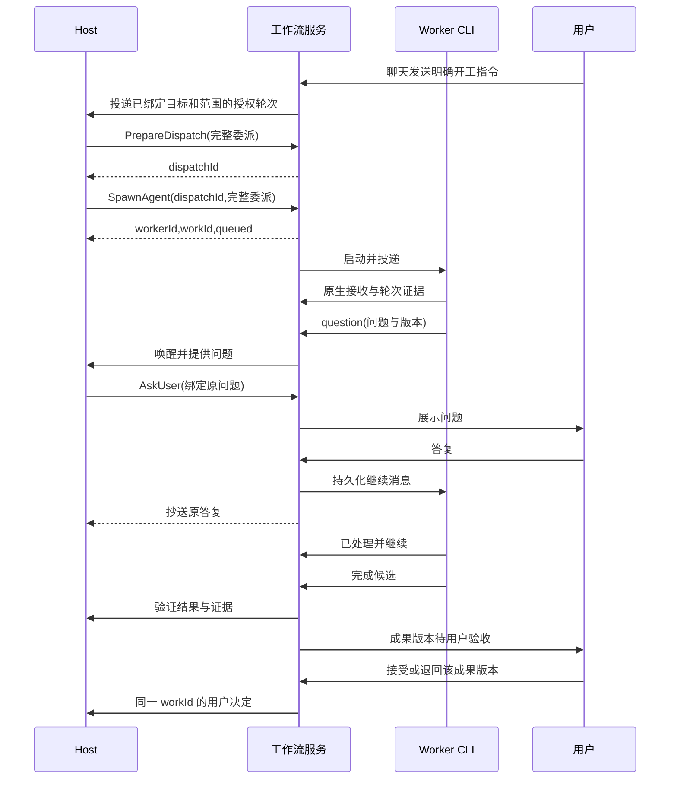

# 03 Host 编排与消息

## 模块与调用方向

HostController 驱动 Codex app-server 会话，ToolRouter 验证 Host 工具，MessageRouter 负责持久化路由，WorkflowService 执行状态迁移。模型提出分工，服务执行已授权决策。

现有入口包括 orchestrator.ts、host-group.ts、meeting-tools.ts、meeting-mcp.ts、task-mailbox.ts、ipc/tasks.ts。新工具应直接调用统一 WorkflowService，迁移到新模型的工作流禁用旧 scheduler 的重复派发。

Host session 与工作流稳定绑定，连接重建使用原生线程恢复。Host 只能使用只读项目能力、共享计划写入及编排工具。派发通过结构化工具调用，聊天指令按下节规则绑定开工授权。MCP 或 app-server 动态工具的选择由 07 的 P0-G 验证后确定。P0-G 同时验证崩溃后线程恢复、恢复后 callId 是否稳定以及轮次中断，结论写回本节。

## 聊天开工与派发授权

用户通过正常聊天发送明确的执行指令即可开工。`PostUserMessage` 由主进程根据 IPC sender 验证用户身份和工作流，持久化原始消息及可核对的会话引用。WorkflowService 判定为讨论、待澄清或开工。V1 使用可测试的明确请求句式及上下文规则，覆盖「开始执行」「按这版做」「直接修复」等自然表达。规则检查用户在正文中直接提出的行动请求。引用、转述、假设和要求先讨论的内容留在讨论，开工意图冲突时先澄清。Host 的解释和 Worker 的回报可以作为讨论材料，开工许可只能由服务从经过验证的用户消息生成。

| 用户原话 | 服务行为 |
|---|---|
| 「直接修登录超时，修完跑测试」 | 目标与仓库范围可唯一确定时，记录开工并让 Host 派发 |
| 「按刚才那版开始做」 | 绑定唯一可解析的方案版本。如果有两个候选，只询问指哪版 |
| 「这个方案可以」「要不要加测试」「先分析一下」 | 保存为讨论，Host 可读取资料和整理方案 |
| 「把回归测试加到正在做的 A」 | 解析到明确的 workId 和当前版本，在本次执行范围内修订 A |

开工许可绑定原始消息 ID、工作流、明确目标及范围。目标引用可以是唯一的方案版本、Work 的当前版本，或原始消息里的直接目标。可执行范围由消息要求、绑定版本和已登记的仓库策略共同限定，保存允许仓库、写入路径、动作类别和适用的额度。目标或范围存在歧义时，保存带原消息引用的待澄清记录。用户在聊天里给出明确指代后，服务核对待澄清记录与版本，并用原始开工消息和该答复生成同一份许可。用户取消开工或被引用版本失效后，待澄清记录失效。普通方案评价作为讨论保存。

开工后 Host 自主拆分、选人和安排执行顺序。每份委派引用许可的根目标，服务核对目标引用、仓库、路径、动作、额度及工作版本。目标另立或范围、权限、成本扩大时，需要用户明确新的执行要求。提交、推送和创建 PR 使用各自的 Grant。验收继续绑定成果版本。

ToolRouter 根据持久化输入批次附加派发授权，模型参数中的授权 ID 不参与鉴权。用户讨论与有开工许可的输入分别编入 Host 轮次。已有工作的受信事件可唤醒带该工作许可的轮次，继续同一授权目标。讨论轮次可以查询状态及整理方案，所有会启动、继续或改变 Worker 执行的编排命令均须校验当前轮次授权。缺少许可时返回 `DISPATCH_AUTH_REQUIRED`。这样一个 Host 可以讨论 B，同时服务继续管理已授权的 A。用户的停止操作直接走控制入口。

## 工具契约

所有修改工具使用 README 中的 CommandEnvelope，身份和 Host epoch 由连接附加。以下为 payload 的必需字段，结果均带 operationId、revision、cursor。

Host 工具调用的 requestId 不由模型提供，由 ToolRouter 按 hostThreadId、nativeTurnId 与原生 callId 确定性推导。幂等表的 actorId 取逻辑 Host ID，不含运行代次，因此 Host 重启换代后重放同一调用仍命中原结果；运行代次只用于拒绝旧实例的新派发。ToolRouter 在执行任何工具调用之前，先持久化调用记录（inputBatchId、原生 callId、工具名、参数哈希、推导出的 requestId），执行结果写回同一记录。

原生 callId 在恢复后不稳定时，不能直接改用批内序号：Host 恢复后重新生成的调用，顺序和数量都可能变化，相同操作会得到不同的 requestId 而重复派发，不同操作也可能撞上旧序号。只有原生协议能证明恢复时是按原样重放已记录的调用序列（例如恢复的条目来自持久化历史，调用 ID 和参数逐项一致），才可以按批内序号与已记录的调用对应。否则：

1. 该 inputBatch 标为待核对，不把新调用匹配到旧记录。
2. 服务把该批已记录的调用及其结果（派发意图、dispatchId、已生效的成员、消息与操作回执）作为恢复摘要放进 Host 的下一次输入。
3. Host 确认已读取恢复摘要之前，该工作流的修改类工具返回 RECOVERY_PENDING；只读工具（ListAgents、GetOperation、ReadAgentHistory 等）照常可用。
4. 确认之后的调用使用新的 requestId。续办已记录的派发时沿用原 dispatchId，Host 先查询回执和未完成步骤。

Host 用 `PrepareDispatch` 在授权轮次中保存派发意图。服务分配 `dispatchId`，固定授权、动作、准确参数及目标版本。`SpawnAgent`、`SendMessage(continue/revise/newGoal)`、`RequeueWork` 和 `HandOffAgent` 执行时均携带该 ID。服务按 `dispatchId` 在同一事务应用派发、关联 Work 和操作回执。相同 ID 重试返回原回执，参数冲突拒绝，未完成的副作用按原操作核对。准备回执丢失时从该授权下的派发记录恢复原 ID。`note` 按原消息规则保存。

| 工具 | 输入 | 返回 |
|---|---|---|
| ListAgents | includeArchived、cursor、limit、statusFilter | 成员、当前 workId、pending 修订、排队摘要、状态及证据索引 |
| GetWork | workId、cursor、limit | 工作状态、负责人、委派历史、成果版本和用户决定 |
| GetOperation | operationId | 已获授权操作的当前步骤、结果、等待或待核对原因 |
| PrepareDispatch | action、准确编排参数及适用的预期工作版本 | dispatchId、已持久化的待派发意图 |
| SpawnAgent | name、role、backend、repositoryId、delegationSpec | workerId、workId、排队或启动操作 |
| SendMessage | workerId、mode、text、artifactRefs；continue/revise 另带 workId、expectedVersion，revise/newGoal 另带完整 spec，newGoal 指明仓库 | workId、消息或排队回执、是否触发执行，修订另返回 pendingVersion |
| RequeueWork | workId、expectedWorkRevision、workerId，退回后返工另带完整 spec | 原 workId、排队回执 |
| CancelWork | workId、expectedWorkRevision、reason | 取消结果或待核对的停止与交付操作 |
| SetWaitCondition | workerId、expectedVersion、all/any、明确成果引用 | waitId、满足状态、循环检测结果。all/any 只组合依赖成果类条件；未答问题、缺少授权与冻结属于阻断条件，始终全部解除后才继续 |
| WaitAgents | workerIds、afterCursor、eventKinds、timeoutMs | 有界事件页、nextCursor、超时标志 |
| InterruptAgent | workerId、expectedRevision、scope turn/process、reason | 停止操作及证据状态，执行和轮次由服务准确解析 |
| HandOffAgent | workId、sourceWorker、sourceVersion、targetWorker、新范围、完整接手 spec | 同一 workId、handoffId、冻结及接收进度 |
| RenameAgent | workerId、expectedRevision、name、role | 新 revision |
| ArchiveAgent | workerId、expectedRevision | 已归档或未结束工作清单 |
| ReadAgentHistory | targetWorker、cursor、limit | 经 Grant 过滤后的消息与日志引用 |
| GrantAccess | targetWorker、granteeWorker、range、action grant/revoke、basis | grantId、有效范围 |
| ReadArtifact | artifactId、version | 哈希、正文/流式下载引用 |
| WriteArtifact | logicalPath、expectedVersion、contentRef | artifactId、新版本或冲突 |
| AskUser | question、options、sourceQuestionId、workerId/version、requestedAction | questionId、等待目标 |
| RecordVerdict | workerId/version、candidateId 或 artifactId/version、criterionId、pass/fail、evidenceRefs、reason | Host 判定 Verification，服务重新计算技术验证状态 |
| RequestDelivery | workId、workerId/version、candidateId、repositoryId、targetRef、action。要求 GitHub PR 时附 base ref 与 PR 标题、正文，选用既有 PR 时附编号。替换受阻交付时另带 replacesDeliveryId 和 expectedWorkRevision | 申请、服务核对的目标引用状态、需要的用户授权绑定 |

delegationSpec 含完整目标、允许路径、验收、交付、资料和决定引用。Host 传入路径必须映射到工作流已登记的仓库及授权目录，不能自授范围。GrantAccess 只在用户已允许的成员互读策略内操作。

SendMessage.mode 为 note / continue / revise / newGoal。note 进入历史，有 workId 时归入对应工作；continue 推进当前目标；revise 在同一个 workId 下产生 pending 版本；newGoal 创建独立 workId 并入队。Worker 正忙时返回排队回执，由 02 的领取事务在安全轮次边界分配新委派。修订激活见 01。

对 pending 修订返回 pendingVersion 给 UI 和 Host，具体执行 ID 由系统维护。RequeueWork 可改派尚未领取的 `queued` 工作，沿用原 spec。也可重新安排 `changes_requested` 的工作，由 Host 决定沿用原负责人或改派，返工引用原成果、仓库和最近的用户退回决定。两种操作都保留同一 workId。

CancelWork 按 02 的状态迁移取消明确的工作。已排队的工作在事务中移除领取资格。正在执行的工作先核对停止和交付操作，再记录取消。

RecordVerdict 只写入委派预先声明的 Host 判定条件。机器检查结果由 Verifier 写入，Host 不能通过该工具覆盖失败的机器检查。需要改变验收要求时必须修订委派并重新核对范围与授权。服务通过用户 IPC 记录成果接受或退回，Host 只接收结果事件与准确版本。提交、推送和创建 PR 各自使用对应动作的 Grant，详见 05。

首次 PR 交付受阻时，Host 接收当前 workId、deliveryId、已有回执与阻断原因。换分支使用同一工作的替换申请，由用户在推送授权中确认新目标。服务以当前 Delivery 及 Work revision 约束申请和回执，详见 05。

## Host 收件箱与事件合并

Host 持久收件箱消费工作流事件，并持有单运行轮次锁。立即事件为提问、失败、候选、成果退回、越界请求、授权变化、unknown、修订失败、交付受阻及交付目标变化。接受与退回事件带 workId、resultVersion 和决定引用。普通进度按 Worker 与当前版本聚合，原事件仍可审计。

启动轮次前保存 inputBatchId 和精确事件范围。原生 thread/turn 与批次绑定。工具调用使用原生 callId 和业务 requestId 双重去重。模型轮次结束后持久化回复和已处理范围。响应丢失时恢复同一轮次结果，不能直接重派一批工作。

WaitAgents 在一个读写事务中先登记 afterCursor 与匹配条件，再查询已有匹配事件。已有事件立即返回；没有事件时保存可唤醒的 wait 注册。后续事件入库时同时标记相关 wait 就绪，模型轮次结束时再次检查待处理范围，避免事件恰好发生在查询与休眠之间而丢失唤醒。

匹配游标是成功纳入当前 inputBatch 的事件范围，不能用全局最新序号跳过未处理事件。相同原生调用身份和业务 requestId 的重放不会重复产生副作用。同一派发即使使用新的 requestId，也按原 dispatchId 续办。服务按意图身份区分新派发和重试，恢复上下文提供既有意图和回执供 Host 查询。

WaitAgents 的等待不占用 Worker 执行槽。服务以持久化 wait 状态决定是否结束或再次唤醒 Host，内存通知只用于降低延迟。

## Worker 内容的信任边界

Worker 会读取仓库、依赖、issue 和网页等任意内容。它的报告、问题、Artifact 正文和终端输出都可能夹带这些来源中的指令性文字，因此对 Host 而言一律是数据，不是指令。

- **输入呈现**：Host 输入批次中，Worker 来源的自由文本放在带来源标记的引用块里，标记包括 workerId、委派版本、报文类型和 messageId。Host 的系统提示说明引用块中的指令性文字没有效力。服务生成的结构化字段（状态、版本、验证结果、证据引用）与 Worker 自由文本分开呈现。
- **权限不依赖 Host 的判断**。Host 传入的路径只能映射到已登记的仓库和授权目录。扩大开工范围按本章开工规则取得新许可。交付、推送和成员互读策略之外的读取需要用户结构化确认。提交、推送类 Grant 由服务从用户决定创建，用户设置由用户入口修改。GrantAccess 限于用户已允许的互读策略。RecordVerdict 只能写入预声明的 Host 判定条件，机器检查结果由 Verifier 写入。
- **问题来源可见**：Worker 的问题经 Host 转成 AskUser 时，问题记录保留 sourceQuestionId。界面同时展示问题最初来自哪个 Worker、Worker 的原文和 Host 改写后的措辞，见 06。
- **成员之间同样适用**：Worker B 读取 Worker A 发布的 Artifact 时，内容同样是数据。Worker 的委派只能来自 Host 下发的 delegationSpec，Artifact 中的文字不能改变接收方的范围或验收条件。
- **不依赖检测**：服务可以标记明显的注入模式供审计，但这只是辅助，不作为安全边界。

## 用户问题与确定性答复

Worker question 先落库，Host 决定自行回答或 AskUser。问题绑定当前版本和具体决定范围。用户在应用中回答时，主进程验证问题仍有效、用户窗口身份和授权字段，再事务保存 Decision、给 Worker 的消息、给 Host 的抄送事件。

普通文本答复不会自动成为 push/commit Grant。交付授权需要用户明确对应动作和准确候选，UI 提交结构化 action。过期版本问题显示失效原因，可由 Host 重新发起，禁止自动扩大到新目标。

用户答复已送达但 CLI 尚未处理时继续显示待处理。继续消息需要原生接收/处理证据且全部阻断条件解除后才更新 active。一次性消息不会自动执行其中任意 shell 片段。答复、continue 与修订的投递路径（轮次中通知、空闲注入或 resume-with-instruction）见 01“指令投递路径与降级”。

## 等待与交接

等待条件引用 sourceWorker、delegationVersion、artifact/candidate ID 或 questionId。禁止“等它空闲”作为代码可用证据。服务依据已保存的精确成果满足条件，循环检测在新增等待边时执行。

整体交接为持久操作。先冻结 source，再生成 Candidate 或 Artifact，准备接手目录及 spec。保存新委派的事务同时核对接手 Worker 有可用委派槽且没有在先排队项，记录原 workId 下的新委派、旧 handed_off 及当前负责人。若接收前失败，保留冻结及操作进度，Host 可重试或明确取消。同一工作目录的写入权只授予一方。

V1 直接支持整体交接。部分交接由 Host 组合已有操作完成，先暂停源成员并冻结成果，缩小源成员的委派范围，再为目标成员建立独立 worktree 和一个独立的完整工作，记录源成果引用。每步保存进度；源修订确认前目标不能取得相同范围的写入权，接手失败时保留源成员暂停及恢复入口。这样复用修订和整体交接能力，避免新增跨两个原生会话同时激活的事务协议。分割范围不明确时返回 SCOPE_OVERLAP。

## 关键时序

## 验收

HM-01 重复工具调用只创建一个成员；HM-02 note 不意外触发模型；HM-03 多成员回报顺序及去重；HM-04 用户答复直达且 Host 可追溯；HM-05 用户答复不自动扩大授权；HM-06 原生恢复后不重放已有副作用；HM-07 等待环拒绝；HM-08 部分交接不会双写；HM-09 Host 无资源时用户仍可停止；HM-10 Host 可复用已空闲负责人；HM-11 Host 运行代次变化后重放同一工具调用不重复产生副作用；HM-14 恢复后调用 ID 不稳定且调用顺序改变时，批次进入待核对，修改类工具在 Host 确认恢复摘要前返回 RECOVERY_PENDING，不重复派发；HM-12 any 等待满足后，未答问题仍阻止继续；HM-13 仓库中埋有注入文本、Worker 照搬进报告和问题后，Host 未取得任何新权限，需要授权的动作仍等待用户，AskUser 显示原始来源。

HM-15 同一 Worker 忙时收到第二个独立目标，保留不同 workId 和排队回执；HM-16 整体交接和用户退回后的改派保留同一工作与旧证据；HM-17 Host 自行判定、Worker 自报完成或把聊天文本当用户决定时，工作保持待验收。

HM-18 明确聊天指令绑定目标后可直接派工，讨论轮次和 Worker 引用的开工文字不能发起执行。HM-19 有两个方案时先澄清，选定版本后沿用原开工意图。HM-20 相同 dispatchId 使用新 requestId 重试，仍关联原 Work 与回执。

