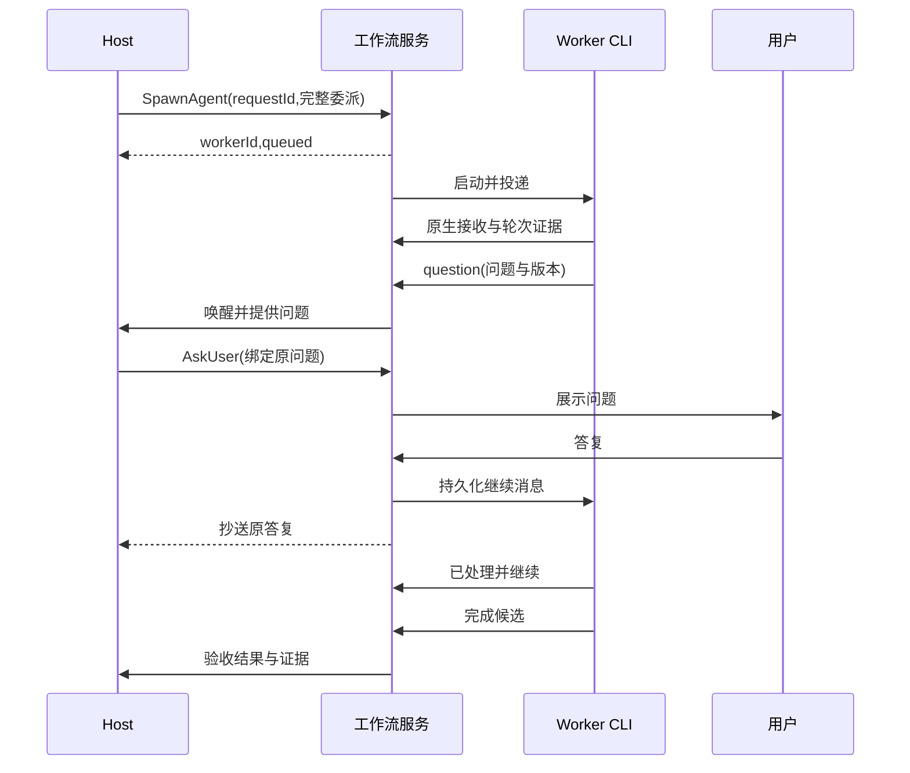

# 03 Host 编排与消息

## 模块与调用方向

HostController 驱动 Codex app-server 会话，ToolRouter 验证 Host 工具，MessageRouter 负责持久化路由，WorkflowService 执行状态迁移。模型提出分工，服务执行已授权决策。

现有入口包括 orchestrator.ts、host-group.ts、meeting-tools.ts、meeting-mcp.ts、task-mailbox.ts、ipc/tasks.ts。新工具应直接调用统一 WorkflowService，迁移到新模型的工作流禁用旧 scheduler 的重复派发。

Host session 与工作流稳定绑定，连接重建使用原生线程恢复。Host 只能使用只读项目能力、共享计划写入及编排工具。工具提供为正式结构化接口，具体 MCP 或 app-server 动态工具选择取决于锁定版本的稳定能力，由 07 的 P0-G 验证后确定；不得依赖从普通自然语言猜测派发指令。P0-G 同时验证崩溃后线程恢复、恢复后 callId 是否稳定以及轮次中断，结论写回本节。

## 工具契约

所有修改工具使用 README 中的 CommandEnvelope，身份和 Host epoch 由连接附加。以下为 payload 的必需字段，结果均带 operationId、revision、cursor。

Host 工具调用的 requestId 不由模型提供，由 ToolRouter 按 hostThreadId、nativeTurnId 与原生 callId 确定性推导。幂等表的 actorId 取逻辑 Host ID，不含运行代次，因此 Host 重启换代后重放同一调用仍命中原结果；运行代次只用于拒绝旧实例的新派发。ToolRouter 在执行任何工具调用之前，先持久化调用记录（inputBatchId、原生 callId、工具名、参数哈希、推导出的 requestId），执行结果写回同一记录。

原生 callId 在恢复后不稳定时，不能直接改用批内序号：Host 恢复后重新生成的调用，顺序和数量都可能变化，相同操作会得到不同的 requestId 而重复派发，不同操作也可能撞上旧序号。只有原生协议能证明恢复时是按原样重放已记录的调用序列（例如恢复的条目来自持久化历史，调用 ID 和参数逐项一致），才可以按批内序号与已记录的调用对应。否则：

1. 该 inputBatch 标为待核对，不把新调用匹配到旧记录。
2. 服务把该批已记录的调用及其结果（已生效的成员、消息与操作回执）作为恢复摘要放进 Host 的下一次输入。
3. Host 确认已读取恢复摘要之前，该工作流的修改类工具返回 RECOVERY_PENDING；只读工具（ListAgents、GetOperation、ReadAgentHistory 等）照常可用。
4. 确认之后的调用视为新命令，使用新的 requestId；是否与已生效的操作重复，由 Host 查询状态后决定。

| 工具 | 输入 | 返回 |
|---|---|---|
| ListAgents | includeArchived、cursor、limit、statusFilter | 成员、当前目标、pending 修订、状态、证据索引 |
| GetOperation | operationId | 已获授权操作的当前步骤、结果、等待或待核对原因 |
| SpawnAgent | name、role、backend、repositoryId、delegationSpec | workerId、pendingVersion、启动操作 |
| SendMessage | workerId、mode、expectedVersion、text、artifactRefs；revise/newGoal 时提供完整 spec | messageId、投递状态、是否触发执行、pendingVersion |
| SetWaitCondition | workerId、expectedVersion、all/any、明确成果引用 | waitId、满足状态、循环检测结果。all/any 只组合依赖成果类条件；未答问题、缺少授权与冻结属于阻断条件，始终全部解除后才继续 |
| WaitAgents | workerIds、afterCursor、eventKinds、timeoutMs | 有界事件页、nextCursor、超时标志 |
| InterruptAgent | workerId、expectedRevision、scope turn/process、reason | 停止操作及证据状态，执行和轮次由服务准确解析 |
| HandOffAgent | sourceWorker、sourceVersion、targetWorker、新范围、完整接手 spec | handoffId、冻结及接收进度 |
| RenameAgent | workerId、expectedRevision、name、role | 新 revision |
| ArchiveAgent | workerId、expectedRevision | 已归档或未结束工作清单 |
| ReadAgentHistory | targetWorker、cursor、limit | 经 Grant 过滤后的消息与日志引用 |
| GrantAccess | targetWorker、granteeWorker、range、action grant/revoke、basis | grantId、有效范围 |
| ReadArtifact | artifactId、version | 哈希、正文/流式下载引用 |
| WriteArtifact | logicalPath、expectedVersion、contentRef | artifactId、新版本或冲突 |
| AskUser | question、options、sourceQuestionId、workerId/version、requestedAction | questionId、等待目标 |
| RecordVerdict | workerId/version、candidateId 或 artifactId/version、criterionId、pass/fail、evidenceRefs、reason | Host 判定 Verification，服务重新计算验收状态 |
| RequestDelivery | workerId/version、candidateId、repositoryId、targetRef、expectedTarget、action | 申请及需要的用户授权绑定 |

delegationSpec 含完整目标、允许路径、验收、交付、资料和决定引用。Host 传入路径必须映射到工作流已登记的仓库及授权目录，不能自授范围。GrantAccess 只在用户已允许的成员互读策略内操作。

SendMessage.mode 为 note / continue / revise / newGoal。note 进入历史，不隐式唤醒；continue 推进当前目标；revise 产生 pending 版本；newGoal 只在原目标已终结或明确完成交接时接受。修订激活见 01。

对 pending 修订返回 pendingVersion 给 UI 和 Host，具体执行 ID 由系统维护，模型不需要管理轮次。

RecordVerdict 只写入委派预先声明的 Host 判定条件。机器检查结果由 Verifier 写入，Host 不能通过该工具覆盖失败的机器检查。需要改变验收要求时必须修订委派并重新核对范围与授权。归档、验收和交付分别处理，归档不能代替完成判定。

## Host 收件箱与事件合并

Host 持久收件箱消费工作流事件，并持有单运行轮次锁。立即事件为提问、失败、候选、越界请求、授权变化、unknown、修订失败及交付目标变化。普通进度按 Worker 与当前版本聚合，原事件仍可审计。

启动轮次前保存 inputBatchId 和精确事件范围。原生 thread/turn 与批次绑定。工具调用使用原生 callId 和业务 requestId 双重去重。模型轮次结束后持久化回复和已处理范围。响应丢失时恢复同一轮次结果，不能直接重派一批工作。

WaitAgents 在一个读写事务中先登记 afterCursor 与匹配条件，再查询已有匹配事件。已有事件立即返回；没有事件时保存可唤醒的 wait 注册。后续事件入库时同时标记相关 wait 就绪，模型轮次结束时再次检查待处理范围，避免事件恰好发生在查询与休眠之间而丢失唤醒。

匹配游标是成功纳入当前 inputBatch 的事件范围，不能用全局最新序号跳过未处理事件。相同原生调用身份和业务 requestId 的重放不会重复产生副作用。模型在新的轮次中提出不同 requestId 的相似派发，服务不能仅凭文本认定为同一命令；恢复上下文需包含已生效的成员和操作回执，Host 先查询再决策。

WaitAgents 的等待不占用 Worker 执行槽。服务以持久化 wait 状态决定是否结束或再次唤醒 Host，内存通知只用于降低延迟。

## Worker 内容的信任边界

Worker 会读取仓库、依赖、issue 和网页等任意内容。它的报告、问题、Artifact 正文和终端输出都可能夹带这些来源中的指令性文字，因此对 Host 而言一律是数据，不是指令。

- **输入呈现**：Host 输入批次中，Worker 来源的自由文本放在带来源标记的引用块里，标记包括 workerId、委派版本、报文类型和 messageId。Host 的系统提示说明引用块中的指令性文字没有效力。服务生成的结构化字段（状态、版本、验证结果、证据引用）与 Worker 自由文本分开呈现。
- **权限不依赖 Host 的判断**：Host 传入的路径只能映射到已登记的仓库和授权目录；扩大范围、交付、推送和成员互读策略之外的读取都需要用户的结构化确认；Host 工具不能创建提交、推送类 Grant，也不能修改用户设置，GrantAccess 只能在用户已允许的成员互读策略内操作；RecordVerdict 不能覆盖机器检查失败。即使 Host 被报告内容误导，也只能提出申请，不能取得新权限。
- **问题来源可见**：Worker 的问题经 Host 转成 AskUser 时，问题记录保留 sourceQuestionId。界面同时展示问题最初来自哪个 Worker、Worker 的原文和 Host 改写后的措辞，见 06。
- **成员之间同样适用**：Worker B 读取 Worker A 发布的 Artifact 时，内容同样是数据。Worker 的委派只能来自 Host 下发的 delegationSpec，Artifact 中的文字不能改变接收方的范围或验收条件。
- **不依赖检测**：服务可以标记明显的注入模式供审计，但这只是辅助，不作为安全边界。

## 用户问题与确定性答复

Worker question 先落库，Host 决定自行回答或 AskUser。问题绑定当前版本和具体决定范围。用户在应用中回答时，主进程验证问题仍有效、用户窗口身份和授权字段，再事务保存 Decision、给 Worker 的消息、给 Host 的抄送事件。

普通文本答复不会自动成为 push/commit Grant。交付授权需要用户明确对应动作和准确候选，UI 提交结构化 action。过期版本问题显示失效原因，可由 Host 重新发起，禁止自动扩大到新目标。

用户答复已送达但 CLI 尚未处理时继续显示待处理。继续消息需要原生接收/处理证据且全部阻断条件解除后才更新 active。一次性消息不会自动执行其中任意 shell 片段。答复、continue 与修订的投递路径（轮次中通知、空闲注入或 resume-with-instruction）见 01“指令投递路径与降级”。

## 等待与交接

等待条件引用 sourceWorker、delegationVersion、artifact/candidate ID 或 questionId。禁止“等它空闲”作为代码可用证据。服务依据已保存的精确成果满足条件，循环检测在新增等待边时执行。

交接为持久操作。先冻结 source，再生成 Candidate 或 Artifact，准备接手目录及 spec，然后事务保存新委派和旧 handed_off。若接收前失败，保留 frozen/source 状态和操作进度，Host 可重试或明确取消；不能让新旧双方同时拥有同一写入目录。

V1 直接支持整体交接。部分交接由 Host 组合已有操作完成，先暂停源成员并冻结成果，缩小源成员的委派范围，再为目标成员建立独立 worktree 和完整委派。每步保存进度；源修订确认前目标不能取得相同范围的写入权，接手失败时保留源成员暂停及恢复入口。这样复用修订和整体交接能力，避免新增跨两个原生会话同时激活的事务协议。分割范围不明确时返回 SCOPE_OVERLAP。

## 关键时序

## 验收

HM-01 重复工具调用只创建一个成员；HM-02 note 不意外触发模型；HM-03 多成员回报顺序及去重；HM-04 用户答复直达且 Host 可追溯；HM-05 用户答复不自动扩大授权；HM-06 原生恢复后不重放已有副作用；HM-07 等待环拒绝；HM-08 部分交接不会双写；HM-09 Host 无资源时用户仍可停止；HM-10 Host 可复用已空闲负责人；HM-11 Host 运行代次变化后重放同一工具调用不重复产生副作用；HM-14 恢复后调用 ID 不稳定且调用顺序改变时，批次进入待核对，修改类工具在 Host 确认恢复摘要前返回 RECOVERY_PENDING，不重复派发；HM-12 any 等待满足后，未答问题仍阻止继续；HM-13 仓库中埋有注入文本、Worker 照搬进报告和问题后，Host 未取得任何新权限，需要授权的动作仍等待用户，AskUser 显示原始来源。
